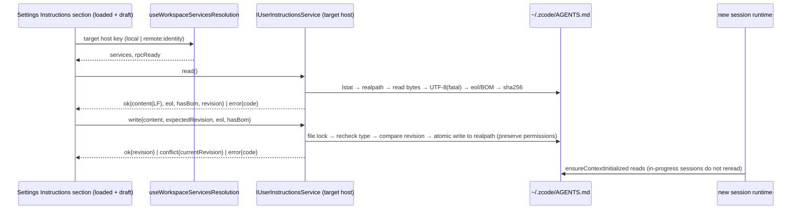

# Global Instructions (Editing Global Instructions)

## Background (Current Source Behavior)

- Global instructions are the user's default instruction file, `~/.zcode/AGENTS.md` (home resolution order: `HOME` → `USERPROFILE` → `os.homedir()`).
  The CLI locates it in `findDefaultUserInstructionFile` at `apps/zcode-cli/packages/adapters/src/context/index.ts`.
- The CLI combines it with the nearest workspace `AGENTS.md` (searching upward to the Git root). It deduplicates by the **literal path** after `path.resolve` (without resolving symbolic links).
  It reads at most 100 KiB per file (truncating by bytes, potentially in the middle of a multibyte character, and appending `[File truncated: ...]`). Files that are empty after `trim()` are not injected.
  The CLI uses `stat` (follows links) for paths, so dangling links and directories are treated as "not found" on the CLI side.
- The CLI reads instructions once in `ensureContextInitialized` in the session runtime (`core/src/runtime/methods/context.ts`).
  Besides the first message, `getSkillCatalog` also triggers this method. The input box requests the skill catalog to warm up draft sessions, so an **already-open draft session** has its instructions fixed before the first message is sent.
  A cold resume (`resume.ts`) resets `contextInitialized`, so the resumed session reads the instructions again.
- The only existing write path is migration on the onboarding page from `~/.claude/CLAUDE.md` to `~/.zcode/AGENTS.md` (`ISettingsSyncService.copyClaudeAgentsFileToZcodeAgentsFile`). There was previously no read/edit interface.

## Product Rules

- Add an **Instructions** section to Settings, inside the **Agent Capabilities** group and before **Memory**. Edit only the global `~/.zcode/AGENTS.md`; do not display or edit project `AGENTS.md` files.
  The section description should say that these instructions are combined with project `AGENTS.md` files and apply to new and restarted sessions.
- **Desktop only**. On Web (including mobile remote control), show a desktop-only placeholder in the same style as **Memory**; do not load the file.
- **Target host = the host of the currently active workspace**: a local workspace or no workspace → local machine; a remote workspace (SSH / WSL / Docker) → remote host
  (the remote CLI reads that host's `~/.zcode/AGENTS.md`). Clearly label the host above the editor as "This computer" or with the remote name, and show the file's absolute path.
  For Docker targets, also show "The file is inside the container and may be lost when the container is rebuilt."
- **Editor**: monospaced Textarea with **Edit / Markdown Preview** tabs (reuse `MarkdownPreviewContent` for preview; do not pass `workspacePath` / `selectionTarget`,
  to avoid resolving relative links in remote documents on the local machine). Support Cmd/Ctrl+S to save. When there are unsaved changes, show an unsaved-changes indicator and a **Discard changes** button (restore disk contents).
  **Show in File Manager** is available only for an existing file on the local machine.
- **Save button**: enabled when `dirty || state === "missing"` (allow saving an untouched missing file to create an empty one); disabled in all other states, including errors.
- **Missing file**: show an empty editor and a "File has not been created" message. Saving creates the `~/.zcode` directory and file.
- **Save empty content**: write an empty file; this feature never deletes files.
- **Import from CLAUDE.md**: show the button when `~/.claude/CLAUDE.md` exists on the target host. The button is available whether or not the global file exists.
  Apply the same checks to the import source as to the global file (symbolic links, 5 MiB limit, UTF-8). Import fills the draft only; the user must save to write it to disk. If the current draft is non-empty and differs from disk, confirm before replacing it.
  ZCode does not expand Claude's `@path` import syntax. If the content contains an import line beginning with `@`, show "@ imports are not expanded" after import.
- **Size**: show the current draft's UTF-8 byte count. Above 100 KiB, show "The Agent reads only the first 100 KiB" but continue to allow saving.
  Do not load files over 5 MiB into the editor; show a read-only oversized state (on the local machine, the user can open it in the file manager).
- **When changes take effect**: The success toast and persistent message below the editor should both say
  "Applies to new and restarted sessions; in-progress sessions and already-open drafts keep their original instructions." This feature does not rebuild warmed-up draft sessions.
- **Protect unsaved drafts**: If a draft is dirty, the following actions show a **Discard changes?** confirmation. Cancelling keeps the current section and draft:
  - Switching to another Settings section (including programmatic navigation through menus).
  - Clicking **Return to Workspace**.
  - Cmd/Ctrl+W: while Settings is visible, the workspace layer does not consume `CLOSE_ACTIVE_CONTEXT_REQUEST_EVENT`, so Root falls back to closing the window.
    If the draft is dirty, Settings intercepts the event, confirms discard, and then runs `DesktopCommandIds.CloseWindow`.
  - An active-workspace switch changes the **target host key**: if the user cancels, keep the editor bound to the original host (show an "Editor still points to X" message)
    until the draft is saved or discarded. Do not show the dialog again for the same new host key.
    Do **not** intercept the window close button or app exit (losing the draft is acceptable).
- The conflict dialog is an `AlertDialog` within this section (three choices, with no Enter-key default action). Do not reuse the global confirmation dialog, to avoid accidental overwrite when Enter is pressed.
- **Target host key**: `local` or `remote:<workspaceIdentity?.trim() || workspacePath>`. Reconnecting to the same remote host (a change in `remoteSessionId` or service-instance recreation)
  does not count as a host switch: do not show a confirmation or discard the draft. If the remote host is `remote-waiting` (RPC not ready), show a waiting state and do not start a read.

### File State Handling

| Disk state                             | Read result               | Edit/save                                                                    |
| -------------------------------------- | ------------------------- | ---------------------------------------------------------------------------- |
| Missing (including missing `~/.zcode`) | `missing`, empty content  | Editable; create directory and file on save                                  |
| Regular file (including empty file)    | `file`, content           | Editable and saveable                                                        |
| Symbolic link to a regular file        | `file`, with `linkTarget` | UI shows "Link → target path"; atomically write target, leave link unchanged |
| Dangling symbolic link                 | Error `BROKEN_LINK`       | Saving disabled (CLI treats it as missing)                                   |
| Directory or other non-regular file    | Error `NOT_REGULAR_FILE`  | Saving disabled                                                              |
| Invalid UTF-8                          | Error `NOT_UTF8`          | Read-only error state; saving disabled to avoid corrupting content           |
| Over 5 MiB                             | Error `TOO_LARGE_TO_EDIT` | Read-only oversized state                                                    |
| Permission denied / other read failure | Error `READ_FAILED`       | Error state with retry                                                       |

### Line Endings, BOM, and Permissions

- The browser's `<textarea>` normalizes CRLF to LF, so line endings cannot be preserved with "zero processing." Use these rules:
  - Detect the line-ending style on read: if all are CRLF, use `eol: "crlf"`; otherwise (all LF, no line breaks, or mixed) use the more frequent style, with LF as the tie-breaker.
  - If line endings are mixed or there is an isolated CR, set `mixedLineEndings: true` and show "Line endings will be normalized to LF/CRLF when saved" in the UI.
  - Return `content` to the UI with LF line endings and without a BOM. On save, the service restores line endings using the detected `eol` and writes a UTF-8 BOM when `hasBom` is true.
  - Determine dirty state from normalized text (LF, no BOM).
- Calculate `revision` from the original bytes on disk, including the BOM and original line endings.
- Preserve the permission bits of an existing file (the target file if it is a link). New files use default permissions, subject to umask.
  Atomic writes use a temporary file in the same directory followed by rename, which breaks hard links. This is acceptable and documented here.

### Concurrency and Conflicts

- Reads return a `revision` (SHA-256 of file bytes, or `null` when missing). Saves include `expectedRevision`.
- Under a file lock (the lock path is `~/.zcode/AGENTS.md` itself, not the link target), the server rechecks the path type and calculates the disk revision:
  - If the path became a dangling link or non-regular file, return the corresponding error and do not write (this is not a conflict).
  - If the revision differs from `expectedRevision` (including when the file was created, modified, or deleted in the meantime), return `REVISION_CONFLICT` and do not write.
- The file lock applies only to ZCode's own writes; external editors do not honor it. A tiny race window remains between the revision check and rename (best effort).
- On conflict, the UI offers **Reload from disk** (discard the draft) or **Overwrite** (retry the write using the current disk revision). Closing the dialog leaves the draft unchanged.
- On write failure, show a toast and retain the draft.

### Symbolic Links and Deduplication

- If `~/.zcode/AGENTS.md` links to a repository's `AGENTS.md` and that repository is open, the CLI injects the same content twice (deduplication uses literal paths).
  For linked files, the UI shows "If the link target is a project AGENTS.md, its contents will be injected twice when that project is open."

## State Owners and Event Order



- The only source of truth is the file on the target host's disk. The UI holds only `loaded` (the last read or saved content, revision, eol, and hasBom) and `draft`.
  Do not add caching, settings, or broadcast synchronization.
- Register the service in each host process (`packages/services/src/node.ts`), shared by the Desktop local Host and remote server.
  Desktop exposes remote workspaces to the renderer through `createServerRemoteWorkspaceServiceCollection`
  (`packages/desktop/src/host/remoteWorkspaceServiceCollection.ts`), the production path for every remote target (server, and SSH / WSL / Docker reaching a Source).
  That collection **must register** `IUserInstructionsService` as the remote connection's proxy (`packages/client/src/remoteServiceAccess.ts`);
  without the registration the Host has no `userInstructions` channel and even an up-to-date remote host shows "Remote host version not supported".
  It must not fall back to the local instance, which would silently edit a local file.
- The channel is fork-only, like `ISystemPromptService`: it is deliberately not part of the upstream remote-workspace RPC contract
  (`remoteWorkspaceRpcContract.ts`, `REMOTE_WORKSPACE_RPC_REGISTRATIONS`), so upstream or older remote servers still connect and fall into the
  "Remote host version not supported" state below.
- The UI selects the target host through `useWorkspaceServicesResolution(workspacePath, remoteSessionId, workspaceIdentity)`. Without a workspace, use the local service.
- Invariant: the server must resolve the file path exactly like the CLI adapter (`HOME` → `USERPROFILE` → `os.homedir()` + `.zcode/AGENTS.md`).
  Do not read `ZCODE_DESKTOP_HOME_DIR`. Share the same path helper in `@zcode/shared/node` with `settingsSyncService`.
  Services must not import CLI source; tests enforce consistency.

## Interface

Add `IUserInstructionsService` (new `ServiceChannels.UserInstructions`; following the memory service pattern, with the interface and types in `packages/services/src/user-instructions/userInstructions.ts` and the path helper in `@zcode/shared/node`):

```ts
type UserInstructionsEol = "lf" | "crlf";

type UserInstructionsReadResult =
  | {
      kind: "ok";
      path: string;
      linkTarget?: string;
      state: "missing" | "file";
      content: string; // LF, no BOM
      revision: string | null;
      sizeBytes: number;
      eol: UserInstructionsEol;
      hasBom: boolean;
      mixedLineEndings: boolean;
      agentReadLimitBytes: number; // 102400
      editLimitBytes: number; // 5 MiB
    }
  | {
      kind: "error";
      path: string;
      linkTarget?: string;
      code: "BROKEN_LINK" | "NOT_REGULAR_FILE" | "NOT_UTF8" | "TOO_LARGE_TO_EDIT" | "READ_FAILED";
      sizeBytes?: number;
      message?: string;
    };

type UserInstructionsWriteResult =
  | { kind: "ok"; revision: string; sizeBytes: number }
  | { kind: "conflict"; currentRevision: string | null }
  | { kind: "error"; code: "BROKEN_LINK" | "NOT_REGULAR_FILE" | "WRITE_FAILED"; message?: string };

type UserInstructionsImportSource =
  | { kind: "missing"; path: string }
  | { kind: "ok"; path: string; content: string }
  | {
      kind: "error";
      path: string;
      code: "BROKEN_LINK" | "NOT_REGULAR_FILE" | "NOT_UTF8" | "TOO_LARGE_TO_EDIT" | "READ_FAILED";
      message?: string;
    };

interface IUserInstructionsService {
  read(): Promise<UserInstructionsReadResult>;
  write(params: {
    content: string;
    expectedRevision: string | null;
    eol: UserInstructionsEol;
    hasBom: boolean;
  }): Promise<UserInstructionsWriteResult>;
  readClaudeImportSource(): Promise<UserInstructionsImportSource>;
}
```

- Keep the existing onboarding migration interface unchanged.
- UI layers: `packages/ui/src/settings/userInstructionsEditorModel.ts` (pure functions: host key, host binding, save eligibility, byte estimate) →
  `packages/ui/src/hooks/useUserInstructionsEditor.ts` (sole owner of loaded/draft/conflict state; selects the target-host service and issues RPCs) →
  `packages/ui/src/settings/UserInstructionsSettingsSection.tsx` (presentation). `SettingsPage` learns only whether a dirty draft exists through `onDirtyChange`,
  for navigation interception; it does not hold draft contents.
- Estimate bytes in the format that will be saved to disk (add 1 byte per CRLF line and 3 bytes for a BOM), matching the 100 KiB limit used by the Agent.

## Version Skew

- New UI + old remote host (service not registered): after timing out, RPC fails with an error whose `name === "Unknown channel"`
  (`packages/rpc/src/channelServer.ts`) → show a "Remote host version not supported" error state in this section without affecting other settings. Show `READ_FAILED` and retry for other exceptions.
- Old UI + new host: no behavior change.

## Acceptance Scenarios

1. Without local `~/.zcode`, open **Instructions** → an empty editor and "File has not been created"; Save is enabled. Enter content and save → create the directory and file and show the effective-time toast; a new session includes the content.
2. For an existing file, load its content. After editing, show an unsaved marker. Cmd/Ctrl+S saves; Save is disabled when there are no changes.
3. Clear the content and save → the file remains present but empty; new sessions do not inject user instructions.
4. If the file is changed externally and then saved in the editor, show a conflict dialog. **Reload** displays disk contents; **Overwrite** writes the draft. External deletion or creation during editing also triggers a conflict.
5. For a symbolic link, show "Link → target." After saving, the path remains a link and the target file's content and permissions are updated/preserved. A dangling link shows an error and disables Save.
6. For a draft over 100 KiB, show the truncation notice and allow saving. A file over 5 MiB displays a read-only oversized state.
7. A directory at the path, invalid UTF-8, or missing read permission shows the corresponding error state and disables Save.
8. If `~/.claude/CLAUDE.md` exists, **Import from CLAUDE.md** fills the draft. Confirm before replacing a dirty draft; disk remains unchanged until Save.
9. When a remote workspace becomes active, label the remote and read/write its file; do not show **Show in File Manager**. When switching from remote to local with a dirty draft, show the discard confirmation.
   Reconnecting to the same remote does not show a confirmation.
10. With a dirty draft, switching Settings sections, clicking **Return to Workspace**, or pressing Cmd/Ctrl+W shows the discard confirmation. Cancelling leaves the user in place and keeps the draft.
11. Opening Settings on Web or mobile remote control shows a desktop-only placeholder for **Instructions**.
12. The Preview tab correctly renders Markdown from the current draft, including unsaved content.
13. After saving a CRLF file, it still uses CRLF; a file with a BOM still has a BOM; mixed line endings show the normalization notice.

## Verification

- Run `pnpm typecheck`, `pnpm lint`, and `pnpm architecture:check --changed`.
- Service layer: `packages/services/test/userInstructionsService.test.ts` (`node:test`, temporary HOME) covers the state table, conflicts, links, line endings/BOM, permissions, and CLI path consistency.
- Interaction scenarios (UI portions of 1–13): the repository currently has no E2E infrastructure. Treat these as manual verification items; they are not covered until performed.
