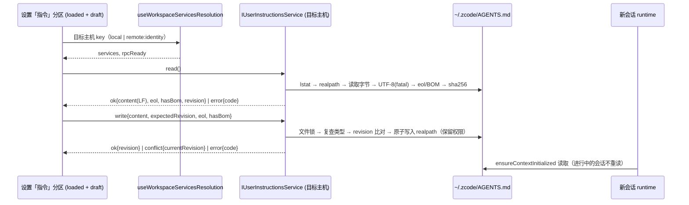

# Global Instructions（全局指令编辑）

## 背景（当前源码事实）

- 全局指令即用户默认指令文件 `~/.zcode/AGENTS.md`（home 解析顺序：`HOME` → `USERPROFILE` → `os.homedir()`）。
  CLI 在 `apps/zcode-cli/packages/adapters/src/context/index.ts` 的 `findDefaultUserInstructionFile` 中定位该文件。
- CLI 把它与工作区最近的 `AGENTS.md`（向上查找到 git 根）合并；按 `path.resolve` 后的**字面路径**去重（不解析符号链接）；
  每个文件最多读取 100 KiB（按字节截断，可能截断在多字节字符中间，并追加 `[File truncated: ...]`）；`trim()` 后为空的文件不注入。
  CLI 对路径使用 `stat`（跟随链接）：悬空链接、目录在 CLI 侧等同于"不存在"。
- CLI 在会话 runtime 的 `ensureContextInitialized`（`core/src/runtime/methods/context.ts`）中读取一次指令。
  该方法除首条消息外，也会被 `getSkillCatalog` 触发；输入框为预热草稿会话请求技能目录，因此**已打开的草稿会话**在发送首条消息前就已固化指令。
  冷恢复（`resume.ts`）会重置 `contextInitialized`，恢复后的会话会重新读取。
- 现有唯一写入路径是引导页的 `~/.claude/CLAUDE.md → ~/.zcode/AGENTS.md` 迁移（`ISettingsSyncService.copyClaudeAgentsFileToZcodeAgentsFile`）；此前不存在读取/编辑接口。

## 产品规则

- 设置页新增「指令」分区，位于「Agent 能力」分组内、「记忆」之前；仅编辑全局 `~/.zcode/AGENTS.md`，不展示或编辑项目 `AGENTS.md`。
  分区描述说明：该指令会与项目 `AGENTS.md` 合并，对新会话和重新启动的会话生效。
- **仅 Desktop 提供**；Web（含手机远控）显示与「记忆」相同风格的只在桌面端可用占位，不加载文件。
- **目标主机 = 当前活动 workspace 所在主机**：本地 workspace 或无 workspace → 本机；远程 workspace（SSH / WSL / Docker）→ 远端主机
  （远端 CLI 读取的正是远端 `~/.zcode/AGENTS.md`）。编辑器上方明确标注「此电脑」或远端名称，并显示文件绝对路径。
  Docker 目标额外提示「文件位于容器内，容器重建后可能丢失」。
- **编辑器**：等宽 Textarea + 「编辑 / Markdown 预览」两个标签（预览复用 `MarkdownPreviewContent`，不传 `workspacePath` / `selectionTarget`，
  避免把远端文档中的相对链接解析到本机）。支持 Cmd/Ctrl+S 保存；有未保存差异时显示「有未保存的修改」与「放弃修改」按钮（恢复为磁盘内容）；
  「在文件管理器中显示」仅对本机且文件已存在时可用。
- **保存按钮**：`dirty || state === "missing"` 时可用（文件不存在时未编辑也允许保存以创建空文件）；其他情况（含错误态）禁用。
- **文件不存在**：显示空编辑器与提示「文件尚未创建」；点击保存时创建 `~/.zcode` 目录与文件。
- **保存空内容**：写入空文件；本功能永不删除文件。
- **从 CLAUDE.md 导入**：目标主机上存在 `~/.claude/CLAUDE.md` 时显示按钮；无论全局文件是否存在都可用。
  导入源使用与全局文件相同的检查（链接、5 MiB、UTF-8）。导入只把内容填入草稿，需保存才落盘；当前草稿非空且与磁盘不同时先确认替换。
  ZCode 不展开 Claude 的 `@path` 导入语法：若内容包含以 `@` 开头的导入行，导入后提示「@ 导入不会被展开」。
- **大小**：显示当前草稿 UTF-8 字节数；超过 100 KiB 时提示「Agent 只会读取前 100 KiB」，仍允许保存。
  超过 5 MiB 的文件不加载进编辑器，显示只读的过大状态（本机可在文件管理器中打开）。
- **生效时机**：保存成功的 toast 与编辑器下方常驻提示均说明
  「对新会话和重新启动的会话生效；进行中的会话和已打开的草稿保持原指令」。本功能不重建预热草稿会话。
- **未保存草稿保护**：以下操作在存在脏草稿时弹出「放弃修改？」确认，取消则保持当前分区与草稿：
  - 切换到其他设置分区（包括通过菜单等程序化跳转）；
  - 点击「返回工作区」；
  - Cmd/Ctrl+W：设置页可见时 workspace 层不消费 `CLOSE_ACTIVE_CONTEXT_REQUEST_EVENT`，Root 会回落为关闭窗口；
    设置页在脏草稿时拦截该事件，确认放弃后再执行 `DesktopCommandIds.CloseWindow`；
  - 活动 workspace 切换导致**目标主机 key** 变化：取消时编辑器继续绑定原主机（显示「编辑器仍指向 X」提示），
    直到保存或放弃；对同一新主机 key 不重复弹窗。
    窗口关闭按钮与退出应用**不拦截**（草稿丢失可接受）。
- 冲突弹窗为分区内的 `AlertDialog`（三选一，不绑定 Enter 默认动作），不复用全局确认框，避免回车误覆盖。
- **目标主机 key**：`local` 或 `remote:<workspaceIdentity?.trim() || workspacePath>`；同一远端重连（`remoteSessionId` 变化、服务实例重建）
  不视为切换主机，不弹确认，也不丢弃草稿。远端处于 `remote-waiting`（RPC 未就绪）时显示等待态，不发起读取。

### 文件状态处理

| 磁盘状态                       | 读取结果                 | 编辑/保存                                                  |
| ------------------------------ | ------------------------ | ---------------------------------------------------------- |
| 不存在（含 `~/.zcode` 不存在） | `missing`，空内容        | 可编辑；保存时 mkdir + 创建                                |
| 普通文件（含空文件）           | `file`，内容             | 可编辑、保存                                               |
| 指向普通文件的符号链接         | `file`，附 `linkTarget`  | UI 显示「链接 → 目标路径」；原子写入目标文件，链接本身不变 |
| 悬空符号链接                   | 错误 `BROKEN_LINK`       | 禁止保存（CLI 视同不存在）                                 |
| 目录或其他非普通文件           | 错误 `NOT_REGULAR_FILE`  | 禁止保存                                                   |
| 非合法 UTF-8                   | 错误 `NOT_UTF8`          | 只读错误态，禁止保存，避免破坏内容                         |
| 超过 5 MiB                     | 错误 `TOO_LARGE_TO_EDIT` | 只读过大态                                                 |
| 无权限 / 其他读取失败          | 错误 `READ_FAILED`       | 错误态 + 重试                                              |

### 行尾、BOM 与权限

- 浏览器 `<textarea>` 会把 CRLF 规范化为 LF，因此无法"零处理"地原样保留行尾。规则：
  - 读取时检测行尾风格：全部 CRLF → `eol: "crlf"`；否则（全部 LF / 无换行 / 混合）→ 取出现次数更多的风格，平局取 LF。
  - 存在混合行尾或孤立 CR 时 `mixedLineEndings: true`，UI 提示「保存时将统一为 LF/CRLF」。
  - 返回给 UI 的 `content` 一律为 LF、去掉 BOM；保存时服务按读取得到的 `eol` 还原行尾，`hasBom` 为真时写回 UTF-8 BOM。
  - 脏判定基于规范化后的文本（LF、无 BOM）。
- `revision` 基于磁盘原始字节计算，包括 BOM 与原始行尾。
- 写入保留已有文件（链接时为目标文件）的权限位；新建文件使用默认权限（受 umask 影响）。
  原子写入通过同目录临时文件 + rename 实现，会断开硬链接（可接受，记录在此）。

### 并发与冲突

- 读取返回 `revision`（文件字节 sha256；不存在时为 `null`）。保存携带 `expectedRevision`。
- 服务端在文件锁（锁路径为 `~/.zcode/AGENTS.md` 本身，而非链接目标）内重新检查路径类型并计算磁盘 revision：
  - 期间变成悬空链接 / 非普通文件 → 返回对应错误，不写入（不是冲突）；
  - revision 与 `expectedRevision` 不同（包括期间被创建、修改或删除）→ 返回 `REVISION_CONFLICT`，不写入。
- 文件锁只约束 ZCode 自身的写入；外部编辑器不遵守该锁，revision 检查之后到 rename 之间仍存在极小竞态窗口（best-effort）。
- UI 收到冲突后弹窗：「从磁盘重新加载」（丢弃草稿）或「覆盖」（以当前磁盘 revision 重试写入）；关闭弹窗保持草稿不变。
- 写入失败：toast 提示，草稿保留。

### 符号链接与去重

- 若 `~/.zcode/AGENTS.md` 是指向某个仓库 `AGENTS.md` 的链接，且该仓库正被打开，CLI 会把同一内容注入两次（字面路径去重）。
  UI 对链接文件显示提示「若链接目标是项目 AGENTS.md，打开该项目时内容会重复注入」。

## 状态所有者与事件顺序



- 唯一事实源是目标主机磁盘上的文件；UI 只持有 `loaded`（最后一次读取/保存的内容、revision、eol、hasBom）和 `draft`。
  不引入缓存、设置项或广播同步。
- 服务在每个主机进程注册（`packages/services/src/node.ts`，Desktop 本地 Host 与远端 server 共用）。
  Desktop 为远程 workspace 构造的组合服务集合（`packages/desktop/src/host/remoteWorkspaceServiceCollection.ts`）中，
  该服务**必须代理到远端连接**（`packages/client/src/remoteServiceAccess.ts`），不得回落到本机实例，否则会静默编辑本机文件。
- UI 通过 `useWorkspaceServicesResolution(workspacePath, remoteSessionId, workspaceIdentity)` 选择目标主机；无 workspace 时使用本机服务。
- 不变量：服务端解析的文件路径必须与 CLI adapter 完全一致（`HOME` → `USERPROFILE` → `os.homedir()` + `.zcode/AGENTS.md`），
  不读取 `ZCODE_DESKTOP_HOME_DIR`；与 `settingsSyncService` 共用 `@zcode/shared/node` 中的同一个路径 helper。
  services 不能导入 CLI 源码，一致性由测试固定。

## 接口

新增 `IUserInstructionsService`（新的 `ServiceChannels.UserInstructions`；与 memory 服务一致，接口与类型位于 `packages/services/src/user-instructions/userInstructions.ts`，路径 helper 位于 `@zcode/shared/node`）：

```ts
type UserInstructionsEol = "lf" | "crlf";

type UserInstructionsReadResult =
  | {
      kind: "ok";
      path: string;
      linkTarget?: string;
      state: "missing" | "file";
      content: string; // LF、无 BOM
      revision: string | null;
      sizeBytes: number;
      eol: UserInstructionsEol;
      hasBom: boolean;
      mixedLineEndings: boolean;
      agentReadLimitBytes: number; // 102400
      editLimitBytes: number; // 5 MiB
    }
  | {
      kind: "error";
      path: string;
      linkTarget?: string;
      code: "BROKEN_LINK" | "NOT_REGULAR_FILE" | "NOT_UTF8" | "TOO_LARGE_TO_EDIT" | "READ_FAILED";
      sizeBytes?: number;
      message?: string;
    };

type UserInstructionsWriteResult =
  | { kind: "ok"; revision: string; sizeBytes: number }
  | { kind: "conflict"; currentRevision: string | null }
  | { kind: "error"; code: "BROKEN_LINK" | "NOT_REGULAR_FILE" | "WRITE_FAILED"; message?: string };

type UserInstructionsImportSource =
  | { kind: "missing"; path: string }
  | { kind: "ok"; path: string; content: string }
  | {
      kind: "error";
      path: string;
      code: "BROKEN_LINK" | "NOT_REGULAR_FILE" | "NOT_UTF8" | "TOO_LARGE_TO_EDIT" | "READ_FAILED";
      message?: string;
    };

interface IUserInstructionsService {
  read(): Promise<UserInstructionsReadResult>;
  write(params: {
    content: string;
    expectedRevision: string | null;
    eol: UserInstructionsEol;
    hasBom: boolean;
  }): Promise<UserInstructionsWriteResult>;
  readClaudeImportSource(): Promise<UserInstructionsImportSource>;
}
```

- 引导页现有迁移接口保持不变。
- UI 分层：`packages/ui/src/settings/userInstructionsEditorModel.ts`（纯函数：主机 key、绑定主机、可保存、字节估算）→
  `packages/ui/src/hooks/useUserInstructionsEditor.ts`（唯一持有 loaded/draft/冲突状态，选择目标主机服务并发起 RPC）→
  `packages/ui/src/settings/UserInstructionsSettingsSection.tsx`（展示）。`SettingsPage` 只通过 `onDirtyChange` 得知是否存在脏草稿，
  用于导航拦截，不持有草稿内容。
- 字节数按保存后的磁盘格式估算（CRLF 每行 +1 字节、BOM +3 字节），与 Agent 读取的 100 KiB 上限口径一致。

## 版本偏斜

- 新 UI + 旧远端主机（未注册该服务）：RPC 在超时后以 `name === "Unknown channel"` 的错误失败
  （`packages/rpc/src/channelServer.ts`）→ 分区显示「远端主机版本不支持」错误态，不影响其他设置。其他异常显示 `READ_FAILED` + 重试。
- 旧 UI + 新主机：无行为变化。

## 验收场景

1. 本机无 `~/.zcode`：打开「指令」→ 空编辑器 + 「文件尚未创建」，保存按钮可用；输入并保存 → 目录与文件创建，toast 提示生效时机；
   新建会话的上下文包含该内容。
2. 文件已存在：内容加载；修改后显示未保存标记；Cmd/Ctrl+S 保存；未修改时保存按钮禁用。
3. 清空并保存 → 文件存在且为空；新会话不注入用户指令。
4. 外部修改文件后在编辑器保存 → 冲突弹窗；「重新加载」显示磁盘内容；「覆盖」写入草稿。编辑期间文件被外部删除或创建同样触发冲突。
5. 符号链接 → 显示「链接 → 目标」；保存后链接仍为链接，目标文件内容与权限更新/保留。悬空链接显示错误且禁止保存。
6. 草稿超过 100 KiB → 显示截断提示，保存成功。超过 5 MiB 的文件显示只读过大态。
7. 目录占位 / 非 UTF-8 / 无读取权限 → 对应错误态，保存禁用。
8. 存在 `~/.claude/CLAUDE.md` → 「从 CLAUDE.md 导入」把内容填入草稿；脏草稿先确认；保存前磁盘不变。
9. 远程 workspace 激活 → 标注远端并读写远端文件；「在文件管理器中显示」不可见；从远端切回本地 workspace 且有脏草稿时弹出放弃确认；
   同一远端重连不弹确认。
10. 有脏草稿时切换到其他设置分区 / 点击「返回工作区」/ Cmd/Ctrl+W → 放弃确认；取消则留在原处且草稿保留。
11. Web / 手机远控打开设置 → 「指令」分区显示仅桌面可用占位。
12. 预览标签正确渲染当前草稿（含未保存内容）的 Markdown。
13. CRLF 文件：编辑保存后仍为 CRLF；带 BOM 的文件保存后仍带 BOM；混合行尾显示统一提示。

## 验证

- `pnpm typecheck`、`pnpm lint`、`pnpm architecture:check --changed`。
- 服务层：`packages/services/test/userInstructionsService.test.ts`（`node:test`，临时 HOME）覆盖状态表、冲突、链接、行尾/BOM、权限与 CLI 路径一致性。
- 交互场景（1–13 的 UI 部分）：仓库当前无 E2E 基础设施，作为手动验证项，未执行前不视为已覆盖。
