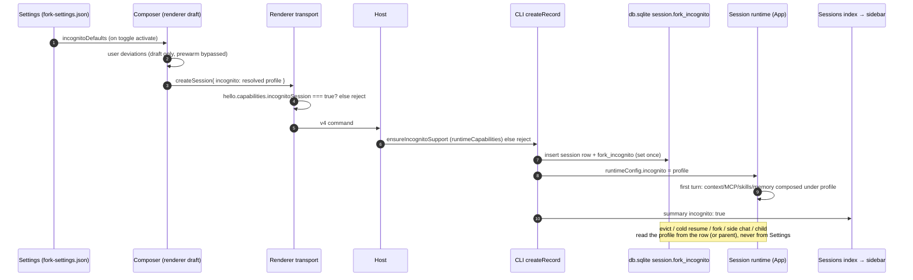

# Incognito session

Status: implemented (2026-10-18), slices 1–5: shared profile contract and fork setting; CLI storage (`session.fork_incognito`); CLI runtime overrides, inheritance, dream exclusion and the `incognitoSession` runtime capability (apps/zcode-cli/docs/design/v2/incognito-session.md); Host and renderer capability gates and the `incognito` summary/task-meta projection; UI (composer toggle and checklist, prompt-shell tint and chip, prewarm bypass, sidebar/hover-card/session-manager marker, Settings «Incognito», i18n). Draft-intent generation (scenario 18, composer half) and the serialized Settings write harden the UI races found in review. The desktop E2E scenarios (13, 17) are written but have not been run.

## Problem

Every session starts with all configured extras: project instructions, skills listing, hooks, plugins, MCP servers, custom agents, memory, output style and system-prompt overrides. There is no way to start a clean, vanilla agent conversation to:

- get a clean-room baseline when something behaves oddly (skill/hook interference, context bloat);
- chat with a minimal prompt and no plugin/MCP startup cost;
- talk to the agent without project memory being read or written.

Today the only switches for these extras are global or per-project config, and several of them re-enable themselves (plugin hooks force `hooks.enabled: true` in `mergeRuntimeHooks`, `apps/zcode-cli/packages/bootstrap/src/app/runtime-config.ts:269`; an empty protocol `mcpServers` list falls back to config servers in `protocol-mcp-config.ts:7`).

## Product rules

1. **Incognito is a per-session start option.** It is chosen in the new-session composer, frozen at session creation, and never changes for the session's lifetime. Mid-session toggling is out of scope.
2. **Minimum by default, opt back in.** An incognito session starts with every toggleable capability **off**. The user can switch individual capabilities back **on** for the session being started.
3. **Defaults live in Settings.** A dedicated Settings section «Incognito» holds the default on/off value of each capability. The composer checklist starts from those defaults; deviations apply to that one session only. There is no separate «Ask before start» dialog — the composer checklist is the pre-start checklist.
4. **Persisted, not ephemeral.** An incognito session is an ordinary persisted session (history, resume, sidebar) that ran with extras disabled. Ephemeral/discard-on-close is out of scope for V1.
5. **Marked everywhere it is listed.** Incognito sessions show an incognito marker in the sidebar, the same way worktree sessions show the worktree marker.
6. **Fail closed.** If any hop (Host or CLI) does not support incognito, session creation is rejected with an explicit error. It must never silently create a normal session.
7. **Inheritance.** Forks, side chats, Task-tool subagents and workflow children of an incognito session run with the parent's profile.
8. **Combines with worktree.** Incognito and execution worktree are independent; a session may be both and shows both markers.
9. **Honest naming.** The feature keeps the name «Incognito», but its UI hint states what it does («A clean session without project instructions, skills, hooks, plugins, MCP and memory») and what it does not do (see Non-goals). It is not a privacy guarantee.

### Capabilities

| Profile key             | When **off** (incognito default)                                                                                                                                                                                                                       | Owner today                                                                                    |
| ----------------------- | ------------------------------------------------------------------------------------------------------------------------------------------------------------------------------------------------------------------------------------------------------ | ---------------------------------------------------------------------------------------------- |
| `projectInstructions`   | No `~/.zcode/AGENTS.md` and no project `AGENTS.md` in the request user context.                                                                                                                                                                        | `resolveUserInstructions`, `apps/zcode-cli/packages/adapters/src/context/index.ts:94`          |
| `skills`                | No skills listing meta block. The Skill tool **stays registered**: the user can still invoke a skill explicitly, and the agent may run one the user names.                                                                                             | listing `core/src/context/builder.ts:191`; tool `core/src/runtime/helpers/runtime-tools.ts:55` |
| `hooks`                 | No hook runner from user/project config, workspace hook snapshot or plugin hooks. SessionStart hooks do not run.                                                                                                                                       | `createRuntimeHookRunner`, `runtime-tools.ts:93`; `mergeRuntimeHooks`                          |
| `plugins`               | Plugin discovery yields nothing for this session: no plugin skill roots, hooks, MCP servers, LSP servers, agents or runtime features. The `node_repl` MCP server, browser use and computer use come from official plugins, so they follow this toggle. | `resolveStartupPlugins`, `bootstrap/src/app/startup-marks.ts:12`                               |
| `mcp`                   | No user/project-configured MCP servers.                                                                                                                                                                                                                | MCP merge, `runtime-config.ts:100`                                                             |
| `customAgents`          | Subagent profiles resolve as `{ kind: "built-in-fallback" }` (built-in agents only).                                                                                                                                                                   | `packages/shared/src/subagent-runtime-config.ts:32`; `create-app.ts:260,890`                   |
| `memory`                | No memory root: no memory section, no MEMORY.md index, no recall prefetch, no extraction, `/dream` unavailable, no subagent persistent memory. Excluded from dream (see below).                                                                        | `resolveEnabledProjectMemoryRoot`, `core/src/runtime/helpers/project-memory.ts:4`              |
| `outputStyle`           | No output-style system section and no output-style reminders.                                                                                                                                                                                          | `bootstrap/src/output-style.ts:48`, `create-app.ts:300`                                        |
| `systemPromptOverrides` | `~/.zcode/system-prompt/<key>.md` overrides are ignored; built-in section texts are used.                                                                                                                                                              | `loadPersistedSystemPromptOverrides`, `bootstrap/src/system-prompt.ts:30`                      |

**Core (never toggleable):** CLI prefix, agent identity and `# Harness`, desktop context, dynamic behavior, session/tool guidance, environment info (including the execution-worktree line), context management, git system context, current date, built-in tools, permissions and permission mode, model selection, internal mailbox hooks.

## Data model

### Profile (shared, strict)

New module `packages/shared/src/incognito-profile.ts`, exported from the shared public entry:

```ts
export const INCOGNITO_CAPABILITY_KEYS = [
  "projectInstructions",
  "skills",
  "hooks",
  "plugins",
  "mcp",
  "customAgents",
  "memory",
  "outputStyle",
  "systemPromptOverrides",
] as const;

// `true` = capability included in this session.
export const incognitoProfileSchema = z
  .object({
    version: z.literal(1),
    projectInstructions: z.boolean(),
    skills: z.boolean(),
    hooks: z.boolean(),
    plugins: z.boolean(),
    mcp: z.boolean(),
    customAgents: z.boolean(),
    memory: z.boolean(),
    outputStyle: z.boolean(),
    systemPromptOverrides: z.boolean(),
  })
  .strict();

export const INCOGNITO_LOCKDOWN_PROFILE: IncognitoProfile; // version 1, every capability false
export const INCOGNITO_UNSUPPORTED_ERROR = "proto.incognitoUnsupported";
export function resolveIncognitoDefaults(
  stored?: Partial<IncognitoCapabilities>,
): IncognitoCapabilities;
export function buildIncognitoProfile(capabilities: IncognitoCapabilities): IncognitoProfile;
export function parseStoredIncognitoProfile(
  stored: string | null | undefined,
): IncognitoProfile | undefined;
```

- The profile is the **resolved, explicit** value of every capability, never a diff against Settings defaults, so later Settings edits do not change existing sessions.
- `version` allows a future fork build to add capabilities. A reader that cannot parse a stored profile (unknown version or shape) uses `INCOGNITO_LOCKDOWN_PROFILE` — the most restrictive reading — never "normal session".

### Session storage (CLI `~/.zcode/cli/db/db.sqlite`)

- Fork migration `9001_fork_session_incognito`: `alter table session add column fork_incognito text;` — additive, nullable, no default, no backfill. Its id never appears in the upstream checksum pin list (docs/specs/sqlite-session-migration-checksum-compatibility.md).
- `fork_incognito`: `NULL` = normal session; JSON-encoded `IncognitoProfile` = incognito session.
- **Set once, never cleared.** The session upsert in `createSession` (`adapters/src/storage/session-store/repositories/sessions.ts:21`) writes the column on insert and uses `fork_incognito = coalesce(session.fork_incognito, excluded.fork_incognito)` on conflict — the same pattern as `execution_directory`. A profile can land after an earlier `NULL` insert, but once set it is never changed or cleared (upstream upserts do not list the column at all).
- `CreateSessionInput` gains `incognito?: IncognitoProfile`. Every path that writes a session row must carry it for incognito sessions: deferred first-send persistence (`core/src/runtime/methods/events.ts:606`), legacy create (`bootstrap/src/zcode-protocol/server-operations.ts:1158`), the v4 bridge (`v4-bridge.ts:1559`), fork (`core/src/runtime/methods/session-fork.ts:896`) and the session store's child/copy paths (`sqlite-session-store.ts:364,421,508`).
- `SessionInfo` gains `incognito?: IncognitoProfile`, decoded from the column.
- Upstream coexistence (verified): the migration runner checks only its own migration ids, so an upstream build ignores the `9001_fork_*` ledger row; upstream's session upsert lists columns explicitly, so it inserts `NULL` for its own new sessions and never touches the value on existing rows.

### Fork settings (`~/.zcode/v2/fork-settings.json`)

- New fork key `incognitoDefaults` in `FORK_SETTING_KEYS` (`packages/shared/src/forkAppSettings.ts:14`), never in `appSettingsObjectSchema` / `setting.json`.
- Value: the capability booleans of the profile without `version`. Effective default: every capability `false`. Reads tolerate a partial or damaged object (a missing capability is off). The patch schema requires every capability: the sidecar merges top-level keys only, so a partial object would replace the stored one and drop the others.

### Session summary projection

- `deriveSessionSummary` (`apps/zcode-cli/packages/bootstrap/src/zcode-protocol-v4/sessions-index-projection.ts:119`) emits a **top-level optional** `incognito: true` when the session row has a profile (older parsers strip unknown top-level keys; nested schemas are strict — `packages/shared/src/zcode-protocol-v4/sessions-index.ts`).
- `mapSessionSummaryToTaskMeta` → `ZCodeTaskMeta.incognito?: boolean` (`packages/shared/src/zcode-task-types-core.ts:372`). Only the boolean leaves the CLI; the profile itself is not projected.

## Protocol

- v4 `createSession` (payload schema split out of `command.ts` into `packages/shared/src/zcode-protocol-v4/create-session-command.ts`) gains `incognito: incognitoProfileSchema.optional()`. Absent = normal session.
- **Worktree preparation cannot carry `incognito`.** The v4 prepare step (`worktreePreparation`) reserves the session row before any profile exists, and that reservation write has no profile, so a create that sends both is rejected — by a refinement on the shared payload schema and again in the handler (`proto.invalidPayload`). The profile is sent on the activation `createSession` (`preparedSessionId`) instead.
- **Prepared-row activation freezes the profile on first use.** The bridge compares the requested profile with the stored row profile (`getSession(...).incognito`) before any reuse of a prepared identity: a mismatch — including an absent profile on an incognito row, or a profile on a normal row — is rejected (deep-equal on the normalized profile), and materialization uses the stored profile once one exists. A retry can therefore never report success for a profile the session does not have.
- Legacy `session/create` (`packages/shared/src/zcode-protocol/index.ts:1927`) gains the same optional field, so the bridge (`bootstrap/src/zcode-protocol/v4-bridge.ts:1443`) and `createRecord` (`server-operations.ts:3503`) carry it explicitly. The handler pick list in `session-mgmt.ts:73` must name it. A create with `importedHistory` persists through `persistImportedSessionHistory`, whose session inputs carry the profile: the `app.resume()` that follows marks the runtime persisted, so first-send persistence never gets a chance to write it.
- `incognito` is **never** an optional compat field: it must not be added to `SESSION_CREATE_OPTIONAL_COMPAT_FIELDS` or `SESSION_RESUME_OPTIONAL_COMPAT_FIELDS` (`packages/services/src/zcode-agent/zcodeAgentService.ts:440`). If a CLI's `.strict()` schema rejects it, the create fails; the Host must not retry without it.
- Capability gate, two hops (precedent: `independentPlanState`):
  1. CLI advertises `incognitoSession: true` in runtime capabilities (`zcodeRuntimeCapabilitiesSchema`).
  2. Host checks the CLI with an `ensureIncognitoSupport(client)` gate (same shape as `packages/services/src/zcode-agent/independentPlanSupport.ts`) before forwarding a `createSession` that carries `incognito`; failure → `proto.incognitoUnsupported`.
  3. Host advertises `incognitoSession: true` in `hostCapabilitiesSchema` (`packages/shared/src/zcode-protocol-v4/transport.ts:23`); the renderer transport (`packages/ui/src/v4/agentConversationTransport.ts:350`) throws `proto.incognitoUnsupported` before sending when the Host does not advertise it.
- The Host never rewrites or fills the profile; the renderer sends the resolved profile.

## Owners and event order

| State                                 | Single owner / writer                                         | Readers                                                   |
| ------------------------------------- | ------------------------------------------------------------- | --------------------------------------------------------- |
| Defaults (`incognitoDefaults`)        | Host `SettingService` (fork sidecar)                          | Settings «Incognito» section, composer                    |
| Draft intent + per-session deviations | Renderer draft store (UI-local, not a server fact)            | Composer                                                  |
| Intent generation per workspace       | Renderer draft store (same owner as the intent)               | Composer toggle (activation), send cleanup (deactivation) |
| Session profile (`fork_incognito`)    | CLI `createRecord` → session upsert (set once, never cleared) | CLI runtime composition, resume, fork, child, dream       |
| Sidebar flag (`incognito: true`)      | CLI sessions-index projection (derived, read-only)            | UI task list, hover card, session manager                 |



Ordering constraints:

- The profile is persisted in the same insert as the session row, so no observable session exists without its profile. Draft sessions are deferred until first send (`session-mgmt.ts:24`); the profile travels with that first create and with the deferred-persistence write in `events.ts:606`.
- Runtime composition reads `runtimeConfig.incognito`, which `createRecord` and resume set from the row. No component reads Settings to decide whether a running session is incognito.

## Runtime composition (CLI)

- `AgentRuntimeConfig` (`apps/zcode-cli/packages/core/src/runtime/types.ts:122`) gains `incognito?: IncognitoProfile`. Set by `createRecord` from params, and on resume from `SessionInfo.incognito` (`resume.ts` alongside `executionWorktree`). The CLI's own TUI/headless resume resolves the target through `resolveResumeSession`, which returns the persisted profile with the id and forwards it into `createZCodeApp`'s `runtimeConfig`.
- Each capability has one override point that wins over every config source (global, project, plugin, env):
  - `projectInstructions` off → `resolveUserInstructions` is not called; `userInstructions` empty.
  - `skills` off → `ContextBuilder` omits the skills meta block; the skill port and Skill tool remain.
  - `hooks` off → no hook runner for config, workspace snapshot or plugin hooks (`mergeRuntimeHooks` must not re-enable). Internal mailbox hooks stay.
  - `plugins` off → plugin discovery for this App returns the empty outcome (same as `plugins.enabled: false`, `adapters/src/plugins/index.ts:145`), which also removes plugin skill roots, hooks, MCP, LSP and agents.
  - `mcp` off → user/project-configured MCP servers are dropped from the merge; plugin-provided servers (including `node_repl`) follow `plugins`. `mcp.enabled` is not used, because it would also remove plugin servers.
  - `customAgents` off → subagent runtime config is `{ kind: "built-in-fallback" }` regardless of the Host's `subagents/readRuntimeConfig`, and `subagents.builtInModelSelectionOverrides` is cleared (user-configured `Explore`/`general-purpose` model overrides included), so built-in agents run their default models.
  - `memory` off → `memory: { enabled: false }` regardless of the Host `memoryEnabled` preference; no memory root, recall, extraction or `/dream`.
  - `outputStyle` off → no active output style.
  - `systemPromptOverrides` off → overrides map empty.
- Plain sessions (`incognito` absent) are byte-identical in prompt and behavior to today.
- Inheritance: `forkSession` (`server-operations.ts:2318`), side chats, Task-tool children (explicit config field list in `core/src/runtime/methods/subagent.ts`) and workflow child runtimes (`bootstrap/src/app/script-workflow-child-runtime.ts:295`, which re-reads skills config) receive the parent profile explicitly. Child session rows store the inherited profile.
- Dream exclusion: `selectProjectDreamSessions` (`core/src/runtime/helpers/project-memory-dream.ts:59`) skips sessions whose profile has `memory: false`, so another session's `/dream` never reads an incognito transcript.

## UI

- **Composer toggle.** Rendered in the composer's top row, the `contextHeader` row (`data-composer-context-row` in `packages/ui/src/v4/ConversationComposer.tsx`), after the workspace (project) chip and the Git branch chip. It sits at the row's trailing end (`ml-auto`). It is not in the bottom toolbar's trailing cluster (`submitControlNode`) and not in the leading group next to the mode switch. Available in every workspace type, gated by the same `draftMode && sessionId === null && !isWebRemoteControl` condition as before. `aria-pressed`, tooltip, i18n label.
  - The top row keeps `flex-wrap`: when the composer is narrow the toggle drops to a second line instead of overflowing, with no horizontal page scroll at phone width (375px) or a ~380px composer.
  - The toggle is not part of `useComposerToolbarFit` (no `data-composer-collapse-priority`, no compact-only styling). The label is never collapsed to an icon; the row wraps instead.
  - **Off:** icon-only ghost button (lucide `VenetianMask`, `size-4`, `size-7`), tooltip «Incognito session».
  - **On:** a cyan pill chip (`rounded-full`, token `--color-incognito`) with the «Incognito» label. The chip is a `relative` wrapper (`group/incognito-chip`, carrying `data-testid` `v4-composer-incognito-marker`) that holds the trigger button and a sibling turn-off button; the wrapper never nests a button inside the trigger.
  - **Turn-off button** (`data-testid` `v4-composer-incognito-off`, `aria-label` = `chat.incognito.turnOff`): an absolutely positioned `Button` sibling, the same pattern as the project chip's detach button in `ChatEmptyState.tsx` (`composer-project-detach`). It is `opacity-0 pointer-events-none` and becomes visible on `group-hover/incognito-chip` and `group-focus-within/incognito-chip`, overlaying the mask icon, which fades out at the same time. It is reachable by keyboard focus (Tab) and is disabled with the control.
  - **Clicking the chip body** opens the checklist menu as before.
- **Checklist.** The button opens a menu: the incognito on/off row and, while active, one row per capability, each with a visible leading checkbox (the row stays a `menuitemcheckbox`), initialized from `incognitoDefaults`. A footer link opens Settings «Incognito».
- **Composer highlight.** New semantic token `--color-incognito` defined in all four theme blocks of `packages/ui/src/styles.css` (mirroring `--color-worktree-task`) and documented in DESIGN.md. Active incognito tints the prompt shell border via `shellClassName`. The active chip is always paired with the «Incognito» label, so the state is not color-only; the mask icon is not repeated next to the label.
- **Draft state.** Incognito intent and deviations are UI-local draft state keyed by the workspace identity key (`workspaceIdentity?.trim() || workspacePath`). They clear after the session is created. The draft store also owns a per-workspace **intent generation**: a counter bumped on every intent transition (activation, explicit deactivation — including a no-op one, which cancels a pending activation — capability change) and when a draft is submitted. Async continuations capture the generation when the user acts and apply only if it is still current, so a defaults read that resolves after the draft was sent never arms the intent for a later draft, and a send completion never clears the intent of a newer draft that re-armed or changed capabilities while the send was in flight.
- **Prewarm.** While incognito is active the draft does not use or promote a prewarmed session (same as worktree sends, `SessionPane.tsx:3507`); toggling invalidates the prewarm. This matters beyond reuse: `getSkillCatalog` on a prewarmed draft runs `ensureContextInitialized` and fixes its instructions and skills before the first message (specs/global-instructions.md).
- **Slash catalog.** Accepted V1 limitation: with `plugins` off, the composer slash catalog may still list plugin-sourced skills; invoking one fails as an unknown skill.
- **Sidebar marker.** `IncognitoTaskMarker` (uncolored, `size-3.5`, like `WorktreeTaskMarker`) reads `task.incognito`; rendered at the same sites as the worktree marker (`TaskListItem.tsx`, `workspace-grouped-tasks/task-row.tsx`, `TaskSidebarHoverCard.tsx`, session manager rows). Both markers render when both apply.
- **Settings «Incognito».** New section in the `agentCapabilities` group (`packages/ui/src/settings/settingsPageConfig.ts`), one `SettingsRow` + switch per capability, plus the honest-scope hint (Non-goals). Every write sends the full `incognitoDefaults` object (`resolveIncognitoDefaults(current)` with one capability flipped); the patch schema rejects partial objects. Because a full-object write races with the settings refresh, the section keeps an immediately-updated optimistic draft as the single source for the next write and serializes writes through a promise chain, so quick successive toggles compose instead of the second write erasing the first; the draft resyncs from the refreshed settings once the write queue is idle, and a failed write reverts the draft to the stored defaults.
- **Mobile Web.** The mobile Web task list currently renders no worktree marker; the incognito marker follows the same treatment (added wherever the worktree marker is rendered, so out of V1 on mobile today). Creating incognito sessions from mobile remote control is out of scope for V1 (toggle hidden in the compact remote shell).
- **i18n.** All strings in `en-US`, `zh-CN`, `uk-UA`. The turn-off aria-label is `chat.incognito.turnOff` (renamed from `chat.incognito.removeMarker`, same text and translations).
- **Errors.** `proto.incognitoUnsupported` shows a toast; the draft text and incognito selection are kept.

## Sidebar marker durability

Status: implemented (2026-10-18) for items 1-5 below; dev-web end-to-end verification is pending (see Limit). Proposed after the dev-web investigation. The marker today depends only on the live sessions-index overlay, so any client that does not observe the CLI sessions-index (dev web: the server shows no zcode-cli child and the rows carry only tasks-index meta) renders no marker, and tasks-index never stores `incognito`.

Root cause (file:line, verified in the code and in the dev web DOM):

- The only writer of `incognito` on the list path is the overlay: `sessionOverlay` (`packages/services/src/window-controller/windowHostControllerService.ts:107`) → `buildSourceRows` (`windowHostControllerProjection.ts:179`) → row (`windowHostControllerService.ts:706,761`). Without an observer the row has no `incognito`.
- Persisted meta has no field for it: the runtime snapshot upsert rebuilds meta from explicit fields (`packages/services/src/session/taskIndexRepo.ts:1700-1725`), which would drop `incognito` on every sync, and `zcodeTaskMetaSchema` (`packages/shared/src/validation.ts:1704`) has no `incognito` key.
- Convergence exists only for the execution-worktree fact (BUG-GWT-010: `convergeExecutionWorktreeFacts`, `windowHostControllerService.ts:215`; `applyExecutionWorktreeFacts`, `taskIndexRepo.ts:2175`). It runs inside the overlay observer, so it does not help a client without one.
- Legacy rows: `sess_f17a4862-…` has `fork_incognito` in `cli/db/db.sqlite` but no `incognito` in `tasks-index` meta_json. The desktop observer, which shares the DB, can converge it.

Design (mirrors BUG-GWT-010; `incognito` is frozen per session, so a persisted `true` never goes stale and needs no clearing):

1. `zcodeTaskMetaSchema` accepts optional `incognito: boolean` (tasks-index meta_json only; the wire row keeps its own `incognito` field).
2. The runtime snapshot upsert preserves the stored value: `incognito: params.meta.incognito ?? existingMeta?.incognito`.
3. Convergence: the observer's incognito overlays are persisted into meta_json (`true` only, idempotent) through a separate `listTasks({ incognitoTaskIds })` input (`TaskIndexRepo.applyIncognitoFacts`; forwarded by `zcodeTaskServiceAdapter.listTasks`). The window controller acknowledges only ids whose returned row carries the marker.
4. Reads: `buildSourceRows` and the search path use `overlay?.incognito || membership.meta.incognito`, so a persisted marker shows without a live overlay.
5. Fork-safe: meta_json is a JSON blob (no migration, no new column, no `setting.json` key). Upstream strips unknown meta keys on read; the marker is re-converged by the next observer publish after an upstream rewrite.

Limit: convergence needs a live sessions-index overlay with `incognito`. A client that never receives one (dev web today: its sidebar rows carry only tasks-index meta) cannot converge, so the marker appears only after a build that includes this change has observed the sessions (desktop Host restart, or a web controller that receives the overlay). Verified by tests: services `taskIndexIncognitoMarker.test.ts` (live convergence, cold restart, sync preserve, absent row) and UI `buildTaskListResultFromSessions.test.ts` (persisted marker kept when the summary lacks it).

Scenario 23: the web sidebar (no sessions-index observer in-process) shows the incognito marker for a session whose tasks-index meta carries `incognito: true`; a runtime snapshot sync does not erase it; a legacy row converges from the CLI row via the observer.

## Acceptance scenarios

1. Incognito with all defaults → first-turn prompt has no AGENTS.md, skills listing, memory section/index, output style or overrides; no hook runs; no configured or plugin MCP server connects; only built-in agents are listed; no `node_repl`, browser use or computer use (they come from official plugins).
2. Each capability switched back on individually → only that capability returns (one scenario per key).
3. Skills off → a skill named explicitly by the user still runs via the Skill tool.
4. Plugin hooks installed + hooks off → no hook runs (regression for the forced `enabled: true`).
5. Normal session → prompt and behavior byte-identical to before (regression guard).
6. Incognito session idle-evicted and cold-resumed, or app restarted → same profile applies (read from `fork_incognito`).
7. Settings defaults changed after an incognito session started → that session's behavior unchanged.
8. Fork, side chat, Task-tool subagent and workflow child of an incognito session → same profile; child rows store it.
9. Another session in the same workspace runs `/dream` → the incognito session's transcript is not selected.
10. Stored profile unparsable (unknown version) → session runs with the lockdown profile, not as normal.
11. CLI without `incognitoSession` capability (older or remote CLI) → create rejected with `proto.incognitoUnsupported`; no session row created.
12. Host without the capability → renderer rejects before sending.
13. Sidebar shows the incognito marker for incognito sessions, both markers for incognito + worktree, none for normal sessions; at every site that renders the worktree marker.
14. Database written by the fork, opened by an upstream build → upstream starts normally (ledger and upsert compatibility).
15. A CLI whose legacy `session/create` `.strict()` schema rejects `incognito` → create fails; the Host does not retry without the field.
16. The deferred first-send write and the create write race (row first inserted without profile) → the profile still lands and is never cleared afterwards.
17. Composer: toggle on → shell tinted and chip shown; checklist reflects Settings defaults; deviation applies to the next session only; toggle off → normal session; prewarmed session never promoted for an incognito send.
18. Stale-intent races: the defaults read resolving after the draft was sent or the toggle unchecked does not arm the intent; a send completing after a newer draft re-armed the intent (or changed capabilities) does not clear it. Two quick Settings toggles both persist (the second write composes on the first).
19. v4 `createSession` with both `worktreePreparation` and `incognito` → rejected (`proto.invalidPayload`); no session row is reserved. The profile is accepted on the activation create instead.
20. Prepared-row activation profile mismatch: a repeat createSession whose `incognito` differs from the stored row profile (present vs absent, or a different capability set) → rejected; a matching retry returns the existing session, and materialization uses the stored profile.
21. A session created incognito in Desktop, resumed in the CLI (TUI `--resume`/`--continue` or headless `-p --resume`) → runs with the frozen profile (no plugins/MCP/hooks/`AGENTS.md`/memory extraction), not as a normal session.
22. `session/create` with `importedHistory` and `incognito` (both import sources) → the session row stores the profile; a later first send does not overwrite it and the runtime keeps the profile.

## Validation

- `pnpm typecheck`, `pnpm lint`, `pnpm architecture:check --changed`, `pnpm fmt:check`.
- CLI unit: migration test (fresh DB, upstream-shaped DB, ledger coexistence, set-once upsert, 16); context builder per capability (1–5); resume/fork/child inheritance (6–8); dream selection (9); profile decode fallback (10).
- Services/UI unit: capability gates (11–12, 15), fork-settings key round-trip, summary → task meta mapping.
- E2E (desktop): scenarios 13 and 17.

## Implementation slices

1. Shared profile schema, fork settings key, protocol fields and capabilities.
2. CLI storage: migration `9001_fork_session_incognito`, insert, decode, `SessionInfo.incognito`.
3. CLI runtime: `runtimeConfig.incognito`, per-capability overrides, inheritance, dream exclusion. Advertise `incognitoSession: true` only as the final step: the in-tree CLI's strict legacy schema already accepts `incognito` and ignores it, so until then the missing capability is the only fail-closed guard.
4. Host gate and projection → task meta.
5. UI: composer toggle/checklist/highlight/prewarm bypass, sidebar marker, Settings section, i18n, DESIGN.md token.

Precondition: resolve the separate audit of fork migration `0023_session_execution_worktree` (upstream numbering, unprefixed columns) first, so `9001_fork_session_incognito` does not build on a non-compliant pattern.

## Non-goals (V1)

- Ephemeral sessions (not persisted / discarded on close).
- Changing the profile mid-session.
- Creating incognito sessions from mobile remote control.
- Privacy guarantees. Still recorded for incognito sessions: local usage tables (`model_usage`, `turn_usage`, `tool_usage`), model-IO dumps, input history, OTLP/ARMS/app telemetry, title generation, debug logs.
- Upstream builds: an upstream app opening this database runs incognito sessions as normal sessions and its `/dream` may select them; this cannot be prevented from the fork.
- Custom session profiles beyond the single built-in incognito mode.
