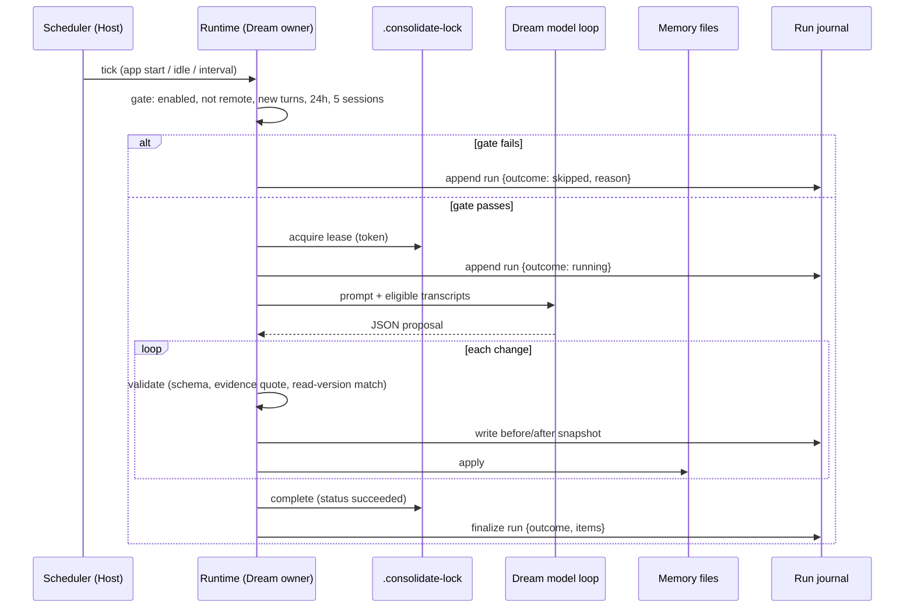

# Night learning (scheduled Dream with journal and undo)

Status: draft. No code yet. Reference design: `makecindy/cindy` nightly learning (read 2026-10-26); our existing base is Dream (`apps/zcode-cli/docs/design/v2/memory/README.md` §7, `specs/dream-lock-lease.md`).

## Problem

Dream consolidates project memory but only on a manual `/dream`, and it leaves no record of what it changed. After a run the user can see that it ran (lock marker mtime, `model_usage` facts, `dream.command.*` logs) but not which memory files were created, updated or deleted, why, or what they contained before. Running it unattended without that record is unsafe, and the spec itself blocks the automatic trigger on two open issues (transcript isolation, Dream's own model-io feeding later runs).

## Product rules

1. **Journal first, schedule last.** The automatic trigger ships only after the journal, undo and validation below exist.
2. **The model proposes, the runtime validates and applies.** Memory and transcript text are data, never instructions. Every proposed change is validated individually before it touches a file.
3. **Off by default, one master switch.** Unlike Cindy, the scheduled run is opt-in. The switch is app-global Memory-adjacent state, not a `setting.json` key (see Ownership).
4. **No model call without new activity.** The gate counts completed real Main-equivalent turns; a scheduled slot with nothing new records `skipped` and calls no model.
5. **Own output is not input.** Sessions created by Dream, automations and subagents are excluded from the gate count and from the transcript corpus.
6. **Bounded blast radius.** Per run: at most 12 memory changes. Skills are out of scope for V1.
7. **Every change is undoable** until the user or agent edits that file afterwards; an edited file is never overwritten by an undo.
8. **Silent to chat.** Results appear in the run journal view and the Dream background-work entry, not as chat messages or push notifications.

## Run lifecycle



Event order is fixed: journal entry is written **before** each apply, so a crash mid-run still leaves every applied change undoable. The lock is released after the journal is finalized; a failed run restores the prior marker per `dream-lock-lease.md`.

## Ownership

| Concern                                           | Owner                                                        | Notes                                                                        |
| ------------------------------------------------- | ------------------------------------------------------------ | ---------------------------------------------------------------------------- |
| Memory files, lock, journal, gate, scheduler tick | CLI Runtime / storage                                        | Desktop Main/Host/Renderer do not copy or persist them.                      |
| Master switch and frequency                       | Host, passed at root Runtime creation like the Memory switch | Not a `setting.json` key; fork-only state lives in `fork_`-prefixed storage. |
| Journal view and undo buttons                     | Renderer via a Host Memory service method                    | Renderer never builds data-root paths.                                       |

Journal location is an open question (see below); it must be fork-prefixed (`fork_`) and additive so the upstream build ignores it.

## Validation rules (applied by the runtime, not the model)

- New memory must carry an evidence quote that appears verbatim (min 8 chars) in a user message of an eligible session.
- Update or delete only files whose full body was shown to the model in this run.
- The file must be unchanged since it was read (version or mtime+size check at apply time); otherwise the change is skipped and journaled as `skipped: modified`.
- Delete and merge require a reason; a merge deletes the source only after the kept file was written and still exists.
- Rejected changes are journaled with a reason code, never silently dropped.
- Frontmatter protocol and `MEMORY.md` budget (200 lines / 25,000 chars) are unchanged; the proposal must keep the index within it.

## Journal

One JSON record per run, newest first, bounded (30 runs; older runs and their snapshots are pruned together).

```
run { id, startedAt, finishedAt, trigger: "scheduled" | "manual", outcome: "learned" | "nothing" | "skipped" | "failed",
      reasonCode?, turnsRead, items[] }
item { id, action: "created" | "updated" | "deleted", file, reason, mergedInto?, undone?, before: snapshot | null, after: snapshot | null }
```

- Snapshots store the file content, never secrets from outside memory files.
- Writes are atomic (temp file + rename), serialized per project; a corrupt journal is renamed aside and rebuilt empty.
- Undo restores `before` only if the current content equals `after`; otherwise it reports `cannot undo: modified since`. Undo of an undo (redo) is allowed under the same check.

## Logging

Uses the runtime logger pattern already in `runtime/methods/dream.ts` (`event`, `module: "core.runtime"`, `status`, trace context). No memory contents, quotes or transcript text in logs; counts, ids, file names and reason codes only.

| Level        | `event`                          | When                                | Fields                                                                                               |
| ------------ | -------------------------------- | ----------------------------------- | ---------------------------------------------------------------------------------------------------- |
| info         | `memory.dream.scheduled.tick`    | scheduler tick evaluated            | `trigger`, `decision`                                                                                |
| info         | `memory.dream.run.skipped`       | gate or lock refused                | `reasonCode` (`disabled`, `remote`, `no_new_turns`, `min_interval`, `lock_held`, `too_few_sessions`) |
| info         | `memory.dream.run.started`       | lock acquired                       | `runId`, `trigger`, `sessionCount`, `turnsRead`                                                      |
| info         | `memory.dream.run.completed`     | journal finalized                   | `runId`, `outcome`, `created`, `updated`, `deleted`, `rejected`, `durationMs`                        |
| warn         | `memory.dream.change.rejected`   | validation rejected a change        | `runId`, `file`, `reasonCode`                                                                        |
| warn         | `memory.dream.undo.refused`      | undo blocked by later edit          | `runId`, `itemId`, `file`                                                                            |
| info         | `memory.dream.undo.applied`      | undo succeeded                      | `runId`, `itemId`, `file`                                                                            |
| warn / error | `memory.dream.failed` (existing) | recoverable / unrecoverable failure | `errorMessage`, `runId`, `phase`                                                                     |
| debug        | `memory.dream.model.request`     | per model request detail            | `runId`, `requestIndex`                                                                              |

Each skip, including those from manual `/dream`, gets a journal row plus the `run.skipped` log, so "why didn't it run last night" has a single answer. Existing `model_usage` facts with `querySource: "dream"` stay the cost source.

## Acceptance scenarios

1. Gate passes on a project with new turns: run executes, journal lists each created/updated/deleted file with before/after, `run.started` and `run.completed` are logged.
2. No new turns at the scheduled slot: no model request, one `skipped` row with `no_new_turns`.
3. Model proposes a new memory with a quote that is not in any user message: change rejected, `change.rejected` logged, nothing written.
4. A target file is edited by the user while the model is thinking: that change is skipped as `modified`, others still apply.
5. Crash after the second apply: both applied changes appear in the journal and are undoable; the lock marker is recoverable.
6. Undo of an item whose file was edited afterwards: refused with a visible reason, file untouched.
7. Sessions started by Dream, automations or subagents never count toward the gate and never appear in the prompt corpus.
8. Master switch off: scheduler never ticks into the model; manual `/dream` still works and still journals.
9. Journal pruning removes runs beyond the cap together with their snapshots.

## Decisions (2026-10-27, from reading the Dream code)

- Dream is an agent loop with file tools (`runMemoryAgentLoop`, `project-memory-dream.ts`), not a JSON proposal: it writes memory files directly and the runtime only learns the touched paths via `collectDreamTouchedPaths`. The "validate each proposed change before apply" rules below therefore need a redesign (structured proposal or write-time hook) and are **not part of V1**. V1 is journal and logging only.
- Journal location: a sidecar directory `.fork_dream-journal/` in the memory root. Precedent: `.consolidate-lock` and `.consolidated-at` already live there as dot entries. Catalog listing, Extraction and the index must ignore it (verify in implementation; add a test).
- Capture point: before the first tool call that touches a path in a run, the runtime snapshots that file (content or absence) and writes the journal item; after the loop it records `after`. This is done in the runtime wrapper around `executor.execute`, not by the model.
- Known limitation: the Dream agent has file tools in the memory root and could in principle read or edit the journal. Accepted for V1; the journal is a diagnostic record, and undo checks `after` equality before restoring.
- V1 scope: journal write and read API in core, lifecycle logs for every run and skip, no undo UI, no scheduler.

## Open questions

- Scheduler form: app-start/idle check in Host versus a CLI-side timer. Desktop may be off at night, so a fixed 03:30 slot is not assumed.
- Transcript isolation of the project model-io (spec §7.1 blocker) must be resolved before rule 1 allows the trigger.
- Which model runs the nightly pass, and its cost ceiling per run.

## Non-goals (V1)

Skill creation or editing, candidate observation lists, cloud sync, mobile controls, pushing run results into chat.
