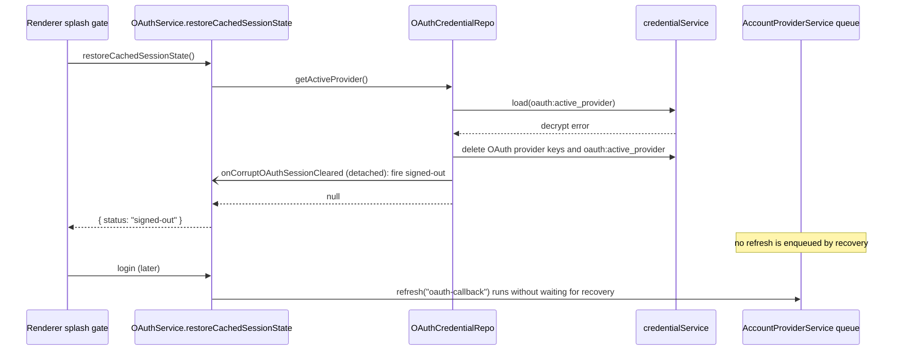

# OAuth Corrupt Session Recovery

When the local OAuth credential store (`~/.zcode/v2/credentials.json`) cannot be decrypted, the
app must start signed-out. Unreadable credentials must never block startup or leave the splash
screen up, and must not delay a login that follows.

Decryption fails when the cipher key (platform, home directory, username) changes, for example
after a renamed home directory, a renamed user, or a restored backup.

## Problem

`useRootOAuthEffects` keeps the splash visible (`isRestoringOAuthSession`) until
`oauthService.restoreCachedSessionState()` settles. On a decrypt failure, the repo clears the OAuth
namespace and then used to await `onCorruptOAuthSessionCleared`. The OAuthService callback enqueued an
account refresh (`refreshAccountProviders`). That refresh shares the single-flight queue of
`AccountProviderService` with login refreshes and runs network probes (SIWC usage, Coding Plan
queries) with no bound of its own. Awaiting it kept restore pending. Detaching it removed the
splash hang, but a login made soon after a corrupt boot then queued behind the in-flight cleanup
refresh.

## Product rules

- Unreadable OAuth credentials are treated as a forced sign-out. The app boots signed-out.
- Corrupt recovery does not enqueue an account refresh or run derived provider cleanup. It has no
  account identity to clear, so the logout handler would only enqueue that refresh. The account
  snapshot reconciles on the next login, logout, or settings-triggered refresh.
- Restore outcome for this case is `{ status: "signed-out" }`. No new protocol reason is added.
- The repo callback `onCorruptOAuthSessionCleared` stays detached. A rejection or a never-settling
  callback never changes the restore outcome. A rejection is logged at `warn`.
- No timeout is used to bound any cleanup. A timeout would hide the synchronization problem; not
  queueing the work removes the dependency instead.

## Owners and order

Owner of the credential namespace: `OAuthCredentialRepo` (`packages/services/src/oauth/repo/oauthCredentialRepo.ts`).
Owner of the corrupt-session sign-out signal: `OAuthService` (`packages/services/src/oauth/oauthService.ts`),
through the repo callback `onCorruptOAuthSessionCleared`. The callback fires `signed-out` and nothing else.
Owner of the account snapshot: `AccountProviderService` (`packages/provider/src/account-provider-service.ts`).
Login refreshes are its only callers on this path.

Open item: `packages/services/src/node.ts` builds a second `OAuthCredentialRepo` whose
`onCorruptOAuthSessionCleared` calls `handleOAuthProviderLogout` (`createOAuthProviderLogoutHandler`),
which enqueues `accountProviderConfigSource.refresh`. Until that callback is removed too, a corrupt
read on that repo can still queue a refresh ahead of a login. This is the same change applied there.

## Acceptance scenarios

1. `load("oauth:active_provider")` throws a credential decrypt error and the repo callback never
   settles: `getActiveProvider()` resolves `null` (`oauthCredentialRepo` tests in
   `packages/services/test/oauthCorruptSessionRecovery.test.ts`).
2. In that scenario, the OAuth provider keys and `oauth:active_provider` are deleted before the
   callback is invoked.
3. The repo callback is invoked once per corrupt-session recovery, with the known provider ids.
4. The repo callback rejects: recovery still returns `null`, and a `warn` entry is logged from the
   `oauthCredentialRepo` scope.
5. `OAuthService.restoreCachedSessionState()` returns `{ status: "signed-out" }` on a corrupt boot and
   does not invoke `onProviderLogout` (`packages/services/test/oauthService.test.ts`, corrupt-recovery
   cases).
6. With the account refresh resolver never settling for `oauth-logout:` reasons, a login refresh
   (`oauth-callback`) requested after a corrupt boot completes (`oauthCorruptSessionRecovery.test.ts`).
7. Non-decrypt errors from `load` still propagate (unchanged behavior).
