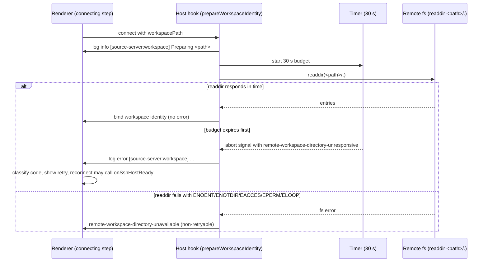

# Port: SSH / remote workspace connection hardening (ZCode 3.16.3)

Status: in progress. Upstream has not published 3.16.3 source. Everything below is reconstructed from the shipped minified 3.16.3 bundle (`app-3163/asar/out` and `zcode.cjs`). Base: fork at upstream 3.16.2 (`3c5b2276`) plus fork features.

Scope: remote (SSH / WSL / Docker) connection hardening. Not in scope: the other 3.16.3 feature groups, Source Server install/upgrade flow, WSL `releaseWorkspacePreparation` (already present in the fork), the Desktop open-flow state machine (see Not ported).

## Reconciling with the real 3.16.3 source

When upstream publishes 3.16.3 source, take upstream's files wholesale for every path listed in "Ported features" and delete this port's tests that pin reconstructed behavior if upstream's tests differ. Delete this document in the same change. Specific identifiers reconstructed here (for example `prepareWorkspace`, `createUnsupportedRemotePlatformError`, `probeDockerDaemon`, `createWslExecError`, `createKeyboardInteractiveResponder(password, onAdditionalVerification)`) are the minified `keepNames` identifiers and are the names most likely to survive in upstream source. Where the bundle's identifier is a minified alias, the fork keeps its existing name.

Evidence: bundle anchors under `app-3163/asar/out` (`preload/resourceManager.cjs`, `host/index.js`, `host/chunk-*.js`, `renderer/assets/IntlProvider-*.js`, `renderer/assets/styles-*.js`) covering the new error-code arrays, the platform/probe/docker/wsl helpers, the SSH verification regex, the 30 s workspace budget, the workspace phase strings and the reconnect catch.

## Product rules

1. Codes. `remote-authentication-unsupported`, `remote-platform-unsupported` and `remote-workspace-directory-unresponsive` are public codes. They are classified by the same paths as the neighboring codes and listed in every exhaustive map.
2. Extra SSH verification. When the server asks a keyboard-interactive prompt that looks like a one-time or second-factor request, the backend still answers with the saved password (unchanged behavior), records that verification was requested, and if authentication then fails it reports `remote-authentication-unsupported` with guidance to use a private key or SSH agent. Without that record, the generic `remote-authentication-failed` is kept.
3. SSH established vs handshake timeout. A `client-timeout` after the session was ready reports the keepalive message (`SSH 连接无响应 ...`) instead of the handshake message. Both messages quote `SSH_READY_TIMEOUT_MS / 1000` (60 s), as the bundle does, even though the keepalive drops the session after about 45 s. The port keeps upstream's wording.
4. Windows native shell. A remote whose POSIX probe fails with a Windows shell signature (`CommandNotFoundException`, `is not recognized as ...`, `The system cannot find the path specified`) is reported as `remote-platform-unsupported` with the POSIX-only message. A Windows platform reported by `uname` is rejected with the same code, before any install step. The probe is not wrapped in `SourceServerProbeEnvironmentError` for this case.
5. glibc. Linux remotes with glibc older than 2.28 are not rejected. The probe emits a warn-level log in the probe phase and installation continues. Upstream 3.16.2 (`3c5b2276`) throws here, so this reverses upstream's own behavior (see Risks).
6. Docker. The availability check is the daemon probe `docker version --format {{.Server.Version}}`. When a Docker command fails, the backend reports the reason inside the message `当前系统未检测到可用的 Docker 环境：<reason>` with code `remote-connection-unknown`. After a failed source probe exec the backend re-runs the daemon check (`diagnoseExecFailure`) so the daemon error replaces a generic exit-status error.
7. WSL exec errors include stderr, else stdout, else the Node error message, and append `（退出码 N）` when the process exited with a numeric code. The original error is attached as `cause` and the numeric code as `exitCode`.
8. Workspace directory. Preparing a remote project folder (readdir of `<path>/.`) has a 30 second budget. Expiry aborts the probe and reports `remote-workspace-directory-unresponsive` (retryable) with message `Remote workspace directory did not respond within 30 seconds: <path>`. The unavailable code keeps its existing meaning.
9. Workspace step. When a remote connection is opened for a project folder, the connecting progress and the minimized progress show a fifth step `remote.phase.workspace` after handshake. Logs tagged `[source-server:workspace]` drive that step. Without a folder the step is hidden and workspace logs (if any) count as handshake progress. The folder is a dedicated flow state (`connectingWorkspacePath`), not the directory step's `directoryPath` (that one is cleared before connecting). It is seeded from the connect attempt's preferred directory (trimmed) when a connection starts, when a profile is selected, and when an initial failure is restored onto the connecting step, and it is cleared when the flow closes or resets. It is unset for `completion === "device-management"` and when an `onConnectionReady` owner is supplied, because neither opens the folder from this flow. While a folder is set, the connecting step's `connectionReady` stays false (the folder step is still pending); the step-copy `connectionReady` is not gated.
10. Reconnect. Reconnecting to a project whose folder is unavailable or unresponsive still calls `onSshHostReady` so sibling projects on the same SSH credentials can continue.

## Owners and interfaces

| Concern               | Owner (fork file)                                                                       | Interface change                                                                                                                                                                                                                                                                        |
| --------------------- | --------------------------------------------------------------------------------------- | --------------------------------------------------------------------------------------------------------------------------------------------------------------------------------------------------------------------------------------------------------------------------------------- |
| Public error codes    | `packages/shared/src/source-server/errorCodes.ts`                                       | Add `REMOTE_AUTHENTICATION_UNSUPPORTED_ERROR_CODE`, `REMOTE_PLATFORM_UNSUPPORTED_ERROR_CODE`, `REMOTE_WORKSPACE_DIRECTORY_UNRESPONSIVE_ERROR_CODE`; insert into `PUBLIC_ZCODE_ERROR_CODES` at upstream positions. Not an agent protocol change: `zcode-protocol/index.ts` is untouched. |
| Remote platform guard | `packages/server/src/remote/remotePlatformSupport.ts`                                   | `createUnsupportedRemotePlatformError(message)`; `assertSupportedRemoteEnvironment` throws it                                                                                                                                                                                           |
| Source probe          | `packages/server/src/source-server/sourceServerProbe.ts`                                | `isWindowsNativeShellFailure`, `warnUnsupportedGlibc` (warn via `context.onLog`), optional `backend.diagnoseExecFailure?.()` before throwing on non-zero exit                                                                                                                           |
| Backend hook          | `packages/server/src/remote/backend.ts`                                                 | Optional `diagnoseExecFailure?(): Promise<void>` on `IRemoteBackend`                                                                                                                                                                                                                    |
| Docker                | `packages/server/src/remote/docker-detect.ts`, `docker-backend.ts`                      | Export `probeDockerDaemon()` (throws); `isDockerAvailable()` wraps it; `DockerBackend.ensureAvailable` uses it with reason; `DockerBackend.diagnoseExecFailure()`                                                                                                                       |
| WSL                   | `packages/server/src/remote/wsl-detect.ts`, `wsl-backend.ts`                            | `createWslExecError(error, stdout, stderr)` used by `execWslForBuffer`                                                                                                                                                                                                                  |
| SSH auth              | `packages/server/src/remote/sshAuth.ts`                                                 | `createKeyboardInteractiveResponder(password?, onAdditionalVerification?)`; `normalizeSSHConnectError(error, options?: { established?, additionalVerificationPrompted? })`                                                                                                              |
| SSH backend           | `packages/server/src/remote/ssh-backend.ts`                                             | `additionalVerificationPrompted` flag; reset before `client.connect`; keyboard-interactive listener sets it; `onClientError` passes `established: this.connected`                                                                                                                       |
| Workspace preparation | `packages/desktop/src/host/remoteWorkspacePreparation.ts`                               | `prepareRemoteWorkspaceIdentity(fileService, input, bind, options?: { timeoutMs?: number })`; inner `prepareWorkspace` keeps the existing body                                                                                                                                          |
| Host hook             | `packages/desktop/src/host/index.ts`                                                    | `prepareWorkspaceIdentity` reports `[source-server:workspace]` info and error logs through `remoteConnectionProgressContext.report`                                                                                                                                                     |
| Error presentation    | `packages/ui/src/lib/remoteConnectionPresentationErrors.ts`                             | Three new `messageIdByCode` entries; `remote-authentication-unsupported` and `remote-platform-unsupported` use `primaryAction = "details"`                                                                                                                                              |
| Reconnect             | `packages/ui/src/root/reconnectRemoteWorkspaceHistoryEntry.ts`                          | `onSshHostReady` for unavailable or unresponsive                                                                                                                                                                                                                                        |
| Connecting step       | `packages/ui/src/remote-connection/RemoteConnectionConnectingStep.tsx`                  | `resolveRemoteConnectionPhases(logs, { connectionReady, includeWorkspace })`; `workspacePath` prop; workspace sub-message                                                                                                                                                               |
| Flow wiring           | `packages/ui/src/remote-connection-flow/index.ts`                                       | `connectingWorkspacePath` state (Product rule 9) passed as `connectingStep.workspacePath` and `minimizedProgress.workspacePath`; `connectingStep.connectionReady` is false while it is set                                                                                              |
| Minimized progress    | `packages/ui/src/remote-connection-flow/ui/RemoteConnectionProgress.tsx`, `contract.ts` | `RemoteConnectionProgress.workspacePath?`; `RemoteConnectionMinimizedProgress` calls the resolver with `includeWorkspace: workspacePath !== undefined`                                                                                                                                  |
| Locales               | `packages/ui/src/i18n/locales/{en-US,zh-CN,uk-UA}.ts`                                   | New keys listed below                                                                                                                                                                                                                                                                   |

Logging: server code uses `createServiceLogger` where it already does; the host hook uses the existing progress context (not `console.log`). Comments are English.

## Connection timing

Owner: the host hook owns the timer and the abort signal. The renderer only derives phase state from logs and the final error code. The timer is cleared in `finally`, and the aborted signal is shared with the inner readdir so the late readdir result cannot bind a workspace after the timeout.

## Acceptance scenarios

1. `PUBLIC_ZCODE_ERROR_CODES` contains the three new codes at the upstream positions (test in `packages/shared/test/sourceServerContracts.test.ts`). `classifyRemoteConnectionError` maps each code to its message id and the `details` primary action for the two details codes.
2. `normalizeSSHConnectError` with `level: client-authentication` and `additionalVerificationPrompted: true` returns an error with `code: remote-authentication-unsupported` and the verbatim Chinese message; without the flag it keeps `remote-authentication-failed`.
3. `normalizeSSHConnectError` with `level: client-timeout` gives the keepalive message when `established: true` and the handshake message otherwise.
4. `createKeyboardInteractiveResponder(password, callback)` answers every prompt with the password; the callback runs only when the name, instructions or a prompt matches the verification regex; with no password it answers with an empty list and never calls the callback.
5. `SSHBackend` with a password sets the flag during keyboard-interactive, resets it before each connect attempt, and a later client error reports `established` according to the connection state.
6. `assertSupportedRemoteEnvironment({ platform: "win32" })` throws an error with `code: remote-platform-unsupported`.
7. `probeSourceServer` with a non-zero exit whose stderr matches the Windows-shell regex throws `remote-platform-unsupported` with `cause`, and calls `diagnoseExecFailure` first when the backend provides it. A non-matching stderr throws `SourceServerProbeEnvironmentError`.
8. `probeSourceServer` with `glibc 2.17` on Linux does not throw; it emits one warn log whose message contains `Continuing installation or connection.`. `glibc 2.28` and `musl` (empty libc section) emit nothing.
9. `probeDockerDaemon` runs `docker version --format {{.Server.Version}}` and rejects on failure. `isDockerAvailable` returns false on failure. `DockerBackend.ensureAvailable` rejects with `当前系统未检测到可用的 Docker 环境：<reason>` and code `remote-connection-unknown`.
10. `createWslExecError` prefers stderr, then stdout, then the error message; appends `（退出码 N）` and sets `exitCode` for numeric codes; attaches `cause`.
11. `prepareRemoteWorkspaceIdentity` with a readdir that never settles rejects with `remote-workspace-directory-unresponsive` after the configured budget (tested with `timeoutMs: 10` and fake timers), signals abort to the inner readdir, and does not bind the identity. With `ENOENT` it still rejects with the unavailable code.
12. `resolveRemoteConnectionPhases` without `includeWorkspace` returns the four original steps (unchanged). With `includeWorkspace: true` it returns five steps, and `[source-server:workspace]` logs activate the fifth step. Without it, workspace logs count toward handshake.
13. Flow wiring: a connection started from a project profile or a direct target with a preferred directory exposes the trimmed folder as `connectingStep.workspacePath` while connecting (before the directory step). `completion: "device-management"` or an `onConnectionReady` owner exposes none. A minimized connection that becomes ready before its folder opens reports `minimizedProgress.workspacePath` and keeps `connectingStep.connectionReady` false.
14. Reconnect calls `onSshHostReady` for `remote-workspace-directory-unresponsive` as it does for `remote-workspace-directory-unavailable`.
15. Renderer copy: all three new message ids exist in en-US, zh-CN and uk-UA; `remote.phase.workspace` exists in all three.

## i18n keys (verbatim where the bundle has text)

| Key                                                  | zh-CN                                                                                                               | en-US                                                                                                                                                                                 |
| ---------------------------------------------------- | ------------------------------------------------------------------------------------------------------------------- | ------------------------------------------------------------------------------------------------------------------------------------------------------------------------------------- |
| `remote.error.authenticationUnsupported`             | 服务器要求额外验证                                                                                                  | Server requires additional verification                                                                                                                                               |
| `remote.error.authenticationUnsupported.reason`      | 该服务器在密码之后还要求额外验证（例如动态口令）。当前只支持密码、私钥和 SSH agent 登录，请改用私钥登录。           | After the password, this server asks for more verification (for example a one-time code). Only password, private key, and SSH agent sign-in are supported. Use a private key instead. |
| `remote.error.platformUnsupported`                   | 不支持该设备的系统                                                                                                  | This device's system is not supported                                                                                                                                                 |
| `remote.error.platformUnsupported.reason`            | 远程连接只支持 Linux 和 macOS 的 x64、arm64 设备。Windows 请在 WSL 中连接，或改用 Linux 设备。                      | Remote connections support Linux and macOS on x64 and arm64. On Windows, connect through WSL or use a Linux device.                                                                   |
| `remote.error.workspaceDirectoryUnresponsive`        | 远端读取项目目录 30 秒没有响应                                                                                      | The remote device did not respond for 30 seconds while reading the project folder                                                                                                     |
| `remote.error.workspaceDirectoryUnresponsive.reason` | 如果远端是 Mac，请在 Mac 上查看是否有文件夹访问授权弹窗；如果目录在网络盘或外接盘上，请确认它可以访问。处理后重试。 | If the remote device is a Mac, check the Mac for a folder access prompt. If the folder is on a network or external drive, make sure the drive is available. Then retry.               |
| `remote.phase.workspace`                             | 打开项目目录                                                                                                        | Open project folder                                                                                                                                                                   |
| `remote.phaseSub.workspaceReading`                   | 正在读取 {path}                                                                                                     | Reading {path}                                                                                                                                                                        |

uk-UA translations are written by hand for the same keys (the bundle has no Ukrainian).

## Not ported

- Renderer open-flow special case for `remote-workspace-directory-unresponsive` (bundle connect `catch` after `remote-connection-canceled`, which fails the flow with `failureStage: remote_connect` and skips the generic error). The fork's open flow is a different state machine and no confident counterpart was located in this pass. The unresponsive code still reaches the UI through the generic classifier (retry action with the new message).
- Renderer log line `[source-server:workspace] Preparing` emitted by the open flow (bundle). The host emits the same line for every remote preparation, so the renderer copy is omitted to avoid duplicate logs.
- SSH `failPendingConnect` (bundle `ensureConnected`). Not part of the listed evidence; the fork's dispose path differs, so porting it needs its own review.
- The renderer `zk` helper naming and the bundle's minified action names; the fork keeps its existing helper names.

## Risks

- glibc behavior reversal of upstream. Upstream 3.16.2 (`3c5b2276`, `packages/server/src/source-server/sourceServerProbe.ts`) already throws for glibc < 2.28. 3.16.3 downgrades that to a warning, and the port follows 3.16.3. The reviewer should confirm this reversal when upstream 3.16.3 source lands.
- Docker message change: `ensureAvailable` now includes the daemon error reason. Tests that matched the old text need updating.
- The connecting step and the minimized progress gain a fifth phase only when a folder is known (Product rule 9). The sidebar progress (`resolveRemoteOperationProgress`, `RemoteConnectionProgress` in the sidebar) keeps the four-step default.
- Architecture gate. `packages/desktop/src/host/remoteWorkspacePreparation.ts` and `packages/ui/src/lib/remoteConnectionPresentationErrors.ts` exist at upstream `3c5b2276`, but the upstream-admission snapshot (`scripts/architecture/upstream-snapshot.json`) lists both under `introduced`, so editing them raises `unmanaged-new-file`. The policy exception `port-3163-remote-ssh-unmanaged-edit` in `architecture-policy.yaml` covers both paths, so `pnpm architecture:check --changed` passes. Remove the exception when the real 3.16.3 source replaces the port; adopting `packages/desktop/src/host` and `packages/ui/src/lib` as managed modules is a separate refactor.
- Size gate. `packages/ui/src/remote-connection-flow/index.ts` is already above the staged-file cap on `integration`. It was added to `.staged-file-size-exemptions` with a comment, not split, because splitting is a separate refactor. Its `max-lines` warning (limit 800, `.oxlintrc.json`; 2057 counted lines before this port) predates the port.

## Known environment failure

`packages/desktop/test/storagePreparationProtocol.test.ts` cannot resolve `@zcode/adapters/storage` from `apps/zcode-cli/packages/bootstrap`; that package is outside this port and this worktree does not build it. Treated as an environment failure; not confirmed against integration. All other typecheck/lint/fmt/architecture/unit runs for this port passed (2026-10 port run); 3.16.3 `IntlProvider` contains no `settings.source.error.*` entries for the three new codes, so none were added.
