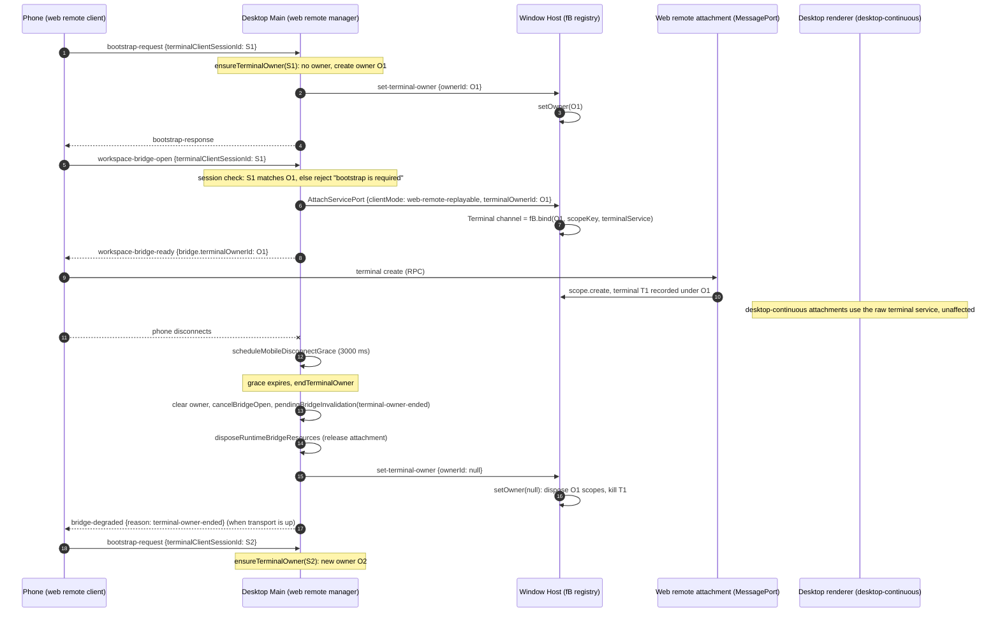

# Port 3.16.3: terminals scoped to an owner window

Status: analysis only, not ported.

Blockers (details below): the phone-side producer of `terminalClientSessionId` is not in the desktop bundle and the fork's phone client (`packages/web`) does not send it. Porting only the desktop half would change the lifetime of every phone terminal in the fork, so the port waits for the real 3.16.3 source.

## Evidence and method

Baseline: `integration` at `809fab71`; fork = upstream 3.16.2 (`3c5b2276`) plus fork features (`specs/upstream-sync-3.16.2.md`). Evidence: the extracted 3.16.3 app `asar/out/` (`main/`, `host/`, `preload/`, `renderer/assets/`) and `zcode.cjs`, read-only. Identifiers wrapped by the bundler as `i(fn, "name")` keep the source name (`createWindowHostTerminalOwners`, `createTerminalScope`, `endTerminalOwner`, `ensureTerminalOwner`, `setTerminalOwner` are reliable); other minified names are cited only as locations.

| Concern                    | Bundle anchor                                                                                                                                                       | Fork anchor                                                                         |
| -------------------------- | ------------------------------------------------------------------------------------------------------------------------------------------------------------------- | ----------------------------------------------------------------------------------- |
| Host owner registry        | `host/index.js` `createWindowHostTerminalOwners`                                                                                                                    | none                                                                                |
| Host terminal scope        | `host/index.js` `createTerminalScope`                                                                                                                               | none                                                                                |
| Host attachment with owner | `host/index.js` `exposeServicesOnMessagePort` (terminal override, attachment scope)                                                                                 | `packages/desktop/src/host/index.ts` `exposeServicesOnMessagePort`                  |
| Host set-owner message     | `host/index.js` `SetTerminalOwner` branch                                                                                                                           | `packages/desktop/src/host/index.ts` `AttachServicePort` branch                     |
| Host dispose               | `host/index.js` (setOwner(null), then dispose)                                                                                                                      | `disposeAttachedServicePorts`                                                       |
| Main owner state           | `main/index.js` `endTerminalOwner` / `ensureTerminalOwner`                                                                                                          | none                                                                                |
| Main bootstrap             | `main/index.js` `bootstrap-request` case (passes `terminalClientSessionId`)                                                                                         | `packages/desktop/src/main/webRemoteControlManager.ts` `routePayload`               |
| Main bridge open           | `main/index.js` session check, `buildWorkspaceBridge` (`terminalOwnerId`)                                                                                           | `webRemoteControlManager.ts` `buildWorkspaceBridge`                                 |
| Main mobile grace          | `main/index.js` `scheduleMobileDisconnectGrace` (calls `endTerminalOwner`)                                                                                          | `webRemoteControlManager.ts` `scheduleMobileDisconnectGrace` (no owner end)         |
| Main app failure           | `main/index.js` failure path (calls `endTerminalOwner`)                                                                                                             | `webRemoteControlManager.ts` failure path                                           |
| Main Host bridge           | `main/index.js` `createWebRemoteControlSharedHostAttachments` (`setTerminalOwner`, `attachWorkspaceHost` with `terminalOwnerId`)                                    | `packages/desktop/src/main/webRemoteControlSharedHostAttachments.ts`                |
| Shared host message        | `host/chunk-5YNPFY3L.js` `HostMessageTypes.SetTerminalOwner: "set-terminal-owner"`                                                                                  | `packages/shared/src/channels.ts`                                                   |
| Shared schemas             | `renderer/assets/validation-*.js` (`bootstrap-request`, `workspace-bridge-open`, bridge descriptor, `bridge-degraded`, `attach-service-port`, `set-terminal-owner`) | `packages/shared/src/validation.ts` and `packages/shared/src/web-remote-control.ts` |

## What 3.16.3 does

A phone (the mobile "terminal" role in relay V2) is a terminal page session. The desktop window that serves it owns one terminal owner at a time. Terminals that a phone creates through its web-remote attachment belong to that owner; when the owner ends, those terminals are disposed. Only `web-remote-replayable` attachments are scoped; `desktop-continuous` attachments keep the raw terminal service.

### Owners

| Owner                                         | Owned by                                                 | Identity                                                                                                                                                        | Created by                                       | Ended by                                                                                                                                                              |
| --------------------------------------------- | -------------------------------------------------------- | --------------------------------------------------------------------------------------------------------------------------------------------------------------- | ------------------------------------------------ | --------------------------------------------------------------------------------------------------------------------------------------------------------------------- |
| Main terminal owner (`runtime.terminalOwner`) | `main/index.js` `endTerminalOwner`/`ensureTerminalOwner` | `{ clientSessionId, id }`; `clientSessionId` is the phone's `terminalClientSessionId`; `id` is a fresh random value (same helper as start-authorization tokens) | `ensureTerminalOwner` on `bootstrap-request`     | `endTerminalOwner`: bootstrap without `terminalClientSessionId` (only if an owner exists), bootstrap with a different id, mobile disconnect grace expiry, app failure |
| Window Host registry                          | `host/index.js` `createWindowHostTerminalOwners`         | one per window Host process (module-level)                                                                                                                      | `SetTerminalOwner` message (`setOwner(ownerId)`) | `setOwner(null)` (message or `disposeAttachedServicePorts`) or a replacing `setOwner(otherId)`                                                                        |
| Terminal scope (`createTerminalScope`)        | `host/index.js`                                          | one per (owner, scopeKey) with `scopeKey` = `"local"` or `remote:<remoteSessionId>`; or one per web-remote attachment when no owner is given                    | first `bind` for the key, or attachment setup    | owner change or Host dispose (owner scope); attachment close (attachment scope)                                                                                       |

Terminal scope semantics:

- `create` checks the scope is active, creates through the underlying service, and records the terminal id with an exit subscription. If the scope was disposed during the await, the new terminal is disposed and the call throws `Terminal owner has ended`.
- `write`, `resize`, `onDynamicData`, `onDynamicExit` throw `Terminal owner has ended or does not own this terminal` unless the terminal id is owned by the scope.
- `dispose({id})` is a silent no-op when the scope is inactive or does not own the id. Otherwise it releases the terminal in the underlying service.
- `dispose()` marks the scope inactive and releases every owned terminal. Release failures go to the `onError` callback (`failed to dispose mobile terminal owner` for the owner registry, `failed to dispose mobile attachment terminal` for attachment scopes).

Owner registry semantics:

- `setOwner(id)` is a no-op when `id` equals the current owner. Otherwise it replaces the owner and disposes every scope of the previous owner (terminals are killed). `setOwner(null)` clears the owner.
- `bind(ownerId, scopeKey, underlying)` throws `Terminal owner has ended` when `ownerId` is not the current owner. Otherwise it returns the scope service for `scopeKey`, creating the scope on first use. The `underlying` service is captured on first use of a key; later binds for the same key ignore the argument.

### Attachment wiring (`exposeServicesOnMessagePort`)

For each attachment the Host computes `attachment services.getOptional(ITerminalService)`:

- If `clientMode === "web-remote-replayable"` and the terminal service exists:
  - With `terminalOwnerId`: the Terminal channel is `registry.bind(ownerId, scopeKey, service)`. The scope survives the attachment; only owner end or a Host dispose kills its terminals.
  - Without `terminalOwnerId`: the Terminal channel is a per-attachment scope. Its terminals are disposed when the attachment closes.
- `desktop-continuous`: no Terminal override; behavior unchanged from 3.16.2.

Consequence of the "without owner" branch: before 3.16.3 (the fork today) a phone attachment has no terminal scope, so phone terminals survive attachment close. In 3.16.3 an attachment without an owner kills its terminals on close.

### Main owner lifecycle

`ensureTerminalOwner(runtime, clientSessionId)`, called from `bootstrap-request`:

1. `clientSessionId` undefined: if an owner exists, `endTerminalOwner`; otherwise no-op.
2. Same `clientSessionId` as the current owner: no-op.
3. Otherwise `endTerminalOwner` (if an owner exists), then a new owner `{clientSessionId, id}`, then `setTerminalOwner(windowId, id)`.

`endTerminalOwner(runtime)`, in this order:

1. Remember whether an owner existed and clear `runtime.terminalOwner`.
2. `cancelBridgeOpen`.
3. If `runtime.currentBridge` exists, set `pendingBridgeInvalidation = { zcode_type: "bridge-degraded", bridgeSessionId, bridgeGeneration?, recoveryId?, reason: "terminal-owner-ended" }`. This happens even when no owner existed (see Reconciling).
4. `disposeRuntimeBridgeResources`: dispose bridge pipes and release the attachment (`releaseWorkspaceHostAttachment`, which closes the port).
5. If an owner existed, `setTerminalOwner(windowId, null)` so the Host kills the owner's terminals.
6. `sendPendingBridgeInvalidation`: send now if the transport is up; otherwise it stays pending.

Other triggers:

- Mobile disconnect: `scheduleMobileDisconnectGrace` fires after 3000 ms (fork: `MOBILE_DISCONNECT_STATUS_GRACE_MS = 3_000`). If it fires while the runtime is current and not in `error`, it calls `endTerminalOwner`, sets `status = "running"` and `mobileConnected = false`, then emits status. A reconnect clears the timer first (`clearMobileDisconnectGraceTimer`).
- App failure: posts `app-error`, then `endTerminalOwner`, then the usual disposal.

### Bridge open

- Session check: if the request carries `terminalClientSessionId` and it differs from the current owner's `clientSessionId`, reject with `Terminal page session has ended; bootstrap is required.`.
- `buildWorkspaceBridge`: `terminalOwnerId = request.terminalClientSessionId ? runtime.terminalOwner?.id : undefined`. It is put on the bridge and passed to `attachWorkspaceHost` as `terminalOwnerId` (only when defined). Local kind passes it in `AttachServicePort`; remote kind passes it to `attachRemoteWorkspaceSessionHost`, which posts `AttachServicePort` to the owning window Host with `scope: {kind: "remote", remoteSessionId, workspacePath, workspaceIdentity}`.
- The bridge descriptor sent to the phone (`toExternalBridge`, carried in `workspace-bridge-ready`) includes `terminalOwnerId` when set.

### Host side messages

- `set-terminal-owner` (`HostMessageTypes.SetTerminalOwner`): Main posts `{ type: "set-terminal-owner", ownerId: string | null }` to the window Host process. Silently a no-op when the process is missing. The Host has no reply.
- `attach-service-port`: gains an optional `terminalOwnerId`. The Host defers a local attachment while the database is starting (`pendingStartupAttachments`); the owner id is captured in the deferred closure, so `bind` runs at attach time. An owner change between queueing and attach makes `bind` throw; the Host catches it and logs `failed to attach scoped service port`.

## Event order



Alternative branch: a second phone page bootstraps with `S2` while `O1` is live. `ensureTerminalOwner` ends `O1` (bridge invalidated, `setTerminalOwner(null)`, then `setTerminalOwner(O2)`). The Host disposes O1's scopes in `setOwner(O2)`. A stale bridge request carrying `S1` is rejected by the session check.

## Interfaces and message schemas

Deltas from the fork, all optional or additive. Each new field needs strict types and runtime validation.

Host message (`packages/shared/src/channels.ts` `HostMessageTypes`):

```ts
SetTerminalOwner: "set-terminal-owner", // placed after DisposeRemoteWorkspaceSession, before AttachServicePort
```

Host message schema (`packages/shared/src/validation.ts`):

```ts
z.object({ type: z.literal("set-terminal-owner"), ownerId: z.string().nullable() }).strict();
```

- Attach (`attach-service-port`, validation.ts): add `terminalOwnerId: z.string().optional()` after `type`.
- Phone to Main (`bootstrap-request`, `workspace-bridge-open`): add `terminalClientSessionId: z.string().optional()`.
- Bridge descriptor (discriminated on `kind`, both `local` and `remote` variants): add `terminalOwnerId: z.string().optional()` (type in `packages/shared/src/web-remote-control.ts`).
- Bridge degraded: add `"terminal-owner-ended"` to the `reason` enum. The fork enum has `source-session-replaced` in validation.ts but not in the TypeScript interface; that gap predates this port and should be kept as is.

Internal interfaces (names from the bundle):

- Host: `createWindowHostTerminalOwners(onDisposeError)` returns `{ setOwner(ownerId: string | null): void; bind(ownerId: string, scopeKey: string, service: ITerminalService): ITerminalService }`.
- Host: `createTerminalScope(service: ITerminalService, onError: (error: unknown) => void): { service: ITerminalService; dispose(): void }`.
- Main: `createWebRemoteControlSharedHostAttachments` returns `setTerminalOwner(windowId: number, ownerId: string | null)`. `attachWorkspaceHost` context gains `terminalOwnerId?: string`.

## Acceptance scenarios

Desktop-continuous (desktop real-time link, `clientMode: "desktop-continuous"`):

1. Desktop creates a terminal, phone bootstraps with a new id, and then the phone disconnects for more than 3 s. The desktop terminal keeps running and its output keeps streaming. Owner changes never touch it.
2. `attach-service-port` for `desktop-continuous` never carries `terminalOwnerId`. The Terminal channel is the raw service. The attachment close does not dispose its terminals.
3. A `set-terminal-owner` message does not change the raw service for desktop attachments.

Web-remote-replayable (mobile recovery link, `clientMode: "web-remote-replayable"`):

4. Bootstrap with `S1`, bridge open with `S1`. Phone creates terminal T1. The bridge is rebuilt (`bridge-degraded` with a non-owner reason such as `rpc-transport-fault`) without a bootstrap. T1 survives. The new bridge uses the same `terminalOwnerId`.
5. Phone disconnects and reconnects within 3 s. The grace timer is cleared. The owner and T1 survive.
6. Phone disconnects for more than 3 s. `endTerminalOwner` runs. T1 is killed. The `bridge-degraded` payload with reason `terminal-owner-ended` stays in `pendingBridgeInvalidation` until the transport next flushes it. A later bootstrap creates a new owner.
7. Bootstrap with `S2` while `S1` is live. The bridge for `S1` is invalidated. T1 is killed. A bridge request carrying `S1` is rejected with `Terminal page session has ended; bootstrap is required.`.
8. Bridge open without `terminalClientSessionId` on a window with no owner gets a per-attachment scope. Its terminals are disposed when the attachment closes. The fork today keeps them.
9. Remote workspace: the same as 4 to 7 with `scopeKey = remote:<remoteSessionId>`. Two remote sessions on one owner keep separate scopes. Disposing one remote session does not kill the other's terminals.
10. Race: the owner changes between `AttachServicePort` queueing (startup) and attach. `bind` throws, the attachment fails, and the phone must bootstrap again.

Invariants for both links: no change to `desktop-continuous` owner, snapshot or gap-recovery boundaries; relay V2 remains forwarding-only (no owner state in the relay); Main holds only the owner id and bridge runtime; the Host owns the scopes.

## Divergences from the fork (3.16.2 plus fork features)

- The fork has no owner state in `webRemoteControlManager.ts`; `bootstrap-request` does not call `ensureTerminalOwner`, and the bridge open path does not check owner state.
- The fork's `scheduleMobileDisconnectGrace` does not end any owner; 3.16.3 ends the owner in the grace callback.
- The fork's Host has no `ITerminalService` scoping; phone terminals are not owned or disposed by the attachment today.
- The fork's `disposeAttachedServicePorts` does not clear an owner, because no owner exists.
- The fork's phone client (`packages/web/src/main.tsx`) sends `bootstrap-request` and `workspace-bridge-open` without `terminalClientSessionId`. It handles `bridge-degraded` generically (`recoverVisibleSession(reason)`). Whether that recovery re-bootstraps on `terminal-owner-ended` is not shown.
- The fork's relay V2 has a `terminal_sid` in `auth_ack` (`packages/remote-relay/src/app/relay.ts`, `packages/shared/src/web-remote-relay/contract.ts`), assigned by the relay per phone connection. It is one candidate for the phone's id, but the bundle does not confirm it.

## Blockers

1. The producer of `terminalClientSessionId` is not in the desktop bundle. The field appears only as schema declarations and as reads in `main/index.js`; no file assigns it a value, so the phone is the producer and its 3.16.3 source is not in this artifact. The renderer `styles-*.js` `terminalOwnerId` is a separate renderer xterm cache owner (`releaseStaleOwner(clientNamespace, owner)`), not the Host owner.
2. If only the desktop half is ported, an owner-less phone attachment gets a per-attachment scope (behavior 8): every bridge rebuild or reconnect that drops the attachment kills the phone's terminals. The fork's phone client never sends an id, so the port would regress the fork's `web-remote-replayable` recovery link.
3. Choosing the id source (per page load, per phone session in storage, or relay `terminal_sid`) and how the fork's phone client recovers after `terminal-owner-ended` is design work in `packages/web` and the relay client. The bundle does not say which one upstream uses, so guessing would be a fallback hack.
4. Remote-session scope capture: `bind` keeps the first `underlying` service per scope key. Whether a remote session generation change leaves a stale service in the owner scope is not verified from the bundle; the fork's `windowRemoteConnectionRegistry.resolveScopedServices` may differ.

Gate result: blockers 1 to 3 make the behavior unverifiable with high confidence. Porting would require guessed design in fork-owned phone client code. Status stays "analysis only".

## Reconciling with the real 3.16.3 source

Check these against the upstream source when it is published:

- Names: `createWindowHostTerminalOwners`, `createTerminalScope`, `endTerminalOwner`, `ensureTerminalOwner`, `setTerminalOwner`, `SetTerminalOwner`, `set-terminal-owner`, `terminal-owner-ended`, and the `terminalOwnerId` / `terminalClientSessionId` field names.
- Source of `terminalClientSessionId` on the phone (per page load, persisted, or relay `terminal_sid`), and whether it survives a reload.
- `endTerminalOwner` invalidates the current bridge even when no owner existed (a bootstrap with a new id invalidates a bridge opened without an owner). Confirm this is intended.
- `ensureTerminalOwner` does not end an owner for a bootstrap without an id when none exists. Confirm.
- Whether the mobile grace timer is 3000 ms in source (bundle `3e3`).
- Whether `bind` should capture the underlying service per call (bundle keeps the first).
- Whether `setOwner(id)` disposes the previous owner's terminals before or after the new owner is installed (bundle: installs first, then disposes the old scopes).
- Whether the phone-side `bridge-degraded` handler re-bootstraps on `terminal-owner-ended`.
- Error message strings: `Terminal owner has ended`, `Terminal owner has ended or does not own this terminal`, `Terminal page session has ended; bootstrap is required.`, `failed to dispose mobile terminal owner`, `failed to dispose mobile attachment terminal`.
- Whether bundle-only 3.16.3 host code paths for remote sessions (`attachRemoteWorkspaceSessionHost` passing `terminalOwnerId`) have the same shape in the fork's `desktopRemoteSessions`/`windowRemoteConnectionRegistry` code.

## Next step

When upstream 3.16.3 source is published, re-run this analysis against it. Then port in one change: Host (`createWindowHostTerminalOwners`, `createTerminalScope`, `exposeServicesOnMessagePort`), Main (`webRemoteControlManager.ts` owner lifecycle, `webRemoteControlSharedHostAttachments.ts`), shared schemas, and the phone client (`packages/web`). Tests come first: registry and scope unit tests, message validation tests, and the acceptance scenarios 1 to 10 for both links.
