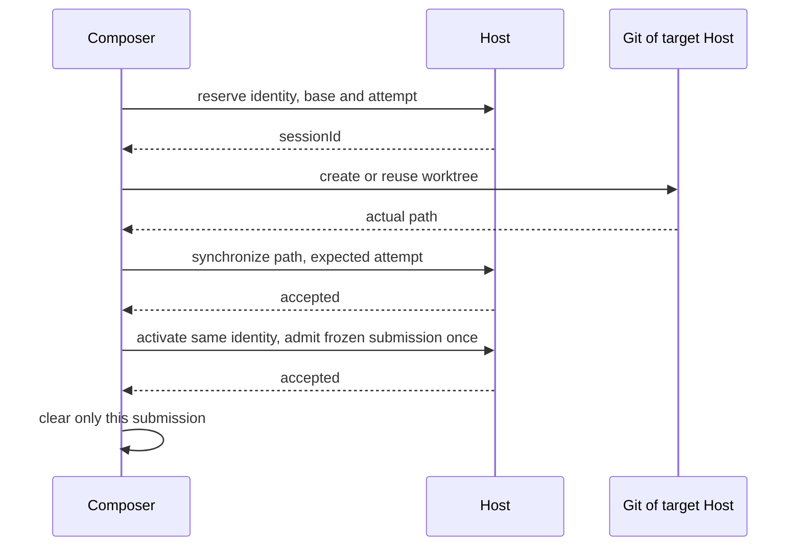

# Reliability review: October 17

## Ownership and compatibility

This supplements composer-worktree-setup-steps.md, composer-branch-switcher-semantics.md,
manage-sessions-table.md and chatgpt-plan-signin.md. Existing sessions and migration definitions
remain readable. No fork state is added to setting.json.

The CLI Host owns durable preparation (session, attempt, base branch, actual path and terminal
status). Renderer owns only uncommitted submission snapshots. A submission freezes workspace
identity, draft scope, revision and attachment ids; callbacks cannot mutate a different owner.
Navigation detaches delivery; explicit cancellation persists before local terminal presentation.
Retry retains the session and creates a new attempt. Every late result checks that attempt.

Recovery is explicit: keep the submitted message and attachment manifest in the session recovery
scope, leave newer text untouched, and offer Restore only when the editor is empty. Missing
non-durable file sources after reload require reattachment or explicit removal before sending.
Only submitted attachments move from draft to prepared scope; later additions stay in the draft.

## Target routing

Git branch listing, switching, worktree creation, retry and reconcile resolve the full workspace
target through the existing workspace service resolver. Disconnected remote targets never use
local services. The target Host supplies its global worktree directory through getWorktreeStorageInfo.
Old Hosts without this method cannot offer global storage. Other location modes are preserved.

## Authentication

Usage grant writes and logout share the account refresh lock. A persistent fork credential epoch
invalidates older Link operations and usage snapshots, including across service instances.
Network exchange occurs outside the lock; epoch and signed-in membership are checked inside it
before commit. Stale issued grants are revoked. Inference SIWC and usage grants remain separate.
Forced resolution may join a real refresh, but cannot be satisfied by an ordinary cached read.
Rotation stays serialized per account; one cancelled waiter does not cancel other waiters.

## Dream and process cleanup

Dream marker changes are serialized with the existing file lock and identify a unique run token.
Only that owner may finish or restore its marker. Live runs are not reclaimed by age. Successful
runs retain the one-hour manual cooldown and daily automatic gate; failures do not stamp success.
Legacy PID markers are readable.

ACP cleanup owns the process tree, including descendants remaining after the root exits. Shared
Node process-tree helpers retain identity checks, POSIX group ownership and bounded Windows
cleanup; remaining processes are an explicit failure rather than a false stopped success.

## Sessions settings

Sessions stays inside Settings. Open ensures the target workspace is open before selecting the
existing session through normal navigation. Unavailable targets leave Settings visible with an
error. Archived ignores Pinned and disables its toggle while preserving the Active preference.

## Acceptance evidence

Each review finding (1–13) needs a behavioral regression. Cover old submission A versus current
draft B, new text in A, attachment handoff/cleanup, restart/base, cancelled preparation, stale
attempts, rejected marker sync, identical paths on different remote Hosts, disconnect/reconnect,
logout during refresh/Link/probe, forced refresh coalescing, stale Dream takeover, ACP descendants
and Settings Back/Open/Archived. Both continuous Desktop and replayable remote recovery keep the
same Host owner. Platform process tests cover macOS/Linux and Windows.
