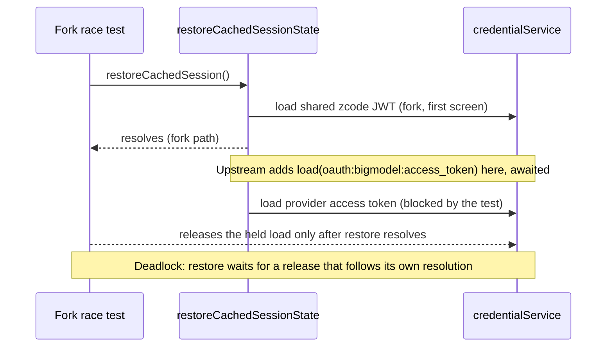
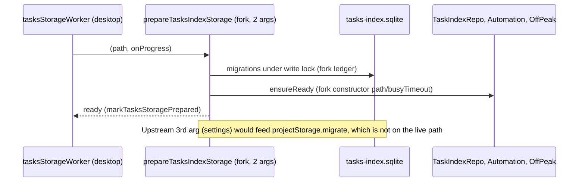

# Services Upstream Sync, Part 4 (3.16.1): deferred leftovers

Parent spec: `specs/services-upstream-sync.md`. Base `aac47556` (v3.15.1), target `0a1fc56d` (v3.16.1). Branch `claude/upstream-sync-services-4` is based on `origin/claude/upstream-sync-ui` (#215), which already carries the services change from G5 (window-controller unread producer, owner-direct `getTaskMeta`).

This part closes the items deferred in 8b and 8c, one file per commit. Where the fork never changed behavior (fork == base), the upstream behavior and test win. Where the fork changed behavior on purpose, the fork test is the spec.

## Decisions carried in (not reopened here)

- `packages/server/src/http.ts`: the fork keeps `/api/connect-remote` and `/ws/remote/:id` (fork remote features and bots `/remote` depend on them, see `specs/bot-remote-command.md`). Every other upstream hunk is taken.
- The fork `zcodeTask*` path is the single writer of task state (AGENTS.md single-owner rule). Upstream `task-facts` and `task-groups` stay unwired.
- The grouped-view surface (`ZCodeGroupedTaskView`) stays fork-owned. It moves to UI-2 together with the sidebar switch.

## 1. `packages/server/src/http.ts` (done)

Owners: the HTTP layer owns routing and auth order. It owns no task state.

Applied upstream hunks: `hostname`/`userInfo` and the `nodePath` namespace import; the containment helper (`isInsideDirectory` with an injectable `pathApi`, absolute `relative` results treated as outside, `isPathDriveQualified` rejected before `resolve`); `Bearer` token acceptance in `hasValidLiteToken`; `resolveHttpServerId` (exported); the richer `serverRemoteInfoOutputSchema` payload (`compatibility`, `migration`, `identity`, `virtualProjects`); optional `workspaceIdentityMapper`, `virtualProjects`, `migrationFailedPathCount` options. The identity mapper is optional and falls back to the plain `LoggingChannelServer`, because server-cli #205 is not in this base.

Fork kept: `/api/connect-remote`, `/ws/remote/:id` and their `createRemoteConnectionStore`, the derived `authRequired`, `resolveHttpListenHost`, and the standalone window controller.

Tests: `serverInfoHttp.test.ts` (upstream payload expectations, plus `keeps the fork web-mode remote routes reachable`: the POST returns 400 for an invalid body, and an unknown `/ws/remote/:id` closes with 4004). `staticRoutePathContainment.test.ts` (upstream, waits for `listeningAddress` instead of reading `address()` synchronously).

## Status and remaining items

Items 2 to 7 are tracked in the sections below and updated per commit.

## 2. `bots/botsService.ts`, `BotsRepo.updateContext` (deferred, design decision needed)

Upstream binds each bot context to a project from the project catalog (`readContext` → `bindProject`, `workspaceRefsFromCatalog`, `context.projectId`). The fork binds a context to a workspace (`workspaceId`, `resolveCanonicalContextWorkspace`, settings-derived `listWorkspaceRefs`). The two models cannot both own a context: a hunk-level port would leave two write paths for the same bot context (AGENTS.md single-owner rule).

Not applied: `BotsRepo.updateContext` (no caller without the binding), the project deps on `BotsServiceDeps`, and `bindProject`. The desktop consumer (`remoteWorkspaceServiceCollection.ts`) passes no project deps and still compiles. Upstream's `projectService` is required, so making it required would break that consumer. Adopting project binding for bots is a product decision (workspace model), to be aligned with the user first. `/remote` and `botRemote*` are unchanged.

## 3. `zcode-agent/zcodeTaskServiceAdapter.ts` and `zcodeTaskIndexSyncer.ts` (partly done, ownership kept)

Owner: the fork `zcodeTask*` path is the only task-state writer. Upstream's `task-facts` writes (`mutateSessionFacts`, `updateIndexedPresentation`, `syncTaskIndexSnapshot`) are not taken.

Taken (non-ownership, pass-through only):

- `resumeSnapshot` forwards `additionalDirectories` when defined.
- `createTask` forwards `projectId` and `additionalDirectories` to `zcodeAgentService.createSession` only when the caller supplies them. Upstream always sends `projectId: params.projectId ?? null`; the fork agent service throws `project.creation-unavailable` for any defined `projectId` when no project creation port is wired, so an unconditional `null` would break task creation. This is a deliberate departure from upstream.
- Contract: `ZCodeTaskService.createTask` gains the two optional fields (`session/zcodeTaskService.ts`).
- Test: `zcodeLegacyTaskCompatTaskIndex.test.ts` "forwards project and directory fields to createSession only when the caller supplies them".

Still at fork HEAD (per hunk, ownership or fork-decided): overlay writes (`TaskOverlay`, `applyOverlayToMeta`), `closeTask` and deletion writes, `initializeGroupedTaskAtTop`, every `syncTaskIndexMeta` to `updateIndexedPresentation` rename, `moveGroupedTaskToTop`, live tool projection. The `zcodeTaskIndexSyncer.ts` upstream diff is task-facts writes only and is not taken.

## 4. `zcode-agent/zcodeAgentService.ts` (verified present or fork-decided)

Checked by name and behavior against the upstream hunks: `additionalDirectories` plumbing in create and resume params, `PendingSessionRuntimePreferencesRequest.workspace`, off-peak lifecycle and plugin UI tool result emitters with their notification parsing and disposal, `resolveSessionDirectories` in subscribe with the subagent lineage check, `historyFirst` subscribe, `prepareSessionCreation` and project creation guard, `reconcileSessionsIndexV4`.

Fork-decided, not taken: the `refreshRegistry` barrier on `ensureAccountProviderConfigSynced` (8c; the fork test pins that createSession sends no refresh), `includeArchived` removal in `sessionList` (the fork archive repair uses it), `updateTaskPresentation` in the automation path (the fork owner is `syncTaskMeta`, see 8c).

Not verified hunk by hunk: the remaining body differences are fork-changed code; treat this as a presence check, not a complete review.

## 5. `session/taskIndexRepo.ts` non-group hunks (deferred)

Upstream constructor `(migrationSettings, storageHostId, startupDbPath, busyTimeout)` feeds `projectStorage.migrate` and `admitTaskIdentity`. The fork's live migration path (`session/tasksDatabase/migrations.ts`) does not call `projectStorage.migrate`; the only callers are tests and the unwired upstream repo. Adopting the constructor means wiring project schema migrations (`0005_projects`, `0006_default_workspace_tasks`) into the shared tasks database, which changes the shared migration ledger. That is a DB design decision, so it is deferred with the project binding work. The grouped surface (`ZCodeGroupedTaskView`) stays fork-owned until UI-2.

## 6. `oauth/oauthService.ts`: business JWT expiry check (deferred, verified)

Upstream's restore checks the provider access token (`oauth:<provider>:access_token`) in addition to the shared JWT. The fork's restore path reads only the shared JWT, by design: a provider token read on the first-screen restore re-blocks the background BigModel migration (comment in `restoreCachedSessionState`).

Experiment (reverted): adding the provider token read to the restore path makes `does not send zai token to BigModel when migration token load races with provider switch` time out at 8 s. The test holds the first `oauth:bigmodel:access_token` load and releases it only after `restoreCachedSession()` resolves, so an await on that load inside restore can never finish. This is the await that hangs, and no delay-based fix is acceptable. The check cannot coexist with that test as specified, so it stays deferred.

## 7. `project-storage` startup, 3-argument `prepareTasksIndexStorage` (deferred)

The desktop worker keeps the 2-argument call (marked `DEFERRED`); no consumer passes settings, so the fork signature stays. Upstream's third argument (`settings`) only seeds project records through `TaskIndexRepo` → `projectStorage.migrate`. Until the project schema migrations are part of the live fork path (section 5), an optional third argument would be accepted and ignored. That is dead surface, so it is not added. `project-storage/startup-entry.ts` is identical to upstream.

## 8. `window-controller` base

Branch is based on `origin/claude/upstream-sync-ui` (#215), which carries the G5 window-controller change. No further change in this PR.

## Verification log

- Typecheck: `pnpm exec tsc -b packages/services` and `packages/server` pass after the changes above.
- Tests run: `serverInfoHttp.test.ts`, `staticRoutePathContainment.test.ts`, `botsHttp.test.ts`, `remoteConnectionStore.test.ts` (44 pass); `zcodeLegacyTaskCompatTaskIndex.test.ts` (110 pass).
