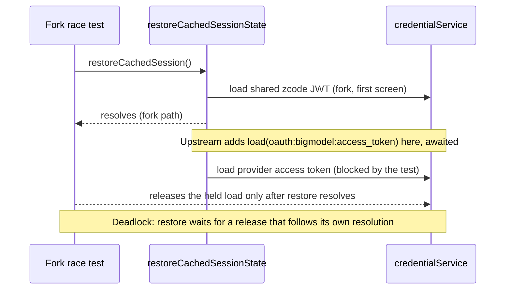
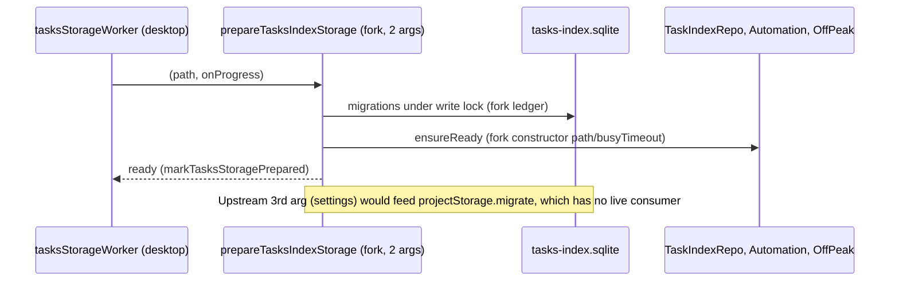

# Services Upstream Sync, Part 4 (3.16.1): deferred leftovers

Parent spec: `specs/services-upstream-sync.md`. Base `aac47556` (v3.15.1), target `0a1fc56d` (v3.16.1). Branch `claude/upstream-sync-services-4` is based on `origin/claude/upstream-sync-ui` (#215), which already carries the services change from G5 (window-controller unread producer, owner-direct `getTaskMeta`).

This part closes the items deferred in 8b and 8c, one file per commit. Where the fork never changed behavior (fork == base), the upstream behavior and test win. Where the fork changed behavior on purpose, the fork test is the spec.

## Coordinator decisions carried in (not reopened here)

- `packages/server/src/http.ts`: the fork keeps `/api/connect-remote` and `/ws/remote/:id` (fork remote features and bots `/remote` depend on them, see `specs/bot-remote-command.md`). Every other upstream hunk is taken.
- The fork `zcodeTask*` path is the single writer of task state (AGENTS.md single-owner rule). Upstream `task-facts` and `task-groups` stay unwired.
- The grouped-view surface (`ZCodeGroupedTaskView`) stays fork-owned. It moves to UI-2 together with the sidebar switch.

## Status

| #   | Item                                                                            | Result                                                                                                                                     | Commit                              |
| --- | ------------------------------------------------------------------------------- | ------------------------------------------------------------------------------------------------------------------------------------------ | ----------------------------------- |
| 1   | `server/src/http.ts`                                                            | Done. Upstream hunks taken, fork routes kept and tested.                                                                                   | `6f4f7932`                          |
| 2   | `bots/botsService.ts`, `BotsRepo.updateContext`                                 | Not done. The coordinator decision is reopened (section 2).                                                                                | none                                |
| 3   | `zcodeTaskServiceAdapter.ts`, `zcodeTaskIndexSyncer.ts`, `zcodeAgentService.ts` | Partly done: adapter pass-through of `projectId` and `additionalDirectories` on the create paths. The rest stays at fork HEAD (section 3). | `c5db924a` and the follow-up commit |
| 4   | `session/taskIndexRepo.ts` non-group hunks                                      | Deferred (section 5).                                                                                                                      | none                                |
| 5   | `oauth/oauthService.ts` business JWT expiry                                     | Deferred, with a verified blocking await (section 6).                                                                                      | none                                |
| 6   | `prepareTasksIndexStorage` 3-argument form                                      | Deferred: no live consumer for the settings argument (section 7).                                                                          | none                                |
| 7   | `windowController` base                                                         | Base is `origin/claude/upstream-sync-ui`; nothing further.                                                                                 | n/a                                 |

## 1. `packages/server/src/http.ts` (done)

Owner: the HTTP layer owns routing and auth order. It owns no task state.

Applied upstream hunks: `hostname`/`userInfo` and the `nodePath` namespace import; the containment helper (`isInsideDirectory` with an injectable `pathApi`, absolute `relative` results treated as outside, `isPathDriveQualified` rejected before `resolve`); `Bearer` token acceptance in `hasValidLiteToken`; `resolveHttpServerId` (exported); the richer `serverRemoteInfoOutputSchema` payload (`compatibility`, `migration`, `identity`, `virtualProjects`); optional `workspaceIdentityMapper`, `virtualProjects` and `migrationFailedPathCount` options.

Identity mapper placement: the mapper is passed to `/ws` and `/ws/host` only. The fork `/ws/remote/:id` route serves a different backend (an SSH/Docker target), and the mapper translates this server's own source-server identities. That route passes `undefined`, so its behavior is unchanged. The mapper is optional and falls back to the plain `LoggingChannelServer`, because server-cli #205 is not in this base.

Fork kept: `/api/connect-remote`, `/ws/remote/:id` and their `createRemoteConnectionStore`, the derived `authRequired`, `resolveHttpListenHost`, and the standalone window controller.

Tests: `serverInfoHttp.test.ts` (upstream payload expectations, plus `keeps the fork web-mode remote routes reachable`: the POST returns 400 for an invalid body, and an unknown `/ws/remote/:id` closes with 4004). `staticRoutePathContainment.test.ts` (upstream, waits for `listeningAddress` instead of reading `address()` synchronously).

## 2. `bots/botsService.ts` and `BotsRepo.updateContext` (not done; coordinator decision reopened)

The coordinator decision was to adopt upstream's project binding additively, through optional deps. It is not done here, and the reason is below, so the decision needs to be made again.

- Upstream binds each bot context to a project from the project catalog (`readContext` → `bindProject`, `workspaceRefsFromCatalog`, `context.projectId`). The fork binds a context to a workspace (`workspaceId`, `resolveCanonicalContextWorkspace`, settings-derived `listWorkspaceRefs`).
- No host in this repo passes `projectService` into `createBotsService`. Desktop-3 (`remoteWorkspaceServiceCollection.ts`) and the services `node.ts` both omit it. An additive port would therefore be inert everywhere today, and it would still add a second context-write path next to the fork's (AGENTS.md single-owner rule).
- Making `projectService` required, as upstream does, would break the unsynced desktop consumer.
- Not applied: `BotsRepo.updateContext`, the project deps on `BotsServiceDeps`, `bindProject`. `/remote` and `botRemote*` are unchanged.

Requested: re-decide whether bot workspace binding moves to projects in this sync, or stays on the fork's workspace model until the project feature is wired.

## 3. `zcode-agent/zcodeTaskServiceAdapter.ts`, `zcodeTaskIndexSyncer.ts`, `zcodeAgentService.ts`

### 3a. Adapter (done, pass-through only)

- `createTask` forwards `projectId` and `additionalDirectories` to `zcodeAgentService.createSession` only when the caller supplies them. Upstream always sends `projectId: params.projectId ?? null`. The fork agent service throws `project.creation-unavailable` for any defined `projectId` when no project creation port is wired, so an unconditional `null` would break task creation. This is a deliberate departure from upstream.
- The native v4 path (`v4Create: true`, used by bots) sends the same fields: `additionalDirectories` in the `createSession` envelope payload, and `projectId` at the `sendConversationCommandV4` call level under the same guard.
- Contract: `ZCodeTaskService.createTask` gains the two optional fields (`session/zcodeTaskService.ts`).
- The resume path is not changed. `resumeTask`'s contract cannot carry `additionalDirectories`, and the agent service already resolves the directories itself when the field is undefined. An adapter pass-through there would be dead code, so it is not added.
- Tests: `zcodeLegacyTaskCompatTaskIndex.test.ts` "forwards project and directory fields to createSession only when the caller supplies them" (legacy path and `v4Create` path, including the absent case).

### 3b. Syncer (not taken; ownership)

`zcodeTaskIndexSyncer.ts` upstream diff is 349 changed lines. Hunk classes, checked against the diff:

- Task-state writes through `task-facts`: `createTaskFacts`, `taskFacts.ingest`/`mutate`/`reconcile`/`removed`, `mirrorSummary`, `refreshSessionFacts`, `mutateSessionFacts`. Ownership: not taken.
- Fork-owned writes renamed upstream: `applyAgentPatch`, `updateTaskState`, `syncTaskMeta`, `seedTaskMetaIfMissing` become `updateTaskPresentation`, and `syncTaskMetaAtGroupedTop` is added. Not taken (fork writer).
- Grouped ordering: `moveGroupedTaskToTop`, `initializedGroupedOrder`. Not taken (fork grouped view, UI-2).
- Repair path: upstream imports `#src/task-facts/repairSubagentTaskIndex.js`. Not taken; the fork copy `zcode-agent/repairSubagentTaskIndex.ts` stays the only owner (main spec, single owners).
- Presentation and title derivation (`buildPresentationFromSnapshot`, removal of `deriveTitleFromSnapshot`): tied to the new writer. Not taken.
- Not taken, no current consumer: `activeTaskRefs()` (an observer for upstream auto-archive, which the fork does not wire), and removing the unused `_options` argument of `ensureSessionSubscription` (cosmetic).

### 3c. `zcodeAgentService.ts` (presence check by symbol name, not a full review)

Checked by symbol name only: `additionalDirectories` in create and resume params, `PendingSessionRuntimePreferencesRequest.workspace`, off-peak lifecycle and plugin UI tool result emitters with their parsing and disposal, `resolveSessionDirectories` in subscribe with the subagent lineage check, `historyFirst` subscribe, the `prepareSessionCreation` guard, `reconcileSessionsIndexV4`. A presence match does not prove the same behavior. The body differences are fork-changed code and have not been reviewed hunk by hunk.

Fork-decided, not taken: the `refreshRegistry` barrier on `ensureAccountProviderConfigSynced` (8c; the fork test pins that createSession sends no refresh), `includeArchived` removal in `sessionList` (the fork archive repair uses it), and `updateTaskPresentation` in the automation path (the fork owner is `syncTaskMeta`, see 8c).

## 4. Grouped surface and fork writer

Unchanged by this part. The grouped-view surface (`ZCodeGroupedTaskView`, `taskIndexRepo` group parts, `zcodeTaskListTypes.ts`) stays fork-owned until UI-2.

## 5. `session/taskIndexRepo.ts` non-group hunks (deferred, no live consumer)

Upstream constructor `(migrationSettings, storageHostId, startupDbPath, busyTimeout)` passes `migrationSettings` to `projectStorage.migrate` and calls `projectStorage.admitTaskIdentity`. The fork's constructor is `(startupDbPath, busyTimeout)`.

Verified: the fork's live tasks-database migration list (`session/tasksDatabase/migrations.ts`) contains neither upstream's `0005_projects` nor `0006_default_workspace_tasks`, and `git grep` finds no `projectStorage`, `PROJECT_SCHEMA_SQL` or `0005_projects` in that directory. Project-storage migrations run only through the unwired upstream repo and in tests. The constructor change therefore has no live consumer for its project seeding, and it is deferred until project binding is wired. This reason is about the missing consumer, not about the migration ledger.

## 6. `oauth/oauthService.ts`: business JWT expiry check (deferred, verified)

Upstream's restore checks the provider access token (`oauth:<provider>:access_token`) in addition to the shared JWT. The fork restore path reads only the shared JWT, by design: a provider token read on the first-screen restore re-blocks the background BigModel migration (comment in `restoreCachedSessionState`).

Experiment (reverted, file back to HEAD): adding the provider token read to the restore path makes `does not send zai token to BigModel when migration token load races with provider switch` time out at 8 s. The test holds the first `oauth:bigmodel:access_token` load and releases it only after `restoreCachedSession()` resolves, so an await on that load inside restore can never finish. This is the await that hangs, and no delay-based fix is acceptable. The check cannot coexist with that test as specified, so it stays deferred.

## 7. `project-storage` startup, 3-argument `prepareTasksIndexStorage` (deferred, no live consumer)

The desktop worker keeps the 2-argument call (marked `DEFERRED`). Upstream's third argument (`settings`) only seeds project records through `TaskIndexRepo` → `projectStorage.migrate`, and that path has no live consumer in the fork (section 5). An optional third argument would be accepted and then ignored, which is dead surface, so it is not added. `project-storage/startup-entry.ts` is identical to upstream.

## 8. `window-controller` base

The branch is based on `origin/claude/upstream-sync-ui` (#215), which carries the G5 window-controller change. No further change in this PR.

## Verification log

Recorded at the end of this section once the full run finishes.
