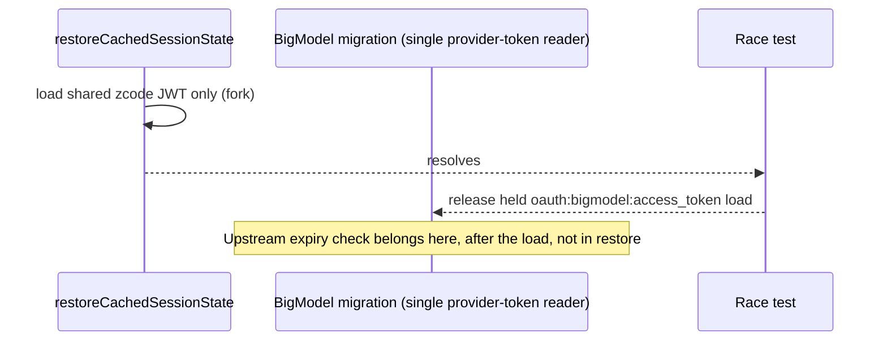

# Services Upstream Sync, Part 5: leftovers after part 4 (decision and ledger)

Parent spec: `specs/services-upstream-sync-part4.md`. Base `aac47556` (v3.15.1), target `0a1fc56d` (v3.16.1). This part is investigation and decisions only; no upstream code is ported here.

## Summary

| #   | Item                                                                   | Outcome in this part                                                                                                                                         |
| --- | ---------------------------------------------------------------------- | ------------------------------------------------------------------------------------------------------------------------------------------------------------ |
| 1   | Bots project binding (`bots/botsService.ts`, `BotsRepo.updateContext`) | Deferred. Blocked: upstream project storage queries tables the fork DB does not have, and no host instantiates a project service in services. See section 1. |
| 2   | `session/taskIndexRepo.ts` project migrations                          | Deferred. Fork live migration list has no `projects`/`project_roots`. Porting them is a shared-DB decision, not a services change. See section 2.            |
| 3   | `prepareTasksIndexStorage` 3-argument form                             | Deferred. Still no live consumer (part 4, section 7 still holds). See section 3.                                                                             |
| 4   | oauth business JWT expiry check                                        | Deferred. Analysis below; the restore path cannot host it. See section 4.                                                                                    |
| 5   | `zcodeAgentService.ts` hunk-by-hunk review                             | Not done in this part. Recorded as an open ledger row. See section 5.                                                                                        |

## 1. Bots project binding

Facts, verified in the worktree:

- Upstream `project-storage/project-repository.ts` reads `projects` and `project_roots`, writes `projects`, `project_roots`, and `tasks.project_id` / `tasks.handoff_pending`. These are created by upstream migration `0005_projects` and `0006_default_workspace_tasks`.
- The fork tasks database (`session/tasksDatabase/`) has no `projects` or `project_roots` table. The only fork `project_id` columns are `automations.project_id` and `off_peak_tasks.project_id` (`migrations.ts`). Upstream SQL hard-codes the table names, so a `9xxx_fork_*` migration cannot satisfy it without changing upstream-identical code.
- `createBotsService` has one non-test call site after the local-global removal: `packages/services/src/node.ts:2585`. It does not pass `projectService`. The desktop call site (`remoteWorkspaceServiceCollection.ts:392`) was removed with the local-global collection (`specs/upstream-sync-final-ledger.md`). `node.ts` has no `createProjectService` instance. `IProjectService` exists only as an optional accessor field (`accessor.ts:65`).

Consequence: if the upstream binding is ported and wired, a project-bound bot context would query missing tables at runtime. Porting it additively without wiring is inert. Either way it is not a safe change in this sync.

Decision: defer. Bot workspace binding stays on the fork's workspace model (`workspaceId`, `resolveCanonicalContextWorkspace`, `listWorkspaceRefs`). `BotsRepo.updateContext`, `/remote`, and `botRemote*` are unchanged. The fork `/remote` contract (`specs/bot-remote-command.md`) is not touched.

Single context-write path, for the future port: `BotsRepo.updateContext` is the only writer of bot context rows. Upstream `bindProject` must go through that method and must not add a second writer.

Ledger row: "bots project binding, owner `botsService` + `BotsRepo`, blocked on project tables in the fork DB (the desktop call site was removed with the local-global collection). Re-open when project storage is a live fork feature."

## 2. `session/taskIndexRepo.ts` project migrations

- Fork live migration list (`session/tasksDatabase/migrations.ts`) contains no upstream project tables (verified).
- Shared-DB rules (AGENTS.md): upstream migration definitions and checksums must not change. A new fork migration would have to be `9001_fork_*`, additive, with `fork_` tables. Upstream project SQL uses unprefixed names, so it cannot be reused as is.
- Therefore porting `0005_projects` is a schema decision (a fork-prefixed project schema) and not a services sync change. Deferred to a separate decision.

## 3. `prepareTasksIndexStorage` 3-argument form

Unchanged from part 4 section 7. The third argument feeds only `projectStorage.migrate`, which has no live consumer. Desktop keeps the 2-argument call. Not added.

## 4. oauth business JWT expiry check

Part 4 found that reading the provider access token on the restore path makes `does not send zai token to BigModel when migration token load races with provider switch` hang. The test holds the first `oauth:bigmodel:access_token` load and releases it only after `restoreCachedSession()` resolves.

- The fork test is the spec. Restore must not wait on the provider token. The check cannot run in restore as an awaited read.
- The provider token read already has an owner: the background BigModel migration path. Upstream's expiry check can coexist only if it runs after that load in the migration path, with that path remaining the single reader.
- Not ported here. Porting it means adding a second reader or changing the migration ordering, which needs a design decision with the owner of that test.

## 5. `zcodeAgentService.ts` hunk-by-hunk review (open)

Part 4 checked this file by symbol name only. This part did not complete the hunk review, and nothing in `zcodeAgentService.ts` changed. Ledger row: "zcodeAgentService hunk review, open. Fork single-writer of task state stays. Upstream task-facts and task-groups stay unwired. Next step: normalize both sides (oxfmt, strip comments), classify each hunk as fork-decided or non-ownership, port only non-ownership hunks with tests."

Fork-decided, not to be ported: task-facts and task-groups writes, `updateTaskPresentation`, the `refreshRegistry` barrier in `ensureAccountProviderConfigSynced`, and `includeArchived` removal in `sessionList` (since superseded: removed, see `specs/build-pipeline-entrypoints.md`).

## Fork features verified unchanged

Incognito, session deletion cascade, worktree identity, deep links, bots `/remote`, self-hosted relay, resource telemetry, `fork_workspace_pins`, usage rollup. No files in these areas were edited.

## Verification

`pnpm typecheck` passed (exit 0, no diagnostics). No behavior changed, so no new tests were added; existing bots and oauth suites, lint/fmt beyond the commit hook, architecture check, vitest suites and CI were not run in this wave (coordinator instruction: typecheck only).

Full history: `git show 01dd23cd:specs/services-upstream-sync-part5.md`
