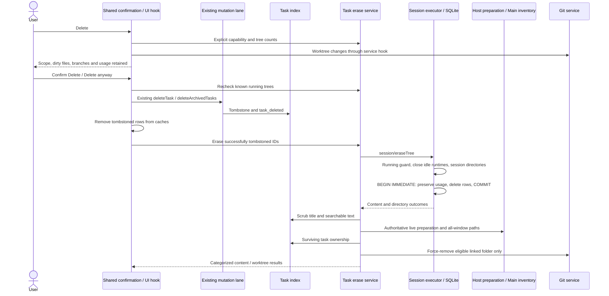

# Permanent session deletion

Status: implemented locally (2026-10-19), with the multi-window worktree retention restriction below. Manual-review E2E cases remain unpromoted pending user review.

## Product contract

Two ordinary actions remain:

- **Archive** is reversible, index-only, unchanged, and requires no confirmation.
- **Delete** requires confirmation, tombstones the task through the existing mutation lane, permanently deletes its session tree, then removes eligible execution worktree folders. Git branches remain. Aggregate App Usage remains, including exact distinct-session counts and longest-session duration through anonymous accounting. Deleted sessions disappear from Top Sessions.

The `deleted` tombstone remains an internal anti-resurrection mechanism; Hide is not an ordinary action. Delete has no undo and no optional erase checkbox. Preserve Session Manager pinned-row opt-in. Historical hidden-session maintenance stays in Settings → Sessions, uses Delete terminology, and shares the executor.

Descendants are the existing recursive `parent_id` children of types `selection_side_chat`, `subagent_child`, `workflow_child`, and `nested_workflow_child`, archived included. Independent forks and interactive primary sessions are not traversed. Surviving forks retain their content and source-session files they still reference.

## Reviewed baseline

Review at `a28996988bdd048480e814e6657c4c1b5f42320c` established:

- `deleteTask` and `deleteArchivedTasks` only tombstone. Archived batch deletion needs an explicit erase step.
- The existing CLI erase chain guards running trees in the answering process, closes idle runtimes, removes known session directories with fork retention, and deletes rows transactionally.
- Services-owned worktree outcomes belong to the task-service result, not a CLI response issued before Git cleanup.
- `executionWorktree` is durable task-index metadata; `worktreePreparation` is a live Host fact, so an index query alone cannot protect preparation.
- Git removal already rejects main and unregistered worktrees. Public service callers use the Git service contract, not repository `getStatus`.
- Usage rollups retain older/pruned raw contributions. A simple detached raw fold plus a union can double-count. Top Sessions uses a left join, so missing content alone does not remove its statistical row.

## Owners and event order



The task index owns membership and durable execution facts. CLI SQLite owns conversation content and usage. Host owns live preparation. Main owns window inventory, not task state. Services coordinates through injected boundaries; UI keeps presentation and pending confirmation only.

Remote workspaces, Web remote control and read-only states cannot execute permanent Delete. The Web remote-control archived bulk action stays disabled even if its base Host advertises local deletion support. Provide a reason. RPC proxy method presence is not support: use explicit capability. Unsupported peers must not silently degrade Delete into tombstone-only success. Archive follows existing availability.

Known running trees block before tombstoning. CLI rechecks at execution; a later race can leave a tombstone with retained content and must be reported. Preserve the accepted process-local running guard; do not add a cross-window session lease.

## Confirmation and UI

All ordinary Delete surfaces share semantics: sidebar menu, Session Manager, archived single and batch deletion.

- Pinned rows are excluded from batch deletion until opted in; previews/counts reflect actual candidates.
- Load exact tree counts asynchronously. Show no additional count line while loading, omit zero categories, and show a generic descendant warning on failure/unsupported counts. Row overlays are not exact counts.
- Read worktree paths from execution facts and deduplicate. Query staged, unstaged and untracked files through a public Git-service hook. Show roughly five paths/statuses (`M`, `??`, etc.) plus a localized remainder. Loading adds no Git line; failure is unknown, not clean.
- Dirty folders warn about permanent loss of uncommitted changes if removed. Dirtiness alone does not block: use **Delete anyway**. State that branches and aggregate usage remain.
- Protected folders can remain, so do not promise every folder will disappear.
- Cancel mutates nothing. Use destructive confirmation, keyboard-accessible controls and DESIGN.md responsive/theme primitives.
- Localize in en-US, zh-CN and uk-UA; use `formatPlural` with appropriate Ukrainian one/few/many/other forms. Shared test IDs cover Delete, dialog and confirmation.

## Content, results and recovery

Preserve controller tombstoning and projection events. Erase only successfully tombstoned IDs; remove them from UI query caches after tombstoning. Failure never restores membership.

Keep files-before-rows: failed known session-directory removal retains rows for retry. Delete workflow runs, nested runs and input history before sessions; FK cascades remove messages, parts and raw usage. Resolve the tree and preserve usage inside the same write transaction. Keep fork-file retention and existing late-child handling.

Scrub tombstoned titles/searchable text, retaining identity and execution facts. Late writes cannot restore content or visible membership. Absent session rows can still have pending worktree cleanup.

Separate outcomes for task content (erased/skipped/running/unsupported/failed), retained/failed session directories, and removed/retained/failed worktree targets with reasons. Extend `ZCodeTaskEraseResult` with `worktreeCleanup`: removed paths, retained/failed target-and-reason entries and counts. Update actual transport validation where the result crosses a boundary; do not report future worktree cleanup in the CLI result.

Pending cleanup must be discoverable and retryable after content deletion, including historical maintenance. Durable execution facts are the recovery source; content counts alone are insufficient. Avoid a second accepted queue or global erasing state.

## Authoritative worktree cleanup

Both erase entry points share one implementation:

1. Capture persisted execution facts and repository scope before erasure. Never reconstruct paths from branch names or location preferences.
2. Deduplicate canonical paths across chunks. Branch protection is repository-scoped; use established cross-platform/symlink identity helpers.
3. After successful content erasure, recheck surviving task facts, including archived/pinned tasks, live non-cancelled preparation, and open workspace paths in every window.
4. Retain shared targets needed by failed/blocked tasks or other hidden sessions whose content survives. A non-deleted-only query cannot establish exclusive ownership.
5. Remote targets and unavailable authoritative guards are retained with explicit reasons. Failed inventory reads are not empty inventory. The current preparation inventory is window-Host-scoped; with multiple main application windows, cleanup conservatively retains worktrees because other Hosts cannot yet supply an authoritative preparation snapshot. Content deletion still proceeds and reports retained folders.
6. Recheck immediately before mutation; use `gitService.removeWorktree` with force and preserve linked/non-main validation. Never delete the branch.
7. Positively confirmed missing folders count as removed. Permission errors, invalid targets and unknown registration do not prove absence. Never recursively delete arbitrary paths as fallback.

Retry must work when content is gone. If the original workspace is missing, resolve a valid repository boundary or report retained/failed without claiming removal.

## Anonymous usage preservation

The user approved extra anonymous accounting on 2026-10-19 to preserve exact distinct-session counts and longest duration as well as additive metrics. A fresh opaque random identity may group a deleted session's time buckets; keep no mapping to its original ID. Detached records contain no original session IDs, titles, prompts or messages and never appear in Top Sessions.

Use additive fork-owned schema with `fork_usage_detached*` names and a separate noncolliding ledger ID (`9002_fork_usage_detached` if unused). Never change upstream migrations or existing `9001_fork_usage_rollup` schema/checksum inputs.

Preservation and deletion share `BEGIN IMMEDIATE`; rollback restores accounting and content. Do not nest transactions or await asynchronous work inside the SQLite transaction.

Single-count invariant: each retained contribution appears exactly once whether raw-backed, rolled up, detached or surviving raw pruning. Simple existing-rollup-plus-doomed-raw is forbidden. Account for stale/debounced rollups, complete/partially pruned buckets, old buckets outside the seven-day replacement window, empty raw tables, and surviving sessions sharing buckets. Never silently clip negative reconciliation residuals or discard uncertain history.

A supported design may protect deletion-affected aggregate buckets from destructive rebuild and apply exact before/after deltas for later usage writes through the existing usage repository. It must synchronize pending usage before protection, retain prior pruned contributions, preserve transaction rollback, and define how existing shared-database writers are observed. Normal recomputation must never overwrite protected/detached contributions or count them twice. Further usage in an affected bucket must remain visible.

Update all applicable queries: additive totals, error counts, weighted average numerators/denominators, model/tool breakdowns, daily/hourly series, workspace/model/provider/query-source facets and filters, exact distinct counts and longest duration. Preserve current filter/date semantics. Raw fallback cannot silently omit anonymous history. Keep the existing two-year retention boundary; all-time means retained history, not indefinite retention.

Immediate reads, recomputation, reopened connections and retries preserve the same historical contribution. Lost attribution in already-pruned model/tool aggregates is not reconstructed as per-session history.

## Acceptance and E2E scenarios

1. Archive/restore changes index membership only; content survives with no new confirmation.
2. Sidebar Delete opens confirmation; cancel changes nothing; confirm erases stopped roots and defined descendants while independent forks and tombstones survive restart.
3. Count loading has no extra line, zeros are omitted, errors show generic warning; pinned inclusion refreshes candidates without stale results.
4. Known running root/child blocks before tombstone; late CLI rejection retains content, reports partial outcome and never cleans that task's worktree.
5. Clean worktree is removed; dirty staged/unstaged/untracked paths show bounded statuses and **Delete anyway** removes an eligible folder. Branch remains.
6. Shared targets, archived/pinned surviving owners, preparation, open windows and failed/blocked batch owners retain folders. Main/remote targets are never removed.
7. Canonical aliases deduplicate targets; unrelated repositories with equal branch names do not interfere; unavailable guards retain.
8. Git failure after content deletion reports partial outcome and remains retryable through maintenance; absent folders and repeated deletion are idempotent.
9. Session Manager has no erase checkbox, retains pinned opt-in, and local archived single/batch actions run full deletion. Restored-elsewhere archived IDs are skipped.
10. Remote/read-only/unsupported peers cannot silently perform hide-only Delete. Mobile reuses its existing Host and Agent attachment.
11. Tokens, requests, errors, cache/reasoning totals, turns/tools and duration sums/counts remain stable. Supported time/workspace ranges preserve exact session count and longest duration. Deleted sessions leave Top Sessions; anonymous storage has no original IDs/titles.
12. Repeat with stale/no rollup, partial pruning, old/shared buckets, debounce, subsequent same-bucket usage, recompute, reopen and retention expiry.
13. Force a deletion-transaction failure: content/accounting roll back atomically; retry does not duplicate usage.
14. E2E: isolated fixtures exercise sidebar cancel/confirm, dirty Delete anyway, running block, pinned batch, archived deletion and partial-result maintenance. Cover desktop/narrow Web, themes and locale lengths where runnable; record environment blockers honestly.

Run root typecheck/lint, CLI typecheck/lint, targeted store/bootstrap/services/shared/UI tests, architecture changed check and fork-scoped format check. Inspect final diff and report real results. Git publication requires explicit user authorization.

## Settings → Archives surface

Settings → Archives (`ArchiveManagement`) is an archived-session Delete surface. Its row trash, group "Delete all" and header "Delete all" entries are permanent Delete, not the hide-only `deleteTask` lane. Restore (unarchive) is unchanged and needs no confirmation.

Owners (one write path for Delete on this page):

- `useArchiveManagement` owns the selection freeze (rows visible under the current search and project filter at the time of the action), the unarchive lock, remote-row exclusion and the Web-remote gate. It never calls `mutateProjectTask` with `kind: "delete"` for this surface.
- `useTaskDeleteDialog` owns the permanent-Delete dialog state (frozen rows, in-flight guard, result text). It renders `TaskDeleteConfirmationDialog` and invokes the executor.
- `permanentlyDeleteTasks` (`packages/ui/src/task-deletion/taskDeletion.ts`) is the only executor. Base local services resolve through `useBaseWorkspaceServices`.

Rules:

- Local archived rows are mapped with `archived: true` and `pinned: false`. The archived batch path (`deleteArchivedTasks`) is still-archived guarded, so a row restored elsewhere before confirm is reported as skipped.
- Remote rows (`workspaceIdentity` set) are never sent to the executor. They are excluded from batches and per-row and per-group entries are disabled with reason `taskDelete.remoteUnavailable`. A batch that contains them shows `taskList.deleteAllArchivedUnavailable` naming the affected projects. If no local rows remain, no dialog opens.
- Web remote control (`isWebRemoteControl`, passed as `allowPermanentDelete={!isWebRemoteControl}`) disables every permanent-Delete entry on this page with reason `taskDelete.remoteUnavailable`. The hook also returns before opening the dialog, and never consults `getDeletionCapability`, even when the base Host advertises local deletion support.
- Capability is explicit: `getDeletionCapability` through `taskDeletionSupported`. Unsupported capability keeps confirm disabled and never falls back to hide-only success.
- Single-row delete uses the same flow as batch delete (the fork's archived single delete also opened the permanent dialog).
- Cancel mutates nothing. The page entry stays disabled while the dialog is open or the erase runs, and is re-enabled on cancel or result.
- Results are inline status text (`formatTaskDeletionResult`), not toasts, because the page has no toast owner.

```mermaid
sequenceDiagram
    actor User
    participant Page as ArchiveManagement
    participant Sel as useArchiveManagement
    participant Dlg as useTaskDeleteDialog
    participant Exec as permanentlyDeleteTasks
    participant Svc as Local zcodeTaskService
    User->>Page: Delete (header, group or row)
    Page->>Sel: run(visible rows, "delete")
    alt allowPermanentDelete is false
        Sel-->>Page: no-op, entries already disabled
    else
        Sel->>Sel: freeze archived local rows, count remote rows
        Sel->>Dlg: openRows(local rows, remote notice)
        Dlg-->>User: confirmation dialog (capability, counts, worktree preview)
    end
    User->>Dlg: Confirm
    Dlg->>Exec: permanentlyDeleteTasks(confirmed rows)
    Exec->>Svc: getDeletionCapability, countTaskTrees (running guard)
    Exec->>Svc: deleteArchivedTasks (tombstone; still-archived guard)
    Exec-->>Dlg: onTombstoned, removeTaskState per tombstoned row
    Exec->>Svc: eraseTasks (tombstoned IDs only)
    Exec-->>Dlg: categorized result
    Dlg->>Sel: refresh tree, publish result text
```

Acceptance scenarios:

1. Header Delete with no archived rows is disabled; with rows it opens the confirmation dialog.
2. Cancel: no `deleteArchivedTasks` or `eraseTasks` call, and the entry is enabled again.
3. Confirm: one `deleteArchivedTasks` then one `eraseTasks` with the confirmed IDs. The entry is disabled while the erase runs and the result text is shown after it.
4. Search or project filter: only the visible rows reach the dialog. Rows hidden by the filter are not deleted.
5. A remote row mixed into a batch is excluded and named in the notice. Local rows still delete. A remote-only batch opens no dialog.
6. Web remote: header, group and row Delete are disabled with the reason. Clicking does nothing, and `getDeletionCapability` is never called even if the service reports supported.
7. Capability reported unsupported: confirm is disabled and nothing is written.
8. A row restored elsewhere between open and confirm is reported as skipped by the still-archived guard.
9. Restore (unarchive) from this page is unchanged.

E2E: the pending manual-review cases under `packages/desktop/test/e2e/conversation-session/manual-review/pending/` are not run by this change. Desktop E2E for this surface is recorded as not run.

## Decisions and non-goals

- 2026-10-19: permanent Delete supersedes conflicting 2026-10-18 Hide/Erase decisions. Archive remains unchanged.
- Remove worktree folders only; branches remain.
- Preserve exact aggregate session metrics through approved anonymous accounting.
- Historical maintenance remains in Sessions settings and covers content or pending cleanup.
- Non-goals: undo, remote permanent deletion, branch deletion, tombstone removal, a new Hide action, retained per-session conversation details or cross-window running-session leases.

## Local verification evidence

Desktop manual-review runs exercised sidebar cancel/confirm/reload (DEL01) and all-archived cancel/confirm. Both passed locally on macOS. Store tests cover anonymous counts/duration, old/shared/partially-pruned buckets, external updates, rollback, retry, privacy and retention. Service tests use controlled Git/inventory ports for guard and partial-result behavior. Dirty-worktree, cross-platform and mobile visual E2E scenarios remain pending; passing unit tests do not imply those E2E cases were run.

The all-CLI typecheck/lint commands also inspect untouched packages. Their existing protocol-lifecycle type errors and widespread max-lines failures must be reported separately from targeted deletion checks. PR publication was subsequently authorized by the user on 2026-10-19.
