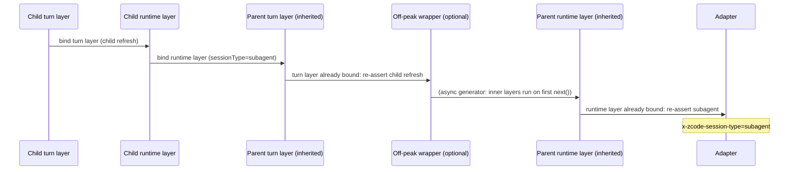

# Subagent inherited model: host invocation context ownership

## Problem

A subagent without its own profile model inherits the parent's Active Model handle
(`createInheritedSubagentModelFactory` returns the same instance so the frozen selection, effective
options and account binding survive). That handle is already wrapped by the parent's host layers:

- runtime layer (`createRuntimeModel`): `modelRequestSessionType`, `modelRetryBudget`,
  `modelRequestAdmission`;
- turn layer (`createTurnModel`): `refreshRuntimeHeadersBeforeAttempt`.

The child runtime wraps the inherited handle with its own host layers. Every wrapper merges
`{ ...current, ...layer }`, so the inner (parent) layers ran last and overwrote the child's values.
Observed result: every inherited child request carried `modelRequestSessionType = main` and the
header `x-zcode-session-type: main`, while `querySource = subagent` and the child session has
`task_type = subagent_child`.

## Rule

Host-layer fields belong to the runtime that executes the request, which is always the outermost host
layer of the call chain.

| Field group                                                                                       | Owner                                             | Precedence                                                              |
| ------------------------------------------------------------------------------------------------- | ------------------------------------------------- | ----------------------------------------------------------------------- |
| Model identity, effective options, account binding, request dependencies, off-peak ticket wrapper | The inherited handle (frozen at parent selection) | Unchanged; the handle is reused as-is                                   |
| `modelRequestSessionType`, `modelRetryBudget`, `modelRequestAdmission` (runtime layer)            | Executing runtime                                 | Outermost runtime layer wins; inner runtime layers re-assert its values |
| `refreshRuntimeHeadersBeforeAttempt` (turn layer)                                                 | Executing runtime                                 | Outermost turn layer wins; inner turn layers re-assert its values       |
| `metadata.querySource`, `traceContext`, `statusSink`, other per-call fields                       | Call site                                         | Unchanged; host layers do not touch them                                |

Host layers still take precedence over call sites (a call site cannot change the host classification).
The marker that records the outermost host layer lives only inside the invocation context of the
current call chain; it does not change the contracts type and is ignored by adapters.

Invariant the marker depends on: every call site that starts a model request
(`runWithModelInvocationContext` in turn, compact, title, sample, WebSearch/WebFetch, workspace and
verification paths) builds a fresh context object and never spreads the ambient
`getCurrentModelInvocationContext()`. Only `withModelInvocationContext` wrappers inherit the current
context, so a marker cannot leak from one runtime's request into an unrelated request. A new call site
that spreads the ambient context must strip the marker first.

## Scope

- Only `subagent_child` receives an already-wrapped handle: `createInheritedSubagentModelFactory` is
  the only place a live Model (rather than a factory) is handed to another runtime. Workflow children
  (`workflow_child`, `nested_workflow_child`) receive the bootstrap's raw model factory, so their
  retry budget and classification do not change. Side chats run as their own sessions; no path that
  hands them a parent handle was found.
- For subagents, the child runtime's admission port is the parent's port and both retry budgets are
  `Default`; the child's provider-runtime-headers port is the parent's port with `sessionId` rewritten
  to the parent session. The observable change is the session type (and its header). No app-side
  authentication or header-refresh difference exists between the parent and inherited children.
- This fix does not claim to resolve provider failure `405 / 3012` ("request has been blocked due to
  unusual activity"). Its cause remains unproven; it is not mapped to the terminal concurrency codes
  `3008/3009/3010`, and no retry, cooldown or text matching is added for it.

## Acceptance

1. A child launched through the Agent tool that inherits the parent's model sends
   `modelRequestSessionType = subagent` for `generateText` and `streamText` (observed while the stream
   is consumed); the parent's requests stay `main`; `querySource` stays `subagent`.
2. A child with an explicit profile model also sends `subagent`.
3. The inherited child request uses the child runtime's turn layer, and its header refresh still
   routes to the parent session (no observable routing change; single ownership only).
4. An async-generator wrapper between the child and parent layers (off-peak binding shape) does not
   lose the outermost host values.
5. The inherited handle is still reused by identity when the selection matches (existing
   `subagent-inherited-model-factory` tests).
6. Existing per-task-type classification (`main`, `subagent`, `side_chat`, `other`) and title/compact
   purposes keep their host classification (`runtime-model-session-type` tests).

Regression tests: `apps/zcode-cli/packages/core/tests/subagent-inherited-invocation-context.test.ts`.
