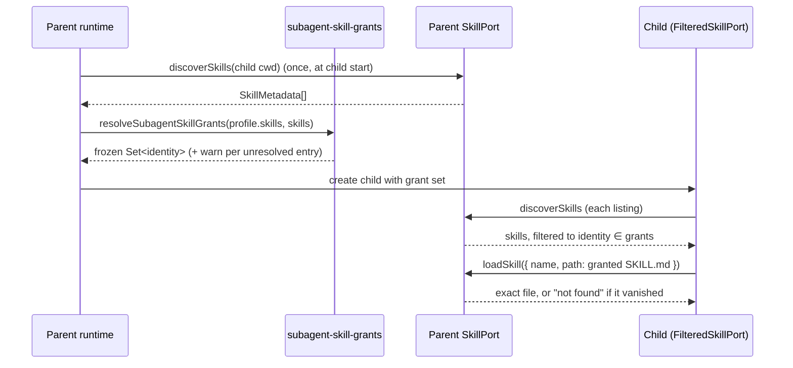

# Subagent skill grants by physical identity

A subagent profile's `skills:` list says which skills the child may see and load. Today the child's
`FilteredSkillPort` (`apps/zcode-cli/packages/core/src/runtime/methods/subagent.ts`) matches those
entries by name each time it is asked, then calls the parent's `loadSkill` with a name, and the
parent resolves that name again. This spec binds each grant to one physical skill file when the
subagent starts, and makes every later check and load use that file. The pattern comes from Cindy
(`packages/maker-core/src/agents/shared/skill-activation.ts`, `managed-skill-policy.ts`, Apache-2.0):
a name is only a lookup key; a grant is a resolved path.

## Problems with the current behaviour

Verified against the current source:

1. **Same bare name at two scopes blocks the skill.** `foo` in `~/.zcode/skills` and in
   `<project>/.zcode/skills` both pass the name filter, so a profile with `skills: [foo]` makes the
   child list `foo` twice, and `Skill(foo)` fails with "Skill name is ambiguous for subagent; use
   the fully qualified skill name". User and project skills have no qualified name, so the child
   cannot recover.
2. **The child's load goes back through a name.** `FilteredSkillPort.loadSkill` resolves to
   `qualifiedName ?? name` and asks the parent by that name; the parent picks the first name match
   across all of its roots. Today this only goes wrong when a same-named skill was hidden from the
   child (in practice an official CUA skill), but it means the filter and the load do not check the
   same file.
3. **Symlinked copies count as different skills.** Discovery deduplicates by the scanned path
   (`NodeSkillAdapter.discoverSkills`), so `~/.zcode/skills/foo -> ~/shared/foo` and
   `~/.agents/skills/foo -> ~/shared/foo` are listed twice and hit problem 1, although they are the
   same file. (The disable switch already compares real paths: `isDisabledSkillPath`.)
4. **Grants drift during the run.** Every `discoverSkills`/`loadSkill` call re-matches names, so a
   same-named skill installed after the child started can be loaded under an existing grant.

## Product rules

- **Identity.** A skill's identity is the real path of its `SKILL.md`: `path.resolve`, then
  `realpath` (keep the resolved path if `realpath` fails), lower-cased on Windows. Only the skill
  adapter touches the filesystem to compute it: `NodeSkillAdapter` sets `SkillMetadata.identity` on
  every discovered skill and uses the same rule for the load-by-path check. `core` never calls
  `realpath`; it compares `identity`, falling back to `path` for a `SkillPort` that does not set it
  (apps/zcode-cli/AGENTS.md, "Converge External I/O at Boundaries"). The adapter tests cover the
  symlink case.
- **Grants are resolved once.** When a subagent with a non-empty `skills:` list starts, the runtime
  runs exactly one parent discovery with the same request the child uses for its own listing
  (`{ workingDirectory: <child cwd>, trace }`, no explicit `roots`, as in `discoverSkillsForContext`)
  and turns the entries into a set of identities. The set is frozen for the life of that child and
  never re-derived from names. The same discovery result feeds the official CUA check
  (`validateSubagentComputerUseConfiguration`), which today runs its own conditional discovery.
- **Discovery failure fails closed.** If that discovery throws, the grant set is empty, one `warn`
  is logged, and the child still starts with no skills. (The CUA check keeps its current behaviour
  of not failing the start on a discovery error.)
- **How an entry resolves.** Symlinked copies with one identity count as one match.
  - A qualified entry (`plugin:skill`, `namespace/skill`) matches `qualifiedName` exactly and grants
    that identity.
  - A bare entry matches `name` or `qualifiedName`:
    - If at least one non-plugin skill matches, the entry grants only the **first non-plugin match
      in root order**, the same skill the parent's `Skill(foo)` loads today. Plugin copies with the
      same name are not granted.
    - If only plugin skills match, the entry grants **every** matching plugin identity. With one
      match that is a plain grant; with several, the child sees all of them, `Skill(x)` keeps
      returning the "use the fully qualified skill name" error and `Skill(p1:x)` loads (today's
      contract, kept).
  - An entry that resolves to nothing grants nothing and logs one `warn` with the agent type and the
    entry text. The child still starts.
- **What the child sees.** `discoverSkills` returns only skills whose identity is in the grant set,
  one entry per identity (the first in root order), still minus official CUA skills.
- **What the child loads.** `Skill(x)` resolves `x` only among the child's visible skills, then
  loads that exact file. The parent never re-resolves by name for a child.
- **Disappeared or disabled skills.** A granted skill that is gone from discovery (deleted,
  disabled, or its symlink now points elsewhere) is not visible and fails with "Skill is not allowed
  for subagent". Skills added after the child started are never granted to it.
- **No grant list keeps today's behaviour.** A profile without `skills:` sees every non-CUA skill
  the parent sees, resolved live. Only explicit lists are frozen.
- **Unchanged.** Official CUA skill rejection, the `Skill` tool being auto-enabled when `skills:` is
  non-empty, plugin `qualifiedName` aliases, and the parent's own skill resolution.
- **Out of scope.** Workflow `opts.skills` (`script-workflow-utils.ts`) and command `skills` are
  prompt hints, not grants. The main agent's precedence between user and project skills is not
  changed here (Cindy makes project win; ZCode keeps root order).

## Interfaces

- `SkillMetadata` (`apps/zcode-cli/packages/contracts/src/skills/index.ts`) gains optional
  `identity?: string`, the physical identity above, set by the adapter at discovery.
- `SkillLoadRequest` (same file) gains optional
  `path?: string`. `NodeSkillAdapter.loadSkill` (`apps/zcode-cli/packages/adapters/src/skills/index.ts`)
  declares its own inline request type, so it must be widened to `SkillLoadRequest` (or gain `path`)
  as well. When `path` is set the adapter selects the discovered skill whose identity equals the
  identity of `path` and fails with `Skill not found` otherwise; `name` stays required and is used
  only for errors and telemetry. Callers that omit `path` behave as today.
- Every production `SkillPort` is a `NodeSkillAdapter` (`bootstrap/src/app/create-app.ts`,
  `workflow-facade.ts`, `script-workflow-child-runtime.ts`); none rebuilds the load request field
  by field, so `path` reaches the adapter. Only `FilteredSkillPort` sets it.
- A new fork-owned module `apps/zcode-cli/packages/core/src/runtime/methods/subagent-skill-grants.ts`
  holds `resolveSubagentSkillGrants(entries, skills)` and the identity-based filter. Both are pure
  functions over discovered metadata and do no I/O. `FilteredSkillPort` in `subagent.ts` (upstream-owned) changes only enough
  to take a frozen grant set and to pass `path` to the parent. This keeps the upstream diff small for
  later syncs.
- `resolveSubagentSkillPort` becomes async: it resolves grants before the child runtime is created.
  The start path runs one discovery when `skills:` is non-empty and passes the result to both
  `validateSubagentComputerUseConfiguration` and `resolveSubagentSkillGrants`.

## Order of events

The parent SkillPort stays the only owner of discovery and of the disable switch. The child holds
only the frozen identity set and never writes skill state.

## Acceptance scenarios

1. User `foo` and project `foo`, profile `skills: [foo]`: the child lists one `foo` (the user copy,
   matching the parent's `Skill(foo)`) and `Skill(foo)` loads that file.
2. Same as 1, but the user copy is disabled: the grant resolves to the project copy and it loads.
3. Two symlinks to one skill directory: the child lists it once and loads it.
4. Two plugins both define `allowed-skill`, profile `skills: [superpowers:allowed-skill]`: the child
   sees and loads only the `superpowers` copy, including through the bare alias `allowed-skill`
   (existing test still passes).
5. Two plugins define `x`, profile `skills: [x]`: the child lists `p1:x` and `p2:x`; `Skill(x)`
   returns the "use the fully qualified skill name" error and `Skill(p1:x)` loads the `p1` file.
   5a. A user skill `x` and a plugin skill `p1:x`, profile `skills: [x]`: only the user copy is
   granted; `Skill(p1:x)` fails with "Skill is not allowed for subagent".
6. A same-named skill installed in a higher-priority root after the child started is not visible to
   the child and `Skill(foo)` still loads the originally granted file.
7. The granted file is deleted while the child runs: `Skill(foo)` fails with "Skill is not allowed
   for subagent".
8. Profile without `skills:`: the child sees every non-CUA skill, as today.
9. Grant entry with no match: the child starts without that skill and one `warn` is logged.
   9a. Discovery throws at child start: the child starts with no skills and one `warn` is logged.
10. `loadSkill({ name, path })` on the adapter picks the file by identity even when another skill
    with the same name comes first in root order.

## Tests

- Unit (`apps/zcode-cli/packages/core/tests/`): `resolveSubagentSkillGrants` for scenarios 1–5a,
  9 and 9a with in-memory metadata, including two entries that share one `identity` (scenario 3).
- Runtime (`apps/zcode-cli/packages/core/tests/subagent-skill-grants-runtime.test.ts`, kept apart
  from the already very large `subagent-explore.test.ts`): scenarios 1, 6, 7, 8 and 9a through a
  fake `SkillPort` that records `loadSkill` requests and asserts `path` is passed. The existing
  filtered-skills test in `subagent-explore.test.ts` still covers scenario 4.
- Adapter (`apps/zcode-cli/packages/adapters` tests): scenario 10 with a real temp-dir layout, and
  discovery setting the same `identity` on two symlinked copies (scenario 3).
- No UI or E2E change: the behaviour is internal to the agent runtime.
