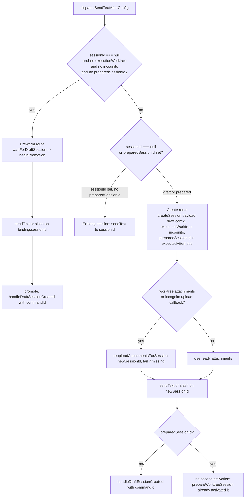
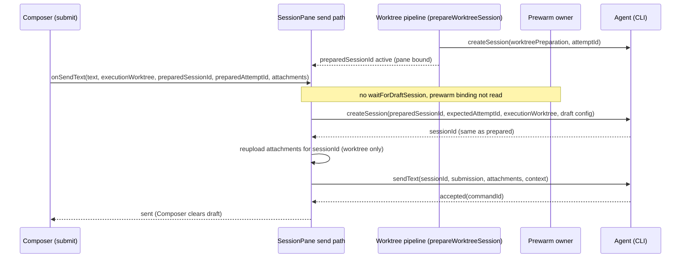
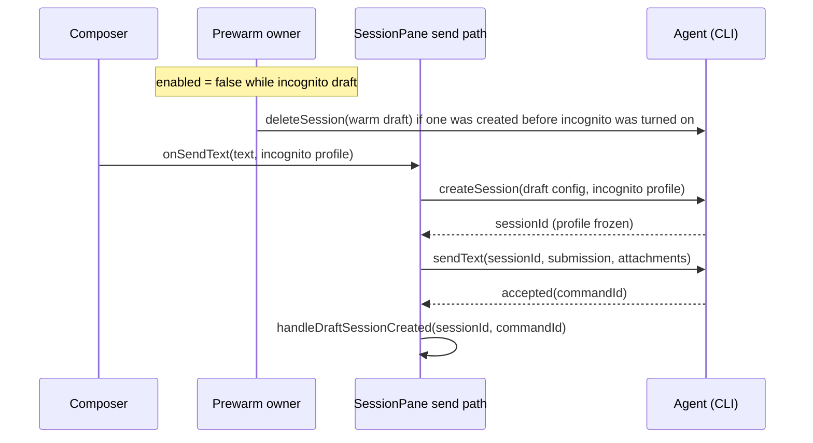

# UI draft send path (upstream 3.16.1 SessionPane, UI-2a)

Status: design for the UI-2a port. Scope: `packages/ui/src/v4/SessionPane.tsx`
`dispatchSendTextAfterConfig` and the hooks it reads. Not in scope: the
`/plan` shortcut (removed upstream; decision: not restored), the composer
recovery panels (already ported by the composer bucket).

## Problem

Upstream 3.16.1 replaced the fork's draft creation with a single prewarm owner
(`useDraftSessionPrewarm`, `waitForDraftSession` / `beginPromotion`). Every
first send of a draft waits for the prewarm session and sends into it. That
session is created with the parent workspace cwd and with the global initial
config, so two first-send variants cannot use it:

- execution-worktree sends: the agent must run in the linked worktree
  (`executionWorktree`), so the prewarm session is the wrong cwd;
- incognito sends: the profile is frozen at session creation
  (`specs/incognito-session.md`), so a prewarm session that already started
  with every extra on is the wrong session.

Without the fork path, both variants fail in `dispatchSendTextAfterConfig`
(`draftBinding!.sessionId` is read with no binding), and worktree-prepared
sends (`preparedSessionId`) cannot adopt their reserved session.

## Owners (single write path per piece of state)

| State                                            | Owner                                                                         | Writes                                                                                        |
| ------------------------------------------------ | ----------------------------------------------------------------------------- | --------------------------------------------------------------------------------------------- |
| Draft prewarm session (id, lifecycle, deletion)  | `DraftSessionPrewarmCoordinator` (`useDraftSessionPrewarm.ts`)                | createSession(config), deleteSession of unpromoted drafts                                     |
| Prewarm enablement                               | `SessionPane` (`enabled` argument)                                            | `sessionId === null && draftAgentStartupAllowed && !recoveringDraft && !incognitoDraftActive` |
| Incognito profile of a draft                     | `useDraftIncognitoIntentStore` (draft intent), frozen by Composer at submit   | Composer `submit` captures it into `options.incognito`; cleared on accepted send              |
| Worktree preparation (reserved session, attempt) | `composerWorktreePipelineStore` + `prepareWorktreeSession` (SessionPane)      | createSession(worktreePreparation) and updateWorktreePreparation                              |
| Promotion of a draft to a real session           | `dispatchSendTextAfterConfig` (SessionPane), via `beginPromotion` / `promote` | the send route below; `handleDraftSessionCreated` at the accepted boundary                    |
| Draft first-send config on a created session     | `buildDraftCreateConfigPayload(draftConfigRef + submission)`                  | payload of createSession on the create route                                                  |

`dispatchSendTextAfterConfig` is the only writer of the create route. The
prewarm coordinator never creates a session for a worktree or incognito send.

## Send routes for a first send



Rules that follow from the owners:

1. The prewarm route is the only route that awaits `waitForDraftSession`.
   A worktree or incognito send never awaits or promotes the prewarm binding, so
   it cannot inherit the wrong cwd or the wrong frozen profile.
2. The prewarm owner is disabled while the draft is incognito, so an incognito
   draft never creates a warm session. Turning incognito on disposes the
   current warm session through the normal `enabled` cleanup (delete of an
   unpromoted draft). Turning it off re-enables prewarm.
3. A worktree send may still see a prewarm session in flight (prewarm is
   enabled for execution-worktree drafts). That session is an unpromoted draft and
   is removed by the owner when the pane leaves draft state.
4. The create route never reads the prewarm binding. The send barrier
   (`configCommandBarrier`) is the only ordering between config CAS and the
   create.
5. The fallback create is allowed only for the three markers above. A plain
   draft with no marker keeps upstream's rule: wait for the prewarm owner, never
   create a second session on the send path. Test
   `不记录预热尚无投影时首发的首次绑定` (upstream) stays.
6. Telemetry: `handleDraftSessionCreated` runs at the accepted boundary
   (`commandId` for `sendText`, `messageId` callback for slash commands). A
   prepared session was already activated by `prepareWorktreeSession`, so the
   create route skips `handleDraftSessionCreated` when `preparedSessionId` is set.
7. Unknown outcome: a transport error after a `createSession` or `sendText` write
   is never retried with a new session or command (same rule as the prewarm
   route). The error propagates; Composer keeps the draft.

## Event order: worktree send (first send, no prewarm promotion)



## Event order: incognito first send



## Acceptance scenarios

1. Plain draft first send: prewarm route; no createSession from the send path;
   the prewarm binding is promoted; `onSessionCreated` fires once.
2. Execution-worktree draft first send with attachments: create route with
   `executionWorktree`; attachments are reuploaded to the new session;
   `sendText` targets the new session; the prewarm binding is not promoted.
3. Incognito draft: prewarm disabled (`enabled: false`); create route carries
   `incognito`; no prewarm `sendText`.
4. Prepared worktree send (pane already bound to the prepared session):
   createSession carries `preparedSessionId` and `expectedAttemptId`,
   `sendText` carries attachments, context and conversation quotes, and the
   reupload is called once for that session.
5. Create route failure (createSession rejected or transport error): the error
   propagates to Composer; no second create; no `onSessionCreated`.

## Non-goals

- `/plan` shortcut (`planShortcut`): removed upstream; upstream plan UI replaces
  it. The fork slash-command tests stay skipped with `TEMPORARY(UI-2)`.
- Recovering a prewarm session after a runtime rebuild (`useDraftRuntimeRebuildGate`)
  is unchanged.

## Incognito attachment admission

An incognito draft does not prewarm. Its captured attachment submission may admit
`waitingSession` items at submit time; uploading, committing and failed items still
block submission. The frozen profile and attachment IDs belong to that submission.
`SessionPane` creates the incognito session through the existing capability-gated
create route, invokes `reuploadAttachmentsForSession` for that session, and only
then dispatches `sendText`. Attachment-only input and slash-looking text use the
same attachment path; they must not become native slash commands.

The captured attachment owner uploads pathless content through `attachmentPut`;
remote local paths go through the transfer service and must return `staged: true`.
No local path may be forwarded to a remote runtime. An upload failure retires the
new empty incognito runtime (never a prepared worktree session), sends no
prompt, preserves the draft/profile/files, and uses the existing send error path.
Accepted input retains the existing continuous/replayable delivery semantics and
command ledger; unknown command outcomes are not retried automatically.

```mermaid
sequenceDiagram
  participant C as Composer / captured attachment owner
  participant P as SessionPane
  participant A as Host / CLI
  C->>P: submit frozen profile, attachment callback
  P->>A: createSession(incognito)
  A-->>P: accepted(sessionId)
  P->>C: upload frozen attachments(sessionId)
  C->>A: attachmentPut / remote stage
  A-->>C: attachment refs
  C-->>P: refs
  P->>A: sendText(sessionId, refs)
  A-->>P: accepted(commandId)
  P-->>C: sent; settle captured content
```

Acceptance: incognito screenshot/attachment-only first send works without prewarm;
upload failure retains the draft and sends no text; failed/in-flight attachments
remain blocked; ordinary drafts retain their pre-upload gate. See restored create
route tests, captured attachment tests, and INCOGNITO-03 E2E candidate.
