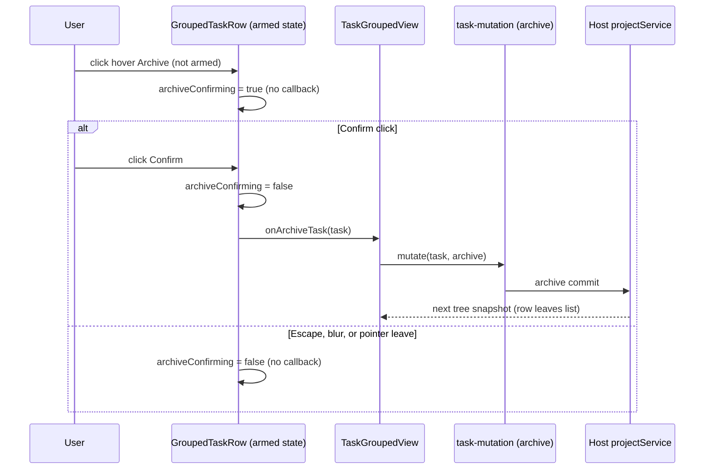

# UI-2b: re-apply fork sidebar and task-list features onto `project-sidebar`

Status: in progress (UI-2b). Ledger: `specs/ui-upstream-sync-ledger-2b.md`.
Base: `claude/upstream-sync-ui` (PR #215, tip `0a845b0c`). Upstream: `0a1fc56d` (3.16.1).
Fork old code: `9c2434f7`. Upstream base: `aac4755666d09fdcd70272fcf063c077a639015f`.

## Scope and rule

Upstream replaced the fork's `WorkspaceSidebar` with `packages/ui/src/project-sidebar/`.
Where the fork changed behavior relative to base, the fork behavior is restored on the
upstream structure. Where fork == base, upstream behavior and tests win.

Unit of work: one feature per row in the ledger. "Ported" means the fork behavior is observable
in the upstream tree with a test. "Ledgered" means it is not ported in this sync and the row says why.

## Data flow owners (single owner per state)

| State                                                   | Owner                                                       | Writers                                                  | Readers                     |
| ------------------------------------------------------- | ----------------------------------------------------------- | -------------------------------------------------------- | --------------------------- |
| Project tree rows (which tasks belong to which project) | Host `projectService.readTree`                              | Host commits (create, move, archive)                     | `ProjectDirectoryProvider`  |
| Grouped (by-group) structure and membership             | Host, via `useTaskGroups` (structure only)                  | Host transactions on manual move                         | `TaskGroupedView`           |
| Task archive / pin / unread / rename                    | `task-mutation.ts` adapter                                  | `useProjectTaskActions`, `TaskGroupedView` callbacks     | Host tree refresh           |
| Two-step archive armed state                            | `GroupedTaskRow` local state (`archiveConfirming`)          | row click / blur / leave / Escape                        | row render only             |
| Pin intent (in flight)                                  | `useProjectPinIntent`                                       | pin action                                               | row render                  |
| Unread dot (collapsed project)                          | `view.ts` projection of `task.unreadAt` (not archived)      | `useProjectUnreadSignals` (desktop base directory owner) | project node                |
| Child-session expansion                                 | per-device localStorage (`childSessionExpansionPreference`) | `ChildSessionCountsMarker`                               | grouped row, child rows     |
| Incognito / worktree / child-count markers              | derived read-only from task meta                            | none                                                     | grouped row, `TaskListItem` |

Upstream `task-groups` and `task-facts` are not wired in this sync (see ledger-2b). The grouped
view keeps consuming the fork's services projection through `workspace-grouped-tasks/view.ts`;
no new writer is added here.

## Event order: archive from a grouped row (two-step confirm)

Invariant: no archive mutation is issued without a second user action. A row unmount clears the
armed state; a stale snapshot never re-arms it.

## Feature classification (UI-2b)

Status values: `ported` (this PR), `present` (already in upstream tree or shared module, verified by
grep), `ledgered` (not ported here, reason given).

| #   | Fork feature                                                                       | Spec                                 | Status                 | Where                                                                                                                      |
| --- | ---------------------------------------------------------------------------------- | ------------------------------------ | ---------------------- | -------------------------------------------------------------------------------------------------------------------------- |
| 1   | Archive two-step inline confirm on grouped row                                     | ui-accidental-action-guards #4       | ported                 | `project-sidebar/grouped/task-row.tsx`                                                                                     |
| 2   | Incognito marker on grouped row                                                    | -                                    | ported                 | `project-sidebar/grouped/task-row.tsx`                                                                                     |
| 3   | Worktree marker on grouped row                                                     | -                                    | ported                 | `project-sidebar/grouped/task-row.tsx`                                                                                     |
| 4   | Child-session counts marker and expansion on grouped row                           | sidebar-child-conversation-counts.md | ported                 | `project-sidebar/grouped/task-row.tsx`                                                                                     |
| 5   | Incognito marker and hover card on project/pinned rows and grouped rows            | task-hover-card-layout.md            | ported                 | project/pinned: `TaskListItem.tsx` (shared); grouped: `project-sidebar/grouped/task-row.tsx` mounts `TaskSidebarHoverCard` |
| 6   | Unread dot on collapsed project                                                    | task-unread                          | present                | `view.ts`, `useProjectUnreadSignals.ts`                                                                                    |
| 7   | Pin intent owner (in-flight pin only)                                              | -                                    | present                | `useProjectPinIntent.ts`                                                                                                   |
| 8   | Project pin (upstream `project.pinned`)                                            | -                                    | present                | `ProjectSidebarNode.tsx`                                                                                                   |
| 9   | Pinned workspaces with fork `fork_workspace_pins` and drag boundary                | sidebar-ui-polish.md                 | ledgered               | design owner needed: fork workspace pin vs upstream project pin                                                            |
| 10  | Drag overlay shows workspace display name and colour                               | sidebar-ui-polish.md                 | ledgered               | needs `workspaceDisplayStore` in `project-sidebar/grouped/group-drag-overlay.tsx`; not in this PR                          |
| 11  | Session-manager entry from sidebar (`setPendingSettingsSectionIntent("sessions")`) | manage-sessions-table.md             | ledgered               | upstream sidebar nav has no entry point; not in this PR                                                                    |
| 12  | Merged-session highlight                                                           | merged-session-highlight.md          | ledgered               | not verified in this PR                                                                                                    |
| 13  | Turn-navigator pin highlight                                                       | -                                    | ledgered               | depends on `ConversationTimeline onPinChange` (ledger b7 S6)                                                               |
| 14  | Task-index light select                                                            | task-index-light-select.md           | ledgered               | not verified in this PR                                                                                                    |
| 15  | Review tab directory grouping                                                      | -                                    | ledgered               | not verified in this PR                                                                                                    |
| 16  | Themes in sidebar footer (zai themes)                                              | themes.md                            | ledgered               | upstream footer not reviewed in this PR                                                                                    |
| 17  | Message change summary tree view in side pane                                      | message-change-summary-tree-view.md  | ledgered               | not sidebar; side pane owner                                                                                               |
| 18  | Worktree notices and open button on sidebar rows                                   | -                                    | ledgered               | not verified in this PR                                                                                                    |
| 19  | Test files removed as `TEMPORARY(UI-2)`                                            | ledger-b7 / integration              | see ledger-2b per file |                                                                                                                            |
| 20  | Pull request items (open, copy link, refresh) in grouped task context menu         | sidebar-pr-status.md (surface 3)     | ported                 | `project-sidebar/grouped/task-context-menu-content.tsx` mounts `TaskPullRequestMenuItems`                                  |

## Test rule outcome

- `groupedTaskRowArchiveConfirm.test.ts`: fork behavior changed (label "Archive", two-step confirm).
  Retargeted to `project-sidebar/grouped/task-row.tsx`; fork test is the spec.
- Other restored tests: see ledger-2b; one line per test file.

## Verification

- `pnpm exec tsc -b packages/rpc packages/provider packages/provider-node packages/acp-agent-runtime packages/shared packages/services packages/client packages/ui`
- `node scripts/run-vitest.mjs run <changed test files>`
- Baseline before changes: `tsc` clean (0 errors); full `packages/ui/test` run logged in scratchpad.
