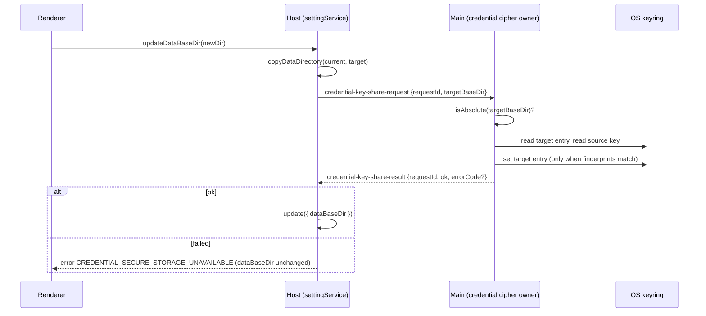

# Upstream 3.18.2 backport (reconstructed from the binary)

Status: active (2026-11-13).

## Why reconstructed

Upstream shipped ZCode 3.18.2 (build `3.18.2.10443`, commit `2681f4af`, built 2026-11-12) only as a binary.
`zai-org/ZCode` still stops at `c5904686e` (v3.18.1). The changes were recovered by comparing the official
`ZCode-3.18.1-mac-arm64.zip` (`cdn-zcode.z.ai/zcode/electron/releases/3.18.1/macos-arm64/`, build 10376)
with the installed 3.18.2 app.

- **Compared:** `app.asar` (main, host, preload, renderer, scheduler), `Resources/glm/zcode.cjs` and the
  node-repl-host bundle. Bundles were diffed by string literals and by per-function token segments with
  short identifiers normalised, so chunk renames drop out.
- **Native binaries** differ only by re-signing.
- **Renderer, preload and scheduler** differ only through the bundled `shared` schemas and channel enum.
- **CLI (`zcode.cjs`)** differs only through bundled `shared`/`services` code. Nothing in `apps/zcode-cli`
  changes.

Every item is reconstructed from minified code, not upstream source. Root causes are inferred from the
diff, not confirmed. Names visible in the bundle are reused so the real source merges with few conflicts:

- `enablePrivateFileKeyFallback`, `keyFingerprint`, `encodedKeyFingerprint`, `readOsKeyFingerprints`,
  `isOsSourcePinned`, `publishPrivateSecretFile`, `shareKeyWithCopiedCredentials`
- `shareCredentialKeyWithDataRoot`
- `loadStartPlanMaterial`, `startPlanMaterialFromSnapshot`, `isStartPlanFamilyCurrent`,
  `resolveStartPlanFamilyFromOAuthProvider`, `loadStartPlanZcodeJwt`
- `escapePowerShellLiteral`

New 3.18.2 code that would push a file over the 20,000-byte commit limit lives in sibling modules:
`packages/shared/src/credential-security/copiedCredentialKeyShare.ts` (fingerprints, private-secret publisher,
key share) and the end of `packages/services/src/model-provider/codingPlanProviderAvailability.ts`
(`isStartPlanFamilyCurrent`, the per-round Start Plan material cache).

**Next upstream sync:** when upstream publishes the 3.18.2 (or later) source, take upstream's version of every
file listed here and drop the reconstruction. Do not merge hunk by hunk. `fork-upstream-base.json` stays on
3.18.1, because there is no 3.18.2 commit to pin.

The original app runs against the same `~/.zcode`, so shared-data names stay byte-identical to 3.18.2:

- **Files:** `credential-source` with content `os\n`, and `credential-secret` (a private file, 0600).
- **Ciphertext prefixes:** `enc:v2:os:` and `enc:v2:env:`.
- **Keyring entry:** service `ZCode Credential Encryption`, account `sha256(resolve(credentials.json))`.
- **IPC:** `credential-key-share-request` / `credential-key-share-result`, with error code
  `CREDENTIAL_SECURE_STORAGE_UNAVAILABLE`.

## Items

| #   | Item                                                                                              | Area                      | Kind |
| --- | ------------------------------------------------------------------------------------------------- | ------------------------- | ---- |
| 1   | Linux: fall back to a private-file credential key when Secret Service is unavailable              | shared, desktop main      | fix  |
| 2   | Moving the data directory copies the OS credential key to the new credentials path                | shared, desktop, services | fix  |
| 3   | Start Plan follows the signed-in login (incl. `zai_cn`), not only the selected provider family    | shared, services          | fix  |
| 4   | Windows Authenticode query imports the security module explicitly and returns JSON through a file | desktop main              | fix  |

## Behaviour after the backport

1. **Linux key fallback.**
   - **When it starts.** Desktop Main, on Linux only, enables the fallback once at startup, before any
     credential access. If a cipher already cached a key, it stays off for this process and Main logs a warning.
   - **What it does.** When the cipher must create a new key (nothing pinned to `os`, no `enc:v2:` data yet)
     and reading or writing the OS keyring fails, it publishes a random 32-byte `credential-secret` file
     (0600, exclusive `link`) next to `credentials.json`. It encrypts with that file as source `env` and calls
     `onFallback`, which logs a warning.
   - **What it does not change.** Existing `enc:v2:os:` data and a pinned `os` source never fall back: they
     still fail with `CREDENTIAL_SECURE_STORAGE_UNAVAILABLE`. The CLI, the server and macOS/Windows are
     unchanged.
2. **Data directory move.**
   - **Order.** `settingService.updateDataBaseDir` copies the data directory, then calls
     `shareCredentialKeyWithDataRoot(targetBaseDir)`, then stores `dataBaseDir`.
   - **Who does what.** The Host only asks Main; Main owns the keyring. Main accepts an absolute root only and
     runs `shareKeyWithCopiedCredentials(<root>/.zcode/v2/credentials.json)`.
   - **When the key is copied.** Only when the copied file's `enc:v2:os:` fingerprints match the source key
     (or there are none and both directories are pinned to `os`), and the target keyring entry is empty or
     holds a different key.
   - **On failure.** The move fails with `CREDENTIAL_SECURE_STORAGE_UNAVAILABLE` and `dataBaseDir` is not
     updated.
   - Before this fix, the moved credentials could not be decrypted after restart: the keyring entry is keyed by
     the credentials path, so the new path had no key.
3. **Start Plan.**
   - **Source of truth.** Start Plan readiness reads `OAuthCredentialRepo.loadStartPlanMaterial(family)`. That
     is the family material without the access token. When no family material exists, it falls back to the
     active login when `resolveStartPlanFamilyFromOAuthProvider(login) === family`; `zai_cn` maps to `bigmodel`.
   - **Current and access.** A Start Plan provider is current when its material has an identity and
     `(providerFamilyDomain ?? resolveStartPlanFamilyFromOAuthProvider(login)) === family`.
     `resolveCurrentAccountAccess` grants start-plan access by the same rule, before the family-domain check.
   - **Identity and keys.** The connection resolver takes the identity per plan kind (Start Plan material for
     start-plan, family material otherwise). Only providers without one are `not-connected`, and personal-plan
     keys load only when the family identity exists.
   - **JWT.** The Start Plan JWT comes from the Start Plan material, both in the availability check and in
     request auth (`loadStartPlanZcodeJwt`).
   - **Staleness.** The resolver re-checks Start Plan material for staleness the same way it re-checks family
     material.
4. **Windows Authenticode.**
   - **Script.** `readWindowsAuthenticodeSignature` (`packages/desktop/scripts/powershell-command.mjs`, bundled
     into Main for update verification) runs PowerShell with `$ProgressPreference` and
     `$ErrorActionPreference='Stop'`. It imports `Microsoft.PowerShell.Security` from `$PSHOME` and calls the
     module-qualified `Get-AuthenticodeSignature`.
   - **Result.** It writes compact JSON with `Out-File -Encoding utf8 -NoNewline` to `signature.json` in a
     private temp dir, which is removed afterwards. On failure it exits 27 with a message.
   - **Paths.** They go in as single-quoted literals (`escapePowerShellLiteral` doubles straight and smart
     quotes and rejects NUL, CR and LF) instead of an argument.

**Owners.**

- Main owns the keyring and the cipher key cache.
- The Host owns the pending request map, keyed by `requestId`.
- The settings service owns the order: copy → share → persist.
- A request from a Host that has already exited gets no reply (the existing `exitedHostProcesses` guard).

## Tests

These are fork-owned Vitest files, listed in `scripts/fork-test-files.json`:

- `packages/shared/src/credential-security/systemCredentialCipher.test.ts`: fallback, no fallback when
  pinned or data exists, enable after the cache is filled, key share copy and skip cases.
- `packages/services/test/accountProviderStartPlan.test.ts`: `zai_cn` login with no family
  domain gives a connected and current bigmodel Start Plan; per-plan-kind `not-connected`;
  `resolveCurrentAccountAccess` for Start Plan.
- `packages/desktop/test/windowsAuthenticodeLiteral.test.ts`: `escapePowerShellLiteral`.

The upstream engineering test `packages/desktop/test/powershell-command.test.ts` mocked the signature JSON on
stdout. Its mocks now write the JSON to the `$zcodeSignatureOutput` file instead, and it checks the escaped path
literal. Upstream's own 3.18.2 test replaces this edit at the next sync.

Not covered by tests: the real keyring and Secret Service, the host↔main IPC round trip in a running app, and
PowerShell on Windows.
