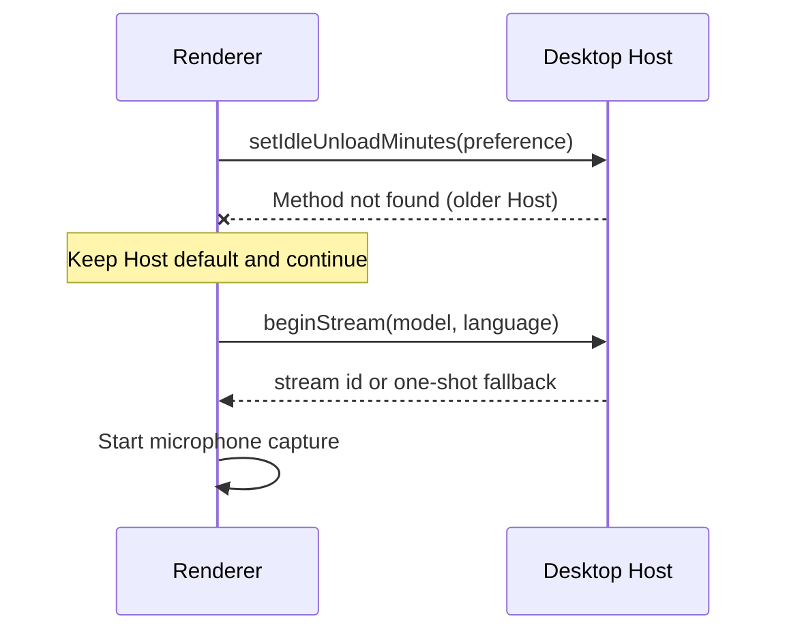
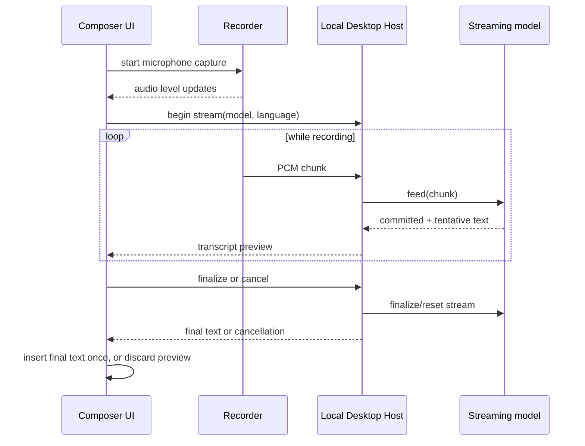
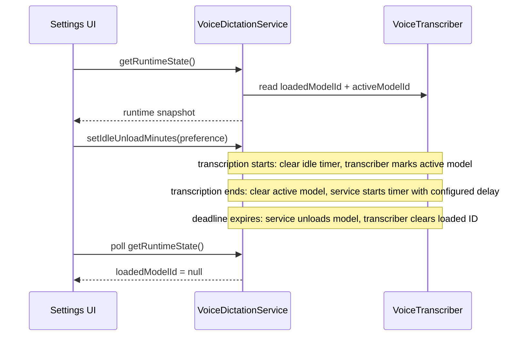

# Voice dictation

## Goal

Make the existing local desktop dictation flow easier to understand and avoid downloading a model already installed by Handy, without silently taking ownership of another application's files.

## Current product boundary

- Desktop captures microphone audio with the browser media API and sends PCM to the local Desktop Host for on-device transcription.
- Web and remote settings do not provide transcription. `getUserMedia` alone is only microphone capture and does not supply a transcription engine.
- The selected microphone is a preference. The selector lists all OS-exposed `audioinput` devices, including virtual inputs; it does not infer which device is physically active.
- The voice-dictation shortcut is a normal editable Keyboard Shortcuts command. Its default is `CmdOrCtrl+Shift+d`.
- Downloaded models are owned by ZCode under its data directory. Downloads are verified by expected size and SHA-256 before installation.

## Improvements in this change

1. Explain that the input selector lists available system audio inputs, including virtual devices. Keep the system-default option and avoid unreliable label-based device filtering.
2. On Desktop, discover a Handy model only in Handy's documented default `models` directory for the current OS. A candidate must match the catalog filename, byte size, and SHA-256. The ZCode-managed copy wins if both apps have it. Show a Handy badge and allow selection, but do not offer deletion of Handy-owned files. Do not scan undocumented/custom paths or other providers.
3. Preserve the existing editable shortcut and default; add regression evidence that voice dictation remains in the shared shortcut catalog.
4. Give a visible success confirmation after a model download. Keep the existing progress/cancel behavior and failure toast.
5. Show a Desktop-only explanation in Web settings. Do not substitute a cloud transcription provider or imply that browser microphone capture enables transcription.
6. Give immediate visible feedback when a download starts, and keep polling model state while a download request is in flight; the progress UI must not depend on the first poll winning a race with the download request. Put a full-width progress bar above one status row with percentage at the left, measured speed when available near the right, and Cancel at the far right. Use an indeterminate bar while the request starts or when total size is unavailable.
7. Confirm before deleting a ZCode-owned model. Identify the model and explain that its local file will be removed; never offer deletion for Handy-owned files.
8. Translate every voice-dictation setting, model action, state, confirmation, and error message in Ukrainian.
9. Show a single System default microphone option. Filter Chromium's synthetic `deviceId === "default"` entry from the explicit-device list so it does not duplicate the system-default choice.
10. Allow a downloading model card to be marked for use after download by clicking the card; do not show a separate `Use when ready` button. Keep the current selected model in effect until the requested model is fully ready; canceling or failing the download keeps the current selection.
11. Present each model as a separate card with its name and description above a metadata/action footer. Clicking a ready card selects it; clicking a model that is not downloaded starts its download; clicking an in-progress download marks or unmarks it for use when ready. Download progress is shown when available, otherwise show an indeterminate starting state. Keep the current model selected until the requested model is ready. Use the shared settings badge style with the short `Active` label for the selected model; keep the distinct loaded/transcribing status without an unload countdown.
12. Let the user choose how many minutes an idle model remains in memory after transcription. Apply the preference to the Desktop Host idle-unload timer, use five minutes as the default, and show only that the model is loaded rather than a countdown.
13. During recording, show a compact floating feedback panel to the left of the microphone button with a clear listening state, microphone-level meter, and optional live transcript preview. Keep it anchored without shifting composer actions.

### Compatibility with an older local Host

- If an older local Host reports `Method not found: setIdleUnloadMinutes`, continue dictation using that Host's default unload delay. Do not treat this one missing preference method as a transcription failure.
- Other errors while applying the preference remain fatal and keep the existing transcription error handling.

## Ownership and interfaces

- `VoiceModelStore` remains the only owner of model discovery, download state, model path, and removal. It may return a verified Handy path as ready with source metadata; it never deletes that path.
- `VoiceDictationSection` owns only display and settings edits. The service remains authoritative for model readiness.
- Mount the voice hook only when Desktop local voice input is enabled. Web and test composers without a `ServiceProvider` must render without mounting the voice hook.
- Keyboard bindings remain owned by `SHORTCUT_COMMANDS` and the existing shortcut settings flow.
- Browser recording remains in the UI recorder; Desktop Host owns inference. Web has no voice transcription service.

## Acceptance cases

| Case  | Setup                                                                       | Action                                          | Expected result                                                                                                                                                                                            |
| ----- | --------------------------------------------------------------------------- | ----------------------------------------------- | ---------------------------------------------------------------------------------------------------------------------------------------------------------------------------------------------------------- |
| VD-01 | Desktop microphone permission granted; multiple OS inputs exist             | Open Voice dictation settings                   | System default and all named audio inputs are listed; copy explains virtual inputs can appear.                                                                                                             |
| VD-02 | Exact catalog model exists in Handy's documented default model directory    | Open model settings                             | Model is ready, identified as Handy, selectable, and has no ZCode delete action.                                                                                                                           |
| VD-03 | Handy candidate has wrong size or SHA-256                                   | Open model settings                             | Candidate is not treated as installed; Handy file is untouched.                                                                                                                                            |
| VD-04 | Same model exists in ZCode and Handy                                        | Open model settings                             | ZCode-owned copy is used and remains removable by ZCode.                                                                                                                                                   |
| VD-05 | Model download succeeds/fails                                               | Download a model                                | Progress/cancel remains available; success is confirmed; failure is reported.                                                                                                                              |
| VD-06 | Web settings                                                                | Open Settings                                   | Voice dictation explains that local transcription is Desktop-only; no microphone or model controls imply Web support.                                                                                      |
| VD-07 | Voice dictation shortcut is in use                                          | Open Keyboard Shortcuts                         | It remains editable using the shared shortcut recorder and defaults to `CmdOrCtrl+Shift+d`.                                                                                                                |
| VD-08 | Start a model download                                                      | Click Download                                  | The card shows a full-width progress bar above a row with status at the left, measured speed when available, and Cancel at the right; starting uses an indeterminate bar. Success or failure is announced. |
| VD-09 | Delete a ZCode-owned model                                                  | Click Delete, then cancel or confirm            | No file is removed before confirmation; confirming removes it and refreshes the model list. Handy-owned models have no delete action.                                                                      |
| VD-10 | Enumerated inputs include a `deviceId` of `default`                         | Open the input selector                         | Only the System default choice and concrete input devices are shown; the synthetic entry is omitted.                                                                                                       |
| VD-11 | Set the app language to Ukrainian                                           | Open Voice dictation settings and model actions | All labels, descriptions, statuses, confirmations, and toasts use Ukrainian text.                                                                                                                          |
| VD-12 | A ready model is selected; another model is downloading                     | Click the downloading model card                | Keep using the selected model, and show a pending-use badge. Switch only after download succeeds; cancel/failure keeps the current selection.                                                              |
| VD-13 | Open Desktop voice-dictation settings                                       | Review the model list                           | Models appear as separate cards with description and metadata/actions; the selected model is clearly labeled and subtly highlighted.                                                                       |
| VD-14 | One ready model is selected; another is downloaded, missing, or downloading | Click each model card                           | Ready model becomes selected; missing model starts downloading; in-progress model toggles use-when-ready. The old selection stays active until the new model is ready.                                     |
| VD-15 | Desktop voice dictation settings are open                                   | Change idle unload delay                        | Persist a supported minute value and apply it to the Host timer; no remaining-time countdown is shown.                                                                                                     |
| VD-16 | Composer microphone starts recording                                        | Review the floating feedback panel              | Listening status and microphone level are clear, transcript preview is optional, and the mic button stays anchored without shifting composer actions.                                                      |

## Handy discovery roots

Use only the default paths documented by Handy at <https://github.com/cjpais/Handy#manual-model-installation-for-proxy-users-or-network-restrictions>:

- macOS: `~/Library/Application Support/com.pais.handy/models`
- Windows: `%APPDATA%/com.pais.handy/models`
- Linux: `~/.config/com.pais.handy/models`

Handy custom data directories and its Hugging Face cache are not included in this first discovery pass. Add another provider only after its file format, location, and ownership/removal behavior are documented.

## Verification

- Service tests cover source precedence, Handy validation, and non-destructive removal.
- UI tests cover device filtering and editable shortcut registration where the existing test seams allow it.
- Validate Desktop and Web settings surfaces manually; an E2E case remains a follow-up if no existing deterministic settings harness can express local audio hardware and model files.

## Live recording feedback and streaming transcription

This behavior applies to Desktop voice dictation. Web continues to show the existing Desktop-only explanation.

### UX

- During recording, show a compact microphone-level meter in the composer voice control. Reuse the recorder's existing per-buffer peak level; do not draw or retain a waveform of the raw audio.
- Keep the microphone stop button anchored in the toolbar while recording. Show the level meter and any live transcript in a floating panel to its left; the panel overlays earlier toolbar actions and must not change their layout positions.
- Keep recording, transcribing, and idle visually distinct. The level meter is active only while recording and returns to zero on stop or cancel.
- For a streaming-capable model, show committed text plus a visually distinct tentative suffix as a preview. The preview is not part of the editable/submittable draft until finalization succeeds.
- On successful stop, replace the preview with the final transcript exactly once using the existing composer insertion behavior. On cancellation or failure, clear the preview and preserve the user's existing draft.
- Models without verified streaming support keep the current record-then-transcribe behavior.

### Ownership and event order

- UI remains the owner of microphone capture and live input level. Desktop Host remains the owner of model loading, stream lifecycle, and inference.
- Extend the voice-dictation service contract with explicit begin, feed, finalize, and cancel operations. Feed calls must be ordered per recording; preview events must be associated with a recording ID so stale updates cannot affect a later recording.
- The transcriber must own one active stream lease per loaded model. Do not unload/remove that model or run a competing transcription until the stream is finalized or reset. Clear the existing idle-unload timer while a stream is active and restart it after teardown.
- The recorder currently invokes level callbacks from its audio processing callback. Chunk delivery must use a bounded, sequential queue; if the Host cannot keep up, surface a clear failure. Streaming mode must not also retain the full clip in memory; one-shot fallback still buffers until stop.
- On window blur, microphone failure, component unmount, RPC failure, or explicit cancel, stop capture and reset the Host stream so the model lease is released. Never leave a stream active after its UI owner disappears.

### Model support gate

- `transcribe-cpp` 0.3.1 exposes `Session.stream()`, `feed()`, `finalize()`, and committed/tentative text snapshots. Its local declarations document stream-slot extensions for Parakeet, Moonshine, and Voxtral.
- Catalog metadata alone is insufficient. At model load, require both `model.capabilities.supportsStreaming` and `model.accepts({ kind: "parakeet" })` before beginning a Parakeet stream.
- The installed `transcribe-cpp` 0.3.1 declarations expose the Parakeet stream slot. Other catalog families, including Nemotron, stay on the one-shot path until their stream slot is declared and the loaded GGUF confirms compatibility.
- Use one-shot transcription when the loaded model does not report compatible streaming capability. Do not infer support from a model name or description.

### Acceptance scenarios for implementation

| Case       | Action                                                  | Expected result                                                                                                             |
| ---------- | ------------------------------------------------------- | --------------------------------------------------------------------------------------------------------------------------- |
| VD-LIVE-01 | Start recording and speak                               | Composer level meter responds to microphone input; no raw waveform is stored or shown.                                      |
| VD-LIVE-02 | Use a runtime-verified streaming model                  | Preview updates during recording; committed and tentative text are visually distinct and cannot be submitted as draft text. |
| VD-LIVE-03 | Stop a streaming recording                              | Stream finalizes; preview becomes one final insertion with no duplicate text.                                               |
| VD-LIVE-04 | Cancel, blur, unmount, or fail during streaming         | Capture stops, preview disappears, existing draft remains intact, and the model stream lease is released.                   |
| VD-LIVE-05 | Use an unsupported or unverified model                  | Existing one-shot transcription behavior remains available; no streaming UI is advertised.                                  |
| VD-LIVE-06 | Edit the composer while a preview is visible            | User edits are preserved; final dictation text is inserted once according to the existing append behavior.                  |
| VD-LIVE-07 | Start a second transcription while one stream is active | The service serializes or rejects it explicitly; no concurrent model use or silent audio loss occurs.                       |
| VD-LIVE-08 | Start recording while composer toolbar is visible       | Stop button stays in its original position; level/preview panel opens to its left without shifting toolbar actions.         |

### E2E validation handoff

- The E2E scenario must use a Desktop runtime with a runtime-verified streaming Parakeet GGUF and a working microphone. Assert that the level meter responds, preview text appears without changing the editor draft, stopping inserts the finalized transcript once, and cancelling preserves the pre-existing draft.
- A fallback scenario must use a model whose loaded runtime reports no compatible stream support and assert that the existing one-shot insertion still works without a streaming preview.
- Current local model inventory has Whisper Tiny and Parakeet TDT only; neither is a streaming candidate. Real microphone E2E remains pending until a compatible model is installed.

## Proposed follow-up: selected versus loaded model status

This section specifies the settings visibility change. A selected model is a user preference; a loaded model is the single model currently resident in the Desktop Host. These states must remain distinct.

### Behavior

- Mark the selected model as `Active`. Switching with `Use` changes this preference and does not load a model immediately.
- Show a separate `Loaded` marker on the model currently resident in memory. During model initialization show `Loading`; during one-shot inference show `Transcribing`; during an active stream show `Streaming transcription` for that model.
- After transcription completes, show `Loaded` without a remaining-time countdown. The configurable policy defaults to five minutes after the most recent transcription completes.
- When the timer expires, or a different model is loaded for a later transcription, clear the loaded marker. At most one model may be loaded at once.
- If the selected model differs from the loaded model, show both facts on their respective rows. This can happen after changing the preference and before the next dictation.
- Removing the loaded model unloads it before deleting its file. Removing a different model does not affect the loaded model.
- The state is local Desktop runtime state; it is not persisted across app restarts and is not shown as available in Web settings.

### Ownership and interface

- `VoiceTranscriber` remains the sole owner of which model is actually loaded and which model is currently executing. It exposes read-only loaded and active model IDs and the active phase (`loading`, `transcribing`, or `streaming`). It holds the native model stream lease until finalize, cancel, or unload.
- `VoiceDictationService` owns the idle-unload timer. It exposes a read-only runtime snapshot (`loadedModelId`, `activeModelId`, `activePhase`) through `IVoiceDictationService`; the UI does not infer loaded status from the selected preference.
- Settings persists the selected idle-unload delay and applies it to the service. The UI does not keep a second timer or display a countdown.
- Starting transcription or stream initialization clears the idle timer and identifies its model as active. After transcription, stream finalization, or stream cancellation, the service starts the timer using the configured delay. When unload finishes, the snapshot reports no loaded model.
- If a new transcription begins as the deadline expires, service operations serialize through the existing transcriber queue. A stale snapshot must not be shown as the current state after a newer poll completes.

### Acceptance scenarios

| Case      | Setup / action                                                       | Expected result                                                                                                              |
| --------- | -------------------------------------------------------------------- | ---------------------------------------------------------------------------------------------------------------------------- |
| VD-MEM-01 | Several models are downloaded; one is selected and another is loaded | Each row identifies its own state: `Active` versus `Loaded`; no implication that selection loaded the model.                 |
| VD-MEM-02 | Choose another ready model with `Use`                                | The selected marker moves immediately; the currently loaded model remains marked until the next transcription or its unload. |
| VD-MEM-03 | Start transcription with the selected model                          | Its row shows `Loading` then `Transcribing`; no idle-unload countdown is shown while it is active.                           |
| VD-MEM-04 | Finish transcription                                                 | The row shows `Loaded` with no countdown.                                                                                    |
| VD-MEM-05 | Let the idle timer expire                                            | The loaded marker disappears after unload completes.                                                                         |
| VD-MEM-06 | Remove the currently loaded model                                    | It unloads before its file is removed; runtime status then reports no loaded model.                                          |
| VD-MEM-07 | Restart the app                                                      | No model is reported loaded until the next transcription loads one.                                                          |
