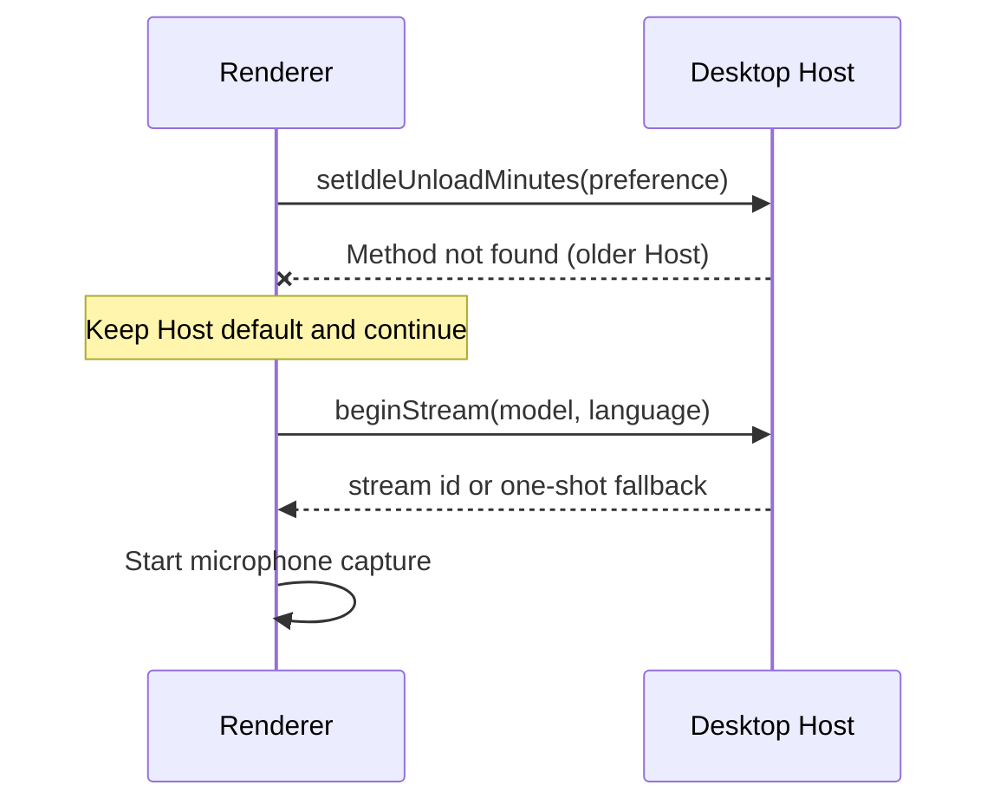
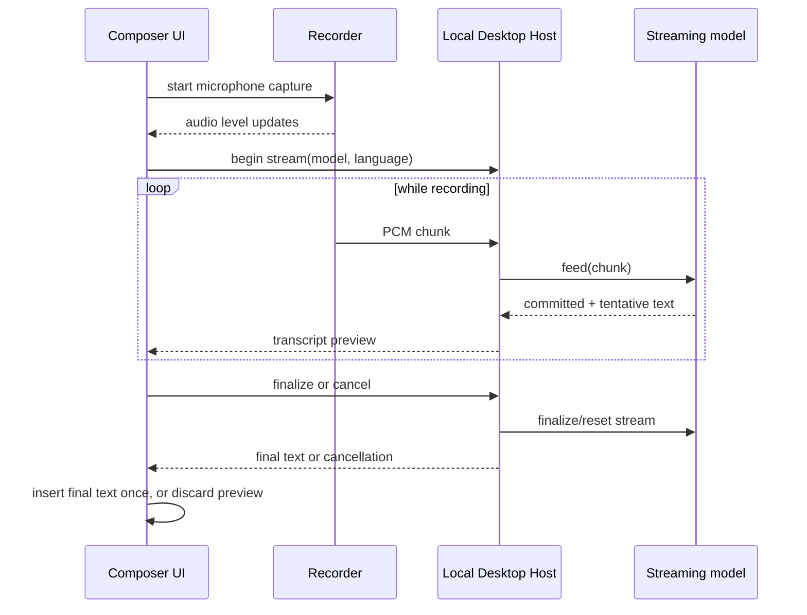
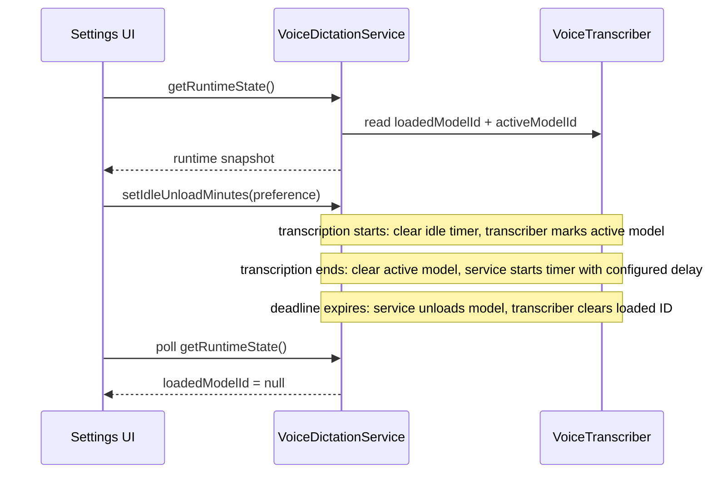
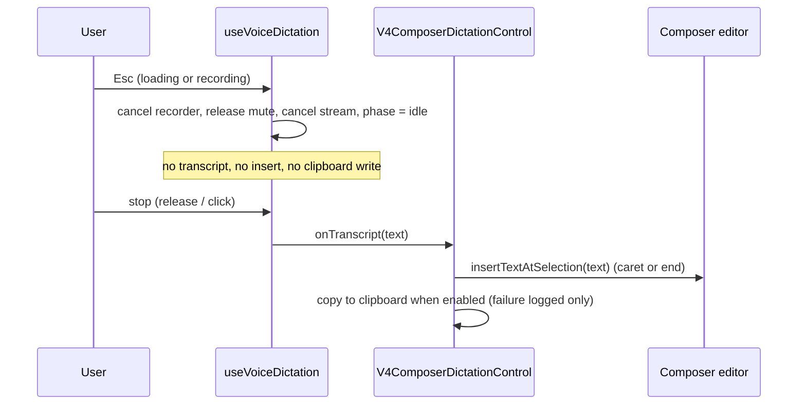
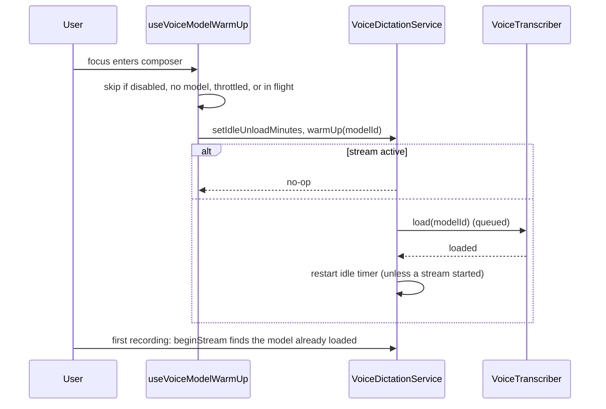

# Voice dictation

## Goal

Make the existing local desktop dictation flow easier to understand and avoid downloading a model already installed by Handy, without silently taking ownership of another application's files.

## Current product boundary

- Desktop captures microphone audio with the browser media API and sends PCM to the local Desktop Host for on-device transcription.
- Web and remote settings do not provide transcription. `getUserMedia` alone is only microphone capture and does not supply a transcription engine.
- The selected microphone is a preference. The selector lists all OS-exposed `audioinput` devices, including virtual inputs; it does not infer which device is physically active.
- The voice-dictation shortcut is a normal editable Keyboard Shortcuts command. Its default is `CmdOrCtrl+Shift+d`.
- Downloaded models are owned by ZCode under its data directory. Downloads are verified by expected size and SHA-256 before installation. Downloads go through the host network transport so proxy and custom CA settings apply, and each download task writes to its own unique `.part` file that is promoted by an atomic rename.

## Improvements in this change

1. Explain that the input selector lists available system audio inputs, including virtual devices. Keep the system-default option and avoid unreliable label-based device filtering.
2. On Desktop, discover a Handy model only in Handy's documented default `models` directory for the current OS. A candidate must match the catalog filename, byte size, and SHA-256. The ZCode-managed copy wins if both apps have it. Show a Handy badge and allow selection, but do not offer deletion of Handy-owned files. Do not scan undocumented/custom paths or other providers.
3. Preserve the existing editable shortcut and default; add regression evidence that voice dictation remains in the shared shortcut catalog.
4. Give a visible success confirmation after a model download. Keep the existing progress/cancel behavior and failure toast.
5. Show a Desktop-only explanation in Web settings. Do not substitute a cloud transcription provider or imply that browser microphone capture enables transcription.
6. Give immediate visible feedback when a download starts, and keep polling model state while a download request is in flight; the progress UI must not depend on the first poll winning a race with the download request. Put a full-width progress bar above one status row with percentage at the left, measured speed when available near the right, and Cancel at the far right. Use an indeterminate bar while the request starts or when total size is unavailable.
7. Confirm before deleting a ZCode-owned model. Identify the model and explain that its local file will be removed; never offer deletion for Handy-owned files.
8. Translate every voice-dictation setting, model action, state, confirmation, and error message in Ukrainian.
9. Show a single System default microphone option. Filter Chromium's synthetic `deviceId === "default"` entry from the explicit-device list so it does not duplicate the system-default choice.
10. Allow a downloading model card to be marked for use after download by clicking the card; do not show a separate `Use when ready` button. Keep the current selected model in effect until the requested model is fully ready; canceling or failing the download keeps the current selection.
11. Present each model as a separate card with its name and description above a metadata/action footer. Clicking a ready card selects it; clicking a model that is not downloaded starts its download; clicking an in-progress download marks or unmarks it for use when ready. Download progress is shown when available, otherwise show an indeterminate starting state. Keep the current model selected until the requested model is ready. Use the shared settings badge style with the short `Active` label for the selected model; keep the distinct loaded/transcribing status without an unload countdown.
12. Let the user choose how many minutes an idle model remains in memory after transcription. Apply the preference to the Desktop Host idle-unload timer, use five minutes as the default, and show only that the model is loaded rather than a countdown.
13. During recording, show the microphone-level meter and Cancel in the toolbar beside the stop button, and show streaming transcript text as ghost text at the caret (superseded the earlier floating panel; see "Live recording feedback and streaming transcription").

### Compatibility with an older local Host

- If an older local Host reports `Method not found: setIdleUnloadMinutes`, continue dictation using that Host's default unload delay. Do not treat this one missing preference method as a transcription failure.
- Other errors while applying the preference remain fatal and keep the existing transcription error handling.
- The Settings save path for the unload delay uses the same `applyIdleUnloadPreference` helper as recording and warm-up. The setting is persisted first; an older Host therefore shows no "save failed" toast (VD-COMPAT-01).
- Older Hosts without `getPostProcessAvailability` or `warmUp` keep their existing handling: post-processing is unavailable with reason `unknown`; warm-up disables itself for the session.



## Ownership and interfaces

- `VoiceModelStore` remains the only owner of model discovery, download state, model path, and removal. It may return a verified Handy path as ready with source metadata; it never deletes that path.
- The Host registers `IVoiceDictationService` only for the desktop-local service authority. Remote and standalone-server hosts keep the channel absent (the accessor stays optional), so transcription never runs off-device.
- `VoiceDictationSection` owns only display and settings edits. The service remains authoritative for model readiness.
- Mount the voice hook only when Desktop local voice input is enabled. Web and test composers without a `ServiceProvider` must render without mounting the voice hook.
- Keyboard bindings remain owned by `SHORTCUT_COMMANDS` and the existing shortcut settings flow.
- Browser recording remains in the UI recorder; Desktop Host owns inference. Web has no voice transcription service.

## Acceptance cases

| Case  | Setup                                                                       | Action                                           | Expected result                                                                                                                                                                                            |
| ----- | --------------------------------------------------------------------------- | ------------------------------------------------ | ---------------------------------------------------------------------------------------------------------------------------------------------------------------------------------------------------------- |
| VD-01 | Desktop microphone permission granted; multiple OS inputs exist             | Open Voice dictation settings                    | System default and all named audio inputs are listed; copy explains virtual inputs can appear.                                                                                                             |
| VD-02 | Exact catalog model exists in Handy's documented default model directory    | Open model settings                              | Model is ready, identified as Handy, selectable, and has no ZCode delete action.                                                                                                                           |
| VD-03 | Handy candidate has wrong size or SHA-256                                   | Open model settings                              | Candidate is not treated as installed; Handy file is untouched.                                                                                                                                            |
| VD-04 | Same model exists in ZCode and Handy                                        | Open model settings                              | ZCode-owned copy is used and remains removable by ZCode.                                                                                                                                                   |
| VD-05 | Model download succeeds/fails                                               | Download a model                                 | Progress/cancel remains available; success is confirmed; failure is reported.                                                                                                                              |
| VD-06 | Web settings                                                                | Open Settings                                    | Voice dictation explains that local transcription is Desktop-only; no microphone or model controls imply Web support.                                                                                      |
| VD-07 | Voice dictation shortcut is in use                                          | Open Keyboard Shortcuts                          | It remains editable using the shared shortcut recorder and defaults to `CmdOrCtrl+Shift+d`.                                                                                                                |
| VD-08 | Start a model download                                                      | Click Download                                   | The card shows a full-width progress bar above a row with status at the left, measured speed when available, and Cancel at the right; starting uses an indeterminate bar. Success or failure is announced. |
| VD-09 | Delete a ZCode-owned model                                                  | Click Delete, then cancel or confirm             | No file is removed before confirmation; confirming removes it and refreshes the model list. Handy-owned models have no delete action.                                                                      |
| VD-10 | Enumerated inputs include a `deviceId` of `default`                         | Open the input selector                          | Only the System default choice and concrete input devices are shown; the synthetic entry is omitted.                                                                                                       |
| VD-11 | Set the app language to Ukrainian                                           | Open Voice dictation settings and model actions  | All labels, descriptions, statuses, confirmations, and toasts use Ukrainian text.                                                                                                                          |
| VD-12 | A ready model is selected; another model is downloading                     | Click the downloading model card                 | Keep using the selected model, and show a pending-use badge. Switch only after download succeeds; cancel/failure keeps the current selection.                                                              |
| VD-13 | Open Desktop voice-dictation settings                                       | Review the model list                            | Models appear as separate cards with description and metadata/actions; the selected model is clearly labeled and subtly highlighted.                                                                       |
| VD-14 | One ready model is selected; another is downloaded, missing, or downloading | Click each model card                            | Ready model becomes selected; missing model starts downloading; in-progress model toggles use-when-ready. The old selection stays active until the new model is ready.                                     |
| VD-15 | Desktop voice dictation settings are open                                   | Change idle unload delay                         | Persist a supported minute value and apply it to the Host timer; no remaining-time countdown is shown.                                                                                                     |
| VD-16 | Composer microphone starts recording                                        | Review the toolbar cluster and the ghost preview | Listening status and microphone level are clear, transcript preview is optional, and the mic button stays anchored without shifting composer actions.                                                      |

## Handy discovery roots

Use only the default paths documented by Handy at <https://github.com/cjpais/Handy#manual-model-installation-for-proxy-users-or-network-restrictions>:

- macOS: `~/Library/Application Support/com.pais.handy/models`
- Windows: `%APPDATA%/com.pais.handy/models`
- Linux: `~/.config/com.pais.handy/models`

Handy custom data directories and its Hugging Face cache are not included in this first discovery pass. Add another provider only after its file format, location, and ownership/removal behavior are documented.

## Verification

- Service tests cover source precedence, Handy validation, and non-destructive removal.
- UI tests cover device filtering and editable shortcut registration where the existing test seams allow it.
- Validate Desktop and Web settings surfaces manually; an E2E case remains a follow-up if no existing deterministic settings harness can express local audio hardware and model files.

## Live recording feedback and streaming transcription

This behavior applies to Desktop voice dictation. Web continues to show the existing Desktop-only explanation.

### UX

- **Level meter and Cancel in the toolbar.** While recording, a cluster sits immediately left of the microphone/stop button and holds the microphone-level meter and a Cancel button. The meter reuses the recorder's per-buffer peak level; do not draw or retain a waveform of the raw audio. The meter is active only while recording and returns to zero on stop or cancel.
- **No overlay, no shift of the stop button.** The cluster is in the toolbar flow and is present only while recording. The stop button keeps its position, and the send button is untouched. Actions to the left of the cluster keep their left edges; the shrinkable model-controls group absorbs the width (it truncates rather than being covered). The panel that previously overlaid the toolbar is removed.
- **Cluster interaction rules.**
  1. The cluster is passive status UI: no `autoFocus`, no `aria-modal`, no tab stop except its Cancel button.
  2. A mousedown on the cluster calls `preventDefault`, so focus and the editor selection stay in the composer. The composer-scoped dictation shortcut depends on that and keeps working afterwards.
  3. Cancel fires the same silent cancel path as Escape.
- **Ghost preview.** For a runtime-verified streaming model, the committed and tentative transcript is drawn as ghost text at the caret. See "Ghost preview".
- Keep recording, transcribing, and idle visually distinct.
- Models without verified streaming support keep the current record-then-transcribe behavior: no ghost text, but the toolbar level meter and Cancel still show while recording.

### Ghost preview

#### Product rules

- The preview is display-only text. It is not part of the Lexical document: it is absent from editor state, `getText`, `getMarkdown`, drafts persistence, and undo/redo history, and it is never submitted by Enter or Send.
- Placement: the ghost starts at the current caret (the insertion point of the final transcript) and follows the caret when it moves. Wrapped lines use the full editor width.
- Style: committed text uses `text-foreground-subtle`; the tentative suffix uses `text-foreground-subtlest` in italic. Both are grey, non-selectable and `pointer-events-none`. Colors come from DESIGN.md tokens, so light and dark themes follow automatically.
- Metrics: font family, size, weight, line height and letter spacing are copied from the editor's computed style so ghost lines sit on the editor's own line grid. The ghost is clipped to the editor box; it never changes the editor's layout or height.
- A leading space is shown when the final insertion would add one (the character before the caret is not whitespace), so the preview matches what will be inserted.
- Accessibility: the ghost layer is `aria-hidden`. Preview words are not announced one by one. The persistent status live region announces listening/transcribing as before, and the final text reaches assistive technology through the textbox value once it is inserted.
- User edits while a preview is visible are kept (VD-LIVE-06); the ghost re-anchors to the caret after each editor update, selection change, scroll, or resize.
- On successful stop the ghost is cleared before post-processing starts, and the final text is inserted once through `insertTextAtSelection`.
- On cancel, blur, failure, or unmount the ghost is cleared together with the stream; the existing draft is untouched.
- The Web remote control engine (Web Speech) uses the same ghost layer because it shares the preview shape.

#### Ownership and event order

- `useVoiceDictation` (and `useWebSpeechDictation`) owns the preview value. `V4ComposerDictationControl` reports it upward through `onPreviewChange`; `ConversationComposer` holds it and passes it to `ChatPromptEditor`, which passes it to `LexicalChatInput`.
- `LexicalChatInput` renders a `VoiceGhostPreview` layer inside the editor's positioning box. It reads the caret from Lexical's selection (not from `window.getSelection`), so the position stays correct while the editor is blurred after a click on the toolbar.
- Pure geometry (text-indent for the first line, vertical alignment, visibility when the caret is outside the editor box) lives in `lib/voiceGhostPreviewLayout.ts` and is unit tested.
- Editor updates, scroll, and resize requests coalesce into one animation frame. Preview changes apply synchronously. Editor box metrics (font, padding) are cached and re-read after a resize or when the ghost was hidden, and the layer re-renders only when its position or metrics change.

```mermaid
sequenceDiagram
  participant H as useVoiceDictation (preview owner)
  participant C as ConversationComposer (holds preview)
  participant E as LexicalChatInput
  participant G as VoiceGhostPreview layer
  participant D as Editor document
  H->>C: preview {committed, tentative} via onPreviewChange
  C->>E: voicePreview prop
  E->>G: preview + caret from Lexical selection
  G-->>G: aria-hidden overlay; document untouched
  Note over H,D: stop succeeds
  H->>H: clear preview (before post-processing)
  H->>D: insertTextAtSelection(final) once
```

#### Acceptance cases

See VD-GHO-01 to VD-GHO-07 in the acceptance table.

### Ownership and event order



- UI remains the owner of microphone capture and live input level. Desktop Host remains the owner of model loading, stream lifecycle, and inference.
- Extend the voice-dictation service contract with explicit begin, feed, finalize, and cancel operations. Feed calls must be ordered per recording; preview events must be associated with a recording ID so stale updates cannot affect a later recording.
- The transcriber must own one active stream lease per loaded model. Do not unload/remove that model or run a competing transcription until the stream is finalized or reset. Clear the existing idle-unload timer while a stream is active and restart it after teardown.
- The recorder currently invokes level callbacks from its audio processing callback. Chunk delivery must use a bounded, sequential queue; if the Host cannot keep up, surface a clear failure. Streaming mode must not also retain the full clip in memory; one-shot fallback still buffers until stop.
- On window blur, microphone failure, component unmount, RPC failure, or explicit cancel, stop capture and reset the Host stream so the model lease is released. Never leave a stream active after its UI owner disappears.

### Model support gate

- `transcribe-cpp` 0.3.1 exposes `Session.stream()`, `feed()`, `finalize()`, and committed/tentative text snapshots. Its declarations document stream-slot extensions for Parakeet (`parakeet`, `parakeet_buffered`), Moonshine, and Voxtral.
- Catalog metadata alone is insufficient. At model load the transcriber derives a stream family from the loaded model with the pure `selectStreamFamily({ supportsStreaming, accepts })`: when `capabilities.supportsStreaming` is false it returns none; otherwise it returns the first of `parakeet_buffered`, `parakeet` that `model.accepts()`. The same result is used both to decide whether streaming is available and as the `family` of `session.stream()`; there are no two hard-coded copies.
- Models for which no family is selected stay on the one-shot path. Do not infer support from a model name or description, and do not catch stream-begin errors to fall back silently.
- The catalog `streaming` flag means "runtime-verified to stream with a family `selectStreamFamily` can pick". It drives the `Streaming` badge and filter, so it may only be set after a real load-and-feed check (see the findings section). `isLiveStreamingModel` reads that flag and nothing else.
- Language codes: the catalog may declare `languageLocales` (code to locale, for example `uk` to `uk-UA`) for models whose native layer rejects bare ISO 639-1 codes. `VoiceTranscriber` resolves the engine language from the descriptor of the requested model for both one-shot and streaming; no locale list is read from `capabilities.languages` because the 0.3.1 binding returns it garbled. Auto detection (no language) is passed through unchanged, and a code that a locale-mapped model does not list falls back to auto detection (the native layer would reject it); models without `languageLocales` receive the code as is.

### Acceptance scenarios for implementation

| Case       | Action                                                  | Expected result                                                                                                                                             |
| ---------- | ------------------------------------------------------- | ----------------------------------------------------------------------------------------------------------------------------------------------------------- |
| VD-LIVE-01 | Start recording and speak                               | Composer level meter responds to microphone input; no raw waveform is stored or shown.                                                                      |
| VD-LIVE-02 | Use a runtime-verified streaming model                  | Preview updates during recording; committed and tentative text are visually distinct and cannot be submitted as draft text.                                 |
| VD-LIVE-03 | Stop a streaming recording                              | Stream finalizes; preview becomes one final insertion with no duplicate text.                                                                               |
| VD-LIVE-04 | Cancel, blur, unmount, or fail during streaming         | Capture stops, preview disappears, existing draft remains intact, and the model stream lease is released.                                                   |
| VD-LIVE-05 | Use an unsupported or unverified model                  | Existing one-shot transcription behavior remains available; no streaming UI is advertised.                                                                  |
| VD-LIVE-06 | Edit the composer while a preview is visible            | User edits are preserved; final dictation text is inserted once according to the existing append behavior.                                                  |
| VD-LIVE-07 | Start a second transcription while one stream is active | The service serializes or rejects it explicitly; no concurrent model use or silent audio loss occurs.                                                       |
| VD-LIVE-08 | Start recording while composer toolbar is visible       | Stop button stays in its original position; the meter and Cancel cluster appears immediately to its left and does not overlay toolbar actions.              |
| VD-CLU-01  | Hover or click the toolbar cluster while recording      | Nothing overlays the toolbar: actions remain clickable and keep their positions; the cluster never covers the stop or send button.                          |
| VD-CLU-02  | Click Cancel in the toolbar cluster while recording     | Cancel fires (same as VD-OUT-03); the editor keeps focus and the draft is unchanged.                                                                        |
| VD-CLU-03  | Mousedown on the cluster while the editor has focus     | Editor focus and caret are kept (default prevented); the dictation shortcut still stops recording afterwards.                                               |
| VD-GHO-01  | Stream a runtime-verified model; preview updates        | Committed and tentative text appear as grey ghost text at the caret, visually distinct; the layer is aria-hidden.                                           |
| VD-GHO-02  | Ghost visible; press Enter, click Send, or undo         | The ghost is never submitted, never saved in the draft, and never added to undo history.                                                                    |
| VD-GHO-03  | Move the caret or edit real text while ghost is visible | Ghost follows the caret; user edits are preserved (VD-LIVE-06).                                                                                             |
| VD-GHO-04  | Long preview wraps; narrow width; dark theme            | First line starts at the caret, wrapped lines use the full editor width, nothing shifts layout, colors follow theme tokens on mobile and desktop.           |
| VD-GHO-05  | Stop with a streaming model                             | Ghost is cleared before post-processing; the final text is inserted once via the existing insertion path (VD-LIVE-03).                                      |
| VD-GHO-06  | Cancel, blur, failure, or unmount during ghost          | Ghost disappears with the stream; the existing draft is intact (VD-LIVE-04).                                                                                |
| VD-GHO-08  | Empty composer, ghost has text                          | The composer placeholder is hidden while the ghost preview has any committed or tentative text, so the two never overlap; it returns when the ghost clears. |
| VD-GHO-07  | Model without streaming support                         | No ghost text; the toolbar meter and Cancel still show while recording (VD-LIVE-05).                                                                        |

### E2E validation handoff

- The E2E scenario must use a Desktop runtime with a runtime-verified streaming Parakeet GGUF and a working microphone. Assert that the level meter responds, preview text appears without changing the editor draft, stopping inserts the finalized transcript once, and canceling preserves the pre-existing draft.
- VD-E2E-GHOST (written, not run): on a Desktop runtime with a runtime-verified streaming model and a microphone, start recording in a composer that holds a draft with the caret mid-text. Assert the toolbar meter responds and the cluster sits left of the stop button without moving the other toolbar actions; the ghost text appears at the caret and is absent from the textbox value, `Enter` submission, and draft persistence; stop inserts the final transcript once at the caret; Cancel leaves the draft unchanged and the ghost gone.
- A fallback scenario must use a model whose loaded runtime reports no compatible stream support and assert that the existing one-shot insertion still works without a streaming preview.
- Streaming candidates for E2E: `nemotron-3.5-asr-streaming-0.6b` (uk/ru/en and 25 more), `parakeet-unified-en-0.6b` and `nemotron-speech-streaming-en-0.6b` (English). Real microphone E2E remains pending; the runtime facts below were obtained by feeding synthetic 16 kHz speech to the native library, not a live microphone.

## Proposed follow-up: selected versus loaded model status

This section specifies the settings visibility change. A selected model is a user preference; a loaded model is the single model currently resident in the Desktop Host. These states must remain distinct.

### Behavior

- Mark the selected model as `Active`. Switching with `Use` changes this preference and does not load a model immediately.
- Show a separate `Loaded` marker on the model currently resident in memory. During model initialization show `Loading`; during one-shot inference show `Transcribing`; during an active stream show `Streaming transcription` for that model.
- After transcription completes, show `Loaded` without a remaining-time countdown. The configurable policy defaults to five minutes after the most recent transcription completes.
- When the timer expires, or a different model is loaded for a later transcription, clear the loaded marker. At most one model may be loaded at once.
- If the selected model differs from the loaded model, show both facts on their respective rows. This can happen after changing the preference and before the next dictation.
- Removing the loaded model unloads it before deleting its file. Removing a different model does not affect the loaded model.
- The state is local Desktop runtime state; it is not persisted across app restarts and is not shown as available in Web settings.

### Ownership and interface

- `VoiceTranscriber` remains the sole owner of which model is actually loaded and which model is currently executing. It exposes read-only loaded and active model IDs and the active phase (`loading`, `transcribing`, or `streaming`). It holds the native model stream lease until finalize, cancel, or unload.
- `VoiceDictationService` owns the idle-unload timer. It exposes a read-only runtime snapshot (`loadedModelId`, `activeModelId`, `activePhase`) through `IVoiceDictationService`; the UI does not infer loaded status from the selected preference.
- Settings persists the selected idle-unload delay and applies it to the service. The UI does not keep a second timer or display a countdown.
- Starting transcription or stream initialization clears the idle timer and identifies its model as active. After transcription, stream finalization, or stream cancellation, the service starts the timer using the configured delay. When unload finishes, the snapshot reports no loaded model.
- If a new transcription begins as the deadline expires, service operations serialize through the existing transcriber queue. A stale snapshot must not be shown as the current state after a newer poll completes.



### Acceptance scenarios

| Case      | Setup / action                                                       | Expected result                                                                                                              |
| --------- | -------------------------------------------------------------------- | ---------------------------------------------------------------------------------------------------------------------------- |
| VD-MEM-01 | Several models are downloaded; one is selected and another is loaded | Each row identifies its own state: `Active` versus `Loaded`; no implication that selection loaded the model.                 |
| VD-MEM-02 | Choose another ready model with `Use`                                | The selected marker moves immediately; the currently loaded model remains marked until the next transcription or its unload. |
| VD-MEM-03 | Start transcription with the selected model                          | Its row shows `Loading` then `Transcribing`; no idle-unload countdown is shown while it is active.                           |
| VD-MEM-04 | Finish transcription                                                 | The row shows `Loaded` with no countdown.                                                                                    |
| VD-MEM-05 | Let the idle timer expire                                            | The loaded marker disappears after unload completes.                                                                         |
| VD-MEM-06 | Remove the currently loaded model                                    | It unloads before its file is removed; runtime status then reports no loaded model.                                          |
| VD-MEM-07 | Restart the app                                                      | No model is reported loaded until the next transcription loads one.                                                          |

## Languages, model discovery, and dictation output

### Product rules

- **Per-model languages.** Every catalog model declares the explicit ISO 639-1 codes it supports (`languages`), not only a count. The model card shows the supported languages as chips (first few plus `+N`, expandable to the full list). `languageCount` is removed from the descriptor; the count is `languages.length`.
- **One language catalog.** The set of languages the user can pick is the union of languages declared by catalog models, displayed with `Intl.DisplayNames`; the settings page no longer keeps its own hard-coded list.
- **Several languages.** The user selects zero or more dictation languages (`voiceDictation.languages`).
  - Zero selected means automatic detection (same as the former `auto`).
  - Exactly one selected is passed to the engine as that language code.
  - Two or more are passed to the engine as automatic detection; the selection is used to filter and recommend models and to warn when the active model cannot cover them. The engine API accepts a single language or none, so the list is never sent as a constraint.
  - `voiceDictation.language` stays as a mirror for older fork builds (the single selected code, otherwise `auto`) and is the fallback when `languages` is absent. `languages` wins when both are present.
- **Model coverage warning.** If the active model does not support every selected language, settings show a warning naming the missing languages and a one-click switch to the recommended covering model when one is downloaded or downloadable.
- **Recommendation.** `recommendVoiceModel(languages)` returns the covering catalog model with the lowest `recommendRank`; with no selected languages nothing is recommended. The card shows a `Recommended` badge on that model.
- **Model filters** above the model list: free-text search over name, family, and language names; a language filter (default: the selected languages — a model matches only if it supports all of them); `Downloaded`; `Streaming`. Filters are view state only and never change the selection. An empty result shows an explanatory empty state with a reset action.
- **Ordering.** Recommended first, then the catalog order. Download state is not a sort key, so a card never jumps when its download finishes.

### Dictation output

- **Insertion point.** A finished transcript is inserted at the composer caret, replacing the current selection; if the editor has no usable selection it is appended to the end. The existing `appendText` stays for other callers. A space is added only on a side that borders a non-space character.
- **Cancel.** `Escape` while loading or recording cancels dictation without transcribing or inserting anything and without interrupting the running agent turn. The toolbar cluster shown while recording also exposes a Cancel button. Cancel follows the same silent path as window blur (no stop chime, mute released).
- **Too short.** A recording shorter than `VOICE_MIN_RECORDING_MS` shows a short notice ("Recording too short") instead of being dropped silently.
- **No model.** Starting without a selected model shows a notice with an `Open settings` action that opens the Voice dictation settings section.
- **Clipboard.** `voiceDictation.copyToClipboard` (default off): after a transcript is produced, also write it to the system clipboard. Insertion into the composer is unaffected. A clipboard failure is logged and never fails dictation. Unmounting the composer aborts dictation with no output, including no clipboard write. The browser may reject the write when the document is not focused; this is only logged.

### Ownership and interfaces

- `voiceDictation` settings live in the fork sidecar (`fork-settings.json`, keys registered in `forkAppSettings.ts`), so adding `languages` and `copyToClipboard` is additive and cannot be wiped by an upstream write. Both the TypeScript interface and the zod schema in `forkAppSettings.ts` must change together.
- `voiceModelCatalog.ts` owns language data and `recommendRank`; a pure helper module (`voiceModelLanguages.ts` in services, re-exported through the public entry) owns language resolution, model coverage, recommendation, and filtering so the UI and tests share one implementation.
- `useVoiceDictation` stays the sole owner of recording phase; it gains `cancel()` and the too-short notice. The composer owns insertion (`LexicalChatInput` handle gets `insertTextAtSelection`). `useDictationTranscriptHandler` (used by `V4ComposerDictationControl`) owns the clipboard copy so both engines (Host and Web Speech) share it.



### Acceptance scenarios

| Case      | Setup / action                                     | Expected result                                                                                                        |
| --------- | -------------------------------------------------- | ---------------------------------------------------------------------------------------------------------------------- |
| VD-LNG-01 | Open the model list                                | Each card lists its supported languages as chips with `+N` overflow; the full list is reachable.                       |
| VD-LNG-02 | Select Ukrainian only                              | Engine receives `uk`; the model list filters to models that support Ukrainian; the best covering model is recommended. |
| VD-LNG-03 | Select Ukrainian and English                       | Engine receives automatic detection; models must cover both to match the language filter.                              |
| VD-LNG-04 | Active model lacks a selected language             | A warning names the missing language and offers the recommended model.                                                 |
| VD-LNG-05 | Clear all languages                                | Behaves as automatic detection; no filter applied; no recommendation.                                                  |
| VD-LNG-06 | Settings saved by an older build (`language` only) | `languages` is derived from `language`; saving writes both fields.                                                     |
| VD-FLT-01 | Type in search / toggle Downloaded / Streaming     | The list narrows; the selection and downloads are unaffected; an empty result offers Reset.                            |
| VD-OUT-01 | Caret in the middle of a draft; dictate            | Text is inserted at the caret with correct spacing; the rest of the draft is intact.                                   |
| VD-OUT-02 | Text selected in the draft; dictate                | The selection is replaced by the transcript.                                                                           |
| VD-OUT-03 | Press Esc while recording                          | Capture stops, nothing is inserted or copied, the agent turn is not interrupted, no stop chime.                        |
| VD-OUT-04 | Click Cancel in the toolbar cluster                | Same as VD-OUT-03.                                                                                                     |
| VD-OUT-05 | Tap the shortcut for less than 250 ms              | A "too short" notice appears; nothing is inserted.                                                                     |
| VD-OUT-06 | Start with no model selected                       | A notice with `Open settings` appears; the action opens Voice dictation settings.                                      |
| VD-OUT-07 | `copyToClipboard` on; dictate                      | Text is inserted and also copied; with it off the clipboard is untouched.                                              |
| VD-OUT-08 | Clipboard write is denied                          | Dictation still inserts; a warning is logged; no error toast.                                                          |

### Catalog additions and streaming findings (research against Handy's catalog)

Handy's catalog (`src-tauri/src/catalog/catalog.json`, 69 models) was compared with ours. All 8 existing entries still match upstream (revision, file, size, sha256, languages, streaming flag). Every Q8_0 size and sha256 below was verified against the Hugging Face tree metadata at the pinned revision (`lfs.oid` / `lfs.size`).

- **Added** (one-shot transcription; families present in the installed `transcribe-cpp` 0.3.1 native library): `whisper-medium`, `whisper-large-v3`, `canary-1b-v2`, `gigaam-v3-e2e-rnnt` (Russian only). Language lists are copied from the model cards.
- **Recommendation ranks** (`recommendRank`): `parakeet-unified-en-0.6b` 1, `parakeet-tdt-0.6b-v3` 2, `canary-180m-flash` 3, `whisper-large-v3-turbo` 4, `whisper-medium` 5. Other models are never recommended automatically.
- **Added after runtime verification:** `nemotron-3.5-asr-streaming-0.6b` (Q8_0, 751094240 bytes, sha256 `b94545b3...`), streaming, 28 languages, with `languageLocales`.
- **Not added yet** (need a runtime check before shipping, see follow-ups): `voxtral-mini-4b-realtime-2602`, `moonshine-base-uk` (Handy accuracy score 38), `parakeet-primeline` (German fine-tune).

Streaming facts, confirmed by running the models with `transcribe-cpp` 0.3.1 on macOS arm64 (GGUF sha256 matched the catalog; synthetic 16 kHz en/uk/ru speech fed in 100-500 ms chunks):

| Model                               | `supportsStreaming` | `accepts parakeet` | `accepts parakeet_buffered` | Streams | Bare language code                                                                       |
| ----------------------------------- | ------------------- | ------------------ | --------------------------- | ------- | ---------------------------------------------------------------------------------------- |
| `parakeet-unified-en-0.6b`          | true                | false              | true                        | yes     | `en` ok                                                                                  |
| `nemotron-speech-streaming-en-0.6b` | true                | true               | false                       | yes     | `en` ok, `en-US` rejected                                                                |
| `nemotron-3.5-asr-streaming-0.6b`   | true                | true               | false                       | yes     | `en`/`uk`/`ru` rejected (stream and one-shot); `en-US`/`uk-UA`/`ru-RU` and auto accepted |
| `parakeet-tdt-0.6b-v3`              | false               | false              | false                       | no      | `en` ok (one-shot)                                                                       |
| `canary-180m-flash`                 | false               | false              | false                       | no      | `en` ok (one-shot)                                                                       |

- Before this change the transcriber gated on `accepts({ kind: "parakeet" })`, which is false for `parakeet-unified-en-0.6b`, so streaming never activated for it and dictation silently stayed one-shot. Requesting the `parakeet` extension on it raises `UnsupportedRequest`.
- `nemotron-3.5-asr-streaming-0.6b` streams uk/ru/en live (partial committed/tentative text updates arrive during feeding) and its auto-detect mode (`supportsLanguageDetect`) identified all three test languages. All 28 catalog codes were accepted as locales: `en-US es-ES fr-FR it-IT pt-BR nl-NL de-DE tr-TR ru-RU ar-AR hi-IN ja-JP ko-KR vi-VN uk-UA pl-PL sv-SE cs-CZ nb-NO da-DK bg-BG fi-FI hr-HR sk-SK zh-CN hu-HU ro-RO et-EE`. These form its `languageLocales`.
- Quality note: on the English test clip `parakeet-unified-en-0.6b`'s streamed final text dropped the leading "The" that its one-shot result kept. Not addressed here.
- Still unknown: accuracy and latency with a real microphone and real speakers, other operating systems and GPU backends, and Nemotron accuracy on uk/ru versus `parakeet-tdt-0.6b-v3` (which is better for accuracy but cannot stream).

### Follow-ups (not part of this change)

1. ~~Select the stream family per loaded model~~ — resolved (`selectStreamFamily`).
2. ~~Locale mapping and runtime verification for `nemotron-3.5-asr-streaming-0.6b`~~ — resolved (`languageLocales`, added to the catalog).
3. Voxtral realtime and Moonshine streaming: add their family kinds to `STREAM_FAMILY_KINDS` after a runtime load-and-feed check.
4. ~~Model warm-up on composer focus~~ — resolved (see "Model warm-up on composer focus"). Level meter RMS and silence hint, recording timer, `AudioWorklet` capture.

## Model warm-up on composer focus

### Product rules

- When the composer gains focus on Desktop and a model is selected, the Host loads that model in the background so the first recording does not wait for it. Warm-up never records, transcribes, or changes the draft.
- `voiceDictation.warmUpOnFocus` controls it. **Default on**: absent means on; only an explicit `false` disables it. The setting row explains that a loaded model holds memory until the idle-unload delay passes.
- Warm-up also counts as use: warming an already-loaded model restarts its idle-unload countdown, so a model stays resident while the user keeps coming back to the composer.
- Warm-up is best-effort. A failure (missing model file, older Host without the method, load error) is logged at warn level and never shown to the user; the next recording loads the model on demand exactly as before.
- Warm-up is Desktop-local only: Web remote control and hosts without the voice service do nothing.

### Ownership and interfaces

- `IVoiceDictationService.warmUp({ modelId })` is new. `VoiceTranscriber` still owns which model is loaded (`load()` already serializes through its queue); `VoiceDictationService` owns the idle timer and the stream-lease guard.
- Service rules: no-op while a dictation stream is active (never unload or swap a model under a stream); otherwise load the model, then (re)start the idle-unload timer unless a stream or transcription started meanwhile. A model that is not downloaded rejects with the store's existing error.
- UI: `useVoiceModelWarmUp` (renderer) listens for focus entering the composer scope, applies the idle-unload preference, and calls `warmUp`. It requests at most once per model per 30 seconds, never while a request is in flight, and tolerates `Method not found: warmUp` from an older Host by disabling itself for the session.
- Settings UI owns only the toggle; the service stays authoritative for what is loaded (the existing runtime state shows the `Loaded` badge).



### Acceptance scenarios

| Case      | Setup / action                                       | Expected result                                                                                         |
| --------- | ---------------------------------------------------- | ------------------------------------------------------------------------------------------------------- |
| VD-WRM-01 | Warm-up on (default), model selected; focus composer | The Host loads the model; settings show it as `Loaded`; the first recording starts without a load wait. |
| VD-WRM-02 | `warmUpOnFocus` is false                             | Focusing the composer never loads a model.                                                              |
| VD-WRM-03 | Focus the composer repeatedly within 30 seconds      | At most one warm-up request.                                                                            |
| VD-WRM-04 | Model already loaded; focus the composer             | No reload; the idle-unload countdown restarts.                                                          |
| VD-WRM-05 | A dictation stream is active                         | Warm-up does nothing and the stream is untouched.                                                       |
| VD-WRM-06 | No model selected, or the model is not downloaded    | No error toast; the failure is only logged.                                                             |
| VD-WRM-07 | Older Host without `warmUp`                          | Dictation works as before; no toast; no repeated requests in the session.                               |
| VD-WRM-08 | Web remote control                                   | No warm-up.                                                                                             |

## Model status dot on the microphone button

### Product rules

- On Desktop the composer microphone button shows a small dot for the **selected** model: a pulsing warning-colored dot while that model is loading (including a warm-up load), a success-colored dot while it is loaded in memory. No dot when it is not loaded, when no model is selected, on Web remote control, and while recording or busy (the button already shows the recording or spinner state).
- The loading dot is never the only signal: its tooltip adds the status text ("Speech model loading"), and the button is described by the same text for assistive technology. The loaded dot is a non-essential hint: it is decorative (`aria-hidden`), adds no tooltip text, and the button has no description for it. Loaded state is therefore conveyed by color only, which is acceptable because it changes no available action. The pulse is disabled under reduced motion.
- A model loaded for a different selection (the user switched models) shows no dot; loaded state always refers to the selected model.

### Ownership and interfaces

- The Host stays the only owner of what is loaded. `VoiceTranscriber.load()` now reports the `loading` phase and the model id through the existing runtime snapshot (it did not before: only transcription and streaming did, so a warm-up load was invisible).
- The renderer derives the status with the pure `deriveVoiceModelStatus(runtimeState, selectedModelId)` and polls the existing `getRuntimeState()` once per second, only while Desktop dictation is enabled and the window is visible. There is no second source of truth and no UI timer.
- The snapshot is a poll, so the dot can lag the Host by up to one poll interval.

### Acceptance scenarios

| Case      | Setup / action                                       | Expected result                                                   |
| --------- | ---------------------------------------------------- | ----------------------------------------------------------------- |
| VD-DOT-01 | Selected model starts loading (warm-up or first use) | A pulsing warning dot appears on the microphone button.           |
| VD-DOT-02 | The model finishes loading                           | The dot turns success-colored and stays.                          |
| VD-DOT-03 | The idle-unload delay passes                         | The dot disappears within about a second.                         |
| VD-DOT-04 | A different model is loaded than the selected one    | No dot.                                                           |
| VD-DOT-05 | Recording or transcribing                            | The dot is hidden; the existing recording/spinner state is shown. |
| VD-DOT-06 | Reduced motion is requested                          | The loading dot does not pulse.                                   |
| VD-DOT-07 | Window hidden                                        | The renderer stops polling until it is visible again.             |

## Post-processing of dictated text

### Product rules

- **Name:** "Post-processing". An optional step that rewrites the finished transcript with a language model according to a user-editable prompt, then inserts the result.
- **Setting:** `voiceDictation.postProcessEnabled` (default off) with `postProcessPrompt` (default below) and `postProcessProvider`.
- **Provider (first version):** a single system provider, shown in settings as read-only text "System model (Apple Foundation Models)" under the label "Provider" (no selector while there is one option). It is offered only when the Host reports it available (macOS with Apple Intelligence enabled and a supported device); otherwise the status line explains why it is unavailable and the switch shows Off. When unavailable at dictation time, the rewrite call fails and the raw transcript is inserted unchanged, with no error toast (see "Post-processing settings" below).
- **TODO (next version):** let the user pick another provider and model from ZCode's configured providers instead of only the system model. The provider setting is an enum so adding values is additive; no other code may assume a single provider.
- **Prompt variable:** `{{text}}` is replaced by the raw transcript. If the prompt contains no `{{text}}`, the transcript is appended after the prompt on a new line. Only this one variable exists.
- **Default prompt (English, language-preserving):** the transcript is fenced in `<transcript>{{text}}</transcript>` tags and the prompt says it is dictated data, never a request to follow or answer; it asks for punctuation, capitalization, recognition fixes and filler removal; it requires the output language to equal the input language ("Translating is a failure") and carries three short examples (English, Ukrainian, Russian). The examples are load-bearing: tuned against the real system model, a plain "never translate" instruction still translated Ukrainian and Russian to English in about half of the runs, and examples in only one language pushed English into that language. The helper requests greedy sampling so the same transcript always gives the same output. A single prompt is kept (no presets, no prompt library). Reset removes the stored prompt key so the built-in default applies, including after the default changes in a later version; see "Post-processing settings".
- **Flow:** transcribe, then (when enabled) process, then insert. While processing the microphone button shows its busy state and the tooltip says "Processing". If processing fails, returns empty text, or does not finish in time (the Host stops after 15 s; the client wrapper `runPostProcess` gives up after 20 s, whichever comes first), the raw transcript is inserted instead and the failure is logged (no error toast).
- **Clipboard:** only when `copyToClipboard` is on, the clipboard receives the **raw** transcript, even when the inserted text is the processed one. When the setting is off, post-processing never touches the clipboard. Esc during processing discards the result (nothing inserted or copied).
- **Privacy:** the on-device system model is the only provider in this version, so no transcript leaves the machine.

### Ownership and interfaces

- A Host service owns availability and execution (`getPostProcessAvailability()`, `postProcess({ text, prompt })`); the renderer owns the prompt and the toggle. `useVoiceDictation` owns the phase (a new `processing` phase after `transcribing`) and the fallback to raw text. There is no availability probe on the stop-to-insert path. The Host's `postProcess` decides at call time: an unavailable or failing provider rejects, and the raw transcript is inserted. The probe that used to run there spawned a helper process with no cache, so it sat on the critical path for no benefit. The settings card keeps `getPostProcessAvailability()` for display only. Known tradeoff: on an unavailable provider the `processing` phase is entered briefly before the raw insert.
- The client wraps `postProcess` with `runPostProcess` (`lib/voicePostProcess.ts`): a 20 s client timeout above the Host's 15 s limit, so a hung Host call cannot strand the busy state. The Try-it control uses the same wrapper; no new Host method is added.
- Apple Foundation Models are reached through a small bundled Swift helper built like `zcode-window-bounds` (`packages/desktop/native/`, a `prepare:` script, `electron-builder` extra resource). It reads JSON from stdin and writes JSON to stdout, checks `SystemLanguageModel.default.availability`, and is spawned per request with a timeout. Main injects the helper path into the Host.
- Settings live in the fork sidecar (`forkAppSettings.ts`), same rules as the other `voiceDictation` fields.

### Acceptance scenarios

| Case      | Setup / action                                               | Expected result                                                                                             |
| --------- | ------------------------------------------------------------ | ----------------------------------------------------------------------------------------------------------- |
| VD-PPR-01 | Post-processing on, system model available; dictate          | The processed text is inserted; the clipboard (if enabled) holds the raw transcript.                        |
| VD-PPR-02 | The prompt has `{{text}}` in the middle                      | The transcript is substituted at that position.                                                             |
| VD-PPR-03 | The prompt has no `{{text}}`                                 | The transcript is appended after the prompt.                                                                |
| VD-PPR-04 | The model errors, times out, or returns empty                | The raw transcript is inserted; the failure is logged, no error toast.                                      |
| VD-PPR-05 | System model unavailable (no Apple Intelligence, non-macOS)  | The setting explains why and stays off; dictation inserts raw text.                                         |
| VD-PPR-06 | Esc while processing                                         | Nothing is inserted or copied.                                                                              |
| VD-PPR-07 | Dictate in Ukrainian with the default prompt                 | The output stays Ukrainian (not translated).                                                                |
| VD-PPR-08 | Reset the prompt                                             | The default prompt is restored.                                                                             |
| VD-PPR-09 | Preference on, but the Host cannot rewrite at dictation time | No availability probe runs; the rewrite call fails and the raw transcript is inserted, with no error toast. |
| VD-PPR-10 | Availability answer still loading on the settings screen     | The switch is disabled and shows no reason text; no Off-then-On flicker from a guessed answer.              |

## Settings information architecture

Desktop Voice dictation settings are five cards in this order. Each card has a heading and an optional one-line description above it. Web keeps its single Desktop-only explanation (VD-06).

1. **Dictation:** shortcut (keycaps, plus an "Open Keyboard Shortcuts" action that opens the Shortcuts section), push to talk, sound notification, volume with Test.
2. **Microphone:** input device; "Test microphone" with its result shown beside the button (recording indicator, peak level, or the no-sound message).
3. **Transcription models:** language at the top (with the "Matches my languages" filter directly under it, with search, Downloaded, and Streaming), then the model cards, then a **Memory** subgroup with "Warm up the model when the message box is focused" and "Unload from memory after".
4. **Output:** copy dictated text to the clipboard, mute system sound while recording. `muteWhileRecording` defaults to **on**: an absent value means on, only an explicit `false` disables it (copy to clipboard stays default off).
5. **Post-processing:** see "Post-processing settings".

Rules:

- Every card writes through the existing single optimistic patch path. No card keeps a second copy of a setting.
- Default values live in one place: `resolveVoiceDictationPreferences` (`lib/voiceDictationPreferences.ts`). The settings card, the dictation hook, the recording-audio hook, and the warm-up hook all read effective values through it; none repeats a `?? default` or `!== false` of its own.
- The shared `SettingsRow` uses a fixed 192 px control column. That is not changed here because every Settings section depends on it; on narrow Web it can squeeze labels. This is a follow-up that needs a cross-section check.

## Post-processing settings

### Availability rule

- The Host is the only source of availability. The settings card has three states:
  - **Checking** (before the first answer): the switch is disabled and unchecked, and no reason text is shown.
  - **Available:** the switch reflects the saved preference and is enabled.
  - **Unavailable:** the switch shows Off and is disabled; the status line gives the localized reason. An unknown reason and a Host without the method both use the generic message.
- Runtime gate: the rewrite runs only when the saved preference is on. The Host's `postProcess` is the single decision point at dictation time. An unavailable provider, a failure, or a timeout rejects, and the raw transcript is inserted (logged at warn, no toast). The dictation path does not call `getPostProcessAvailability()`.

```mermaid
sequenceDiagram
  participant S as Settings card (display only)
  participant R as useVoiceDictation (phase owner)
  participant H as Desktop Host
  S->>H: getPostProcessAvailability() on mount
  Note over S: checking until answered; switch disabled
  R->>R: transcription done, postProcessEnabled true?
  alt still same recording
    R->>R: phase = processing
    R->>H: postProcess(text, prompt), 20 s client / 15 s Host
    alt provider runs
      H-->>R: processed text
    else unavailable, error, or timeout
      H-->>R: rejects
      Note over R: log warn; insert raw transcript, no toast
    end
  else cancelled
    Note over R: nothing inserted
  end
```

### Prompt editor

- The prompt is a single prompt. It is shown full width (no 280 px wide control), in a monospace multi-line field of about eight rows that can be resized vertically.
- The draft is local until **Save**. While the draft differs from the saved value, a "Unsaved changes" indicator appears with **Save** and **Cancel** buttons. Nothing is written per keystroke.
- **Save:** a draft equal to the built-in default stores no custom prompt (the key is removed), so the default keeps following future changes. A blank draft cannot be saved; Save is disabled and an inline message says to use Reset. A draft without `{{text}}` cannot be saved either; Save is disabled and an inline message says the prompt must contain it.
- **Cancel** and **Esc** (focus in the field) revert the draft to the saved value. When the draft is dirty, they first ask for confirmation to discard (confirm dialog, same component as other destructive confirmations).
- **Character counter** `n/4000` is always visible. The field does not truncate silently: above 4000 characters the counter turns warning-colored, Save is disabled, and the message says to shorten the prompt.
- **`{{text}}` requirement:** when the draft is not blank and has no `{{text}}`, the inline message is a warning that the prompt must contain `{{text}}`, and Save is disabled. (The runtime still appends the transcript for an already-stored prompt without the variable; the editor just no longer lets one be created.)
- **Reset to default:** asks for confirmation, removes the stored prompt key (`postProcessPrompt` becomes undefined; it is not written as the default text), and loads the default into the editor. Reset is disabled when no custom prompt is stored and the draft is the default.
- Known limit: leaving the Voice dictation section with an unsaved draft discards the draft. It is never persisted implicitly.

### Try it

- An editable sample sentence (prefilled with a short English sentence containing filler words) and a **Run** button.
- Run calls `IVoiceDictationService.postProcess` through `runPostProcess` (20 s client timeout). It uses the editor draft, including unsaved text, and says so next to the control.
- The output appears below the control. A failure shows an inline error with `role="alert"`; it is not a toast.
- Run is disabled while the provider is unavailable or while a run is in flight. Try it never writes settings.

### Terminology

One term per concept across the Voice dictation settings and the composer. Labels in each language must follow the same mapping.

| Concept                      | Term (en)        | Meaning                                                                                                                                                                            |
| ---------------------------- | ---------------- | ---------------------------------------------------------------------------------------------------------------------------------------------------------------------------------- |
| Selected transcription model | Active           | The preference; badge on the model card.                                                                                                                                           |
| Resident model               | Loaded in memory | The single model the Host holds; badge on the model card.                                                                                                                          |
| Queued switch for a download | Use when ready   | A download-card state: the current model stays Active until the new one is ready. The action on a downloading card is "Use when ready"; once set it reads "Cancel use when ready". |
| Rewrite step                 | Post-processing  | Optional step after transcription.                                                                                                                                                 |
| Engine for the rewrite       | Provider         | Read-only text for the single provider. Replaces the former "Model" label, which clashed with transcription models.                                                                |
| Editable instruction         | Prompt           | The text with `{{text}}`.                                                                                                                                                          |
| Rewrite in progress          | Processing       | Composer phase after transcription.                                                                                                                                                |

### Acceptance scenarios

| Case         | Setup / action                                     | Expected result                                                                                   |
| ------------ | -------------------------------------------------- | ------------------------------------------------------------------------------------------------- |
| VD-SET-01    | Desktop Voice dictation settings open              | Five cards in the order above, each with its heading.                                             |
| VD-SET-02    | Click "Open Keyboard Shortcuts"                    | The Shortcuts section opens; the shortcut stays editable there.                                   |
| VD-SET-03    | Run "Test microphone"                              | The result text is next to the button; it is cleared when the next test starts.                   |
| VD-SET-04    | Change "Unload from memory after" on an older Host | The value is saved; no "save failed" toast; the Host keeps its default delay.                     |
| VD-SET-05    | Language and filters                               | "Matches my languages" is directly under the language row; it does not change the selection.      |
| VD-SET-06    | Pending download uses wording                      | Only the terms in the Terminology table appear; no "Keep current model" or "Will use when ready". |
| VD-PPR-11    | Edit the prompt                                    | "Unsaved changes", Save and Cancel appear; nothing is written until Save.                         |
| VD-PPR-12    | Press Esc with an unsaved change                   | A discard confirmation appears; confirming reverts the draft; cancelling keeps it.                |
| VD-PPR-13    | Draft over 4000 characters                         | Counter shows the count in warning color; Save is disabled; the text is not truncated.            |
| VD-PPR-14    | Draft without `{{text}}`                           | A warning says the prompt must contain `{{text}}`; Save is disabled.                              |
| VD-PPR-15    | Save the default text unchanged                    | No custom prompt is stored; a later Reset is disabled.                                            |
| VD-PPR-16    | Reset with a custom prompt stored                  | After confirmation the stored key is removed and the editor shows the default.                    |
| VD-PPR-17    | Try it with a sample                               | The output (or inline error) shows; no settings are written; Run is disabled while unavailable.   |
| VD-PPR-18    | Copy to clipboard off, post-processing on          | The clipboard is never written by the rewrite path.                                               |
| VD-PPR-19    | Copy to clipboard on, post-processing on           | The clipboard receives the raw transcript; the inserted text is the processed one.                |
| VD-COMPAT-01 | Older Host without `setIdleUnloadMinutes`          | Save of the unload delay persists the value and shows no error toast.                             |

### E2E scenarios (written, not run)

These need a real Desktop runtime on macOS with Apple Intelligence available, and a microphone. They are not runnable in the current environment and are not automated.

- VD-E2E-SET: open Voice dictation settings; assert the five card headings in order; open Keyboard Shortcuts from the Dictation card.
- VD-E2E-PPR: enable post-processing on an available Host; edit and save the prompt; Try it returns text; Reset returns to the default; dictation inserts the processed text and the clipboard holds the raw transcript when copy is on.
- VD-E2E-PPR-OFF: on an unavailable Host, the switch is Off with the reason and dictation inserts raw text with no rewrite call.

## Composer surfaces and a single dictation session

### Product rules

- Dictation is offered in every Desktop conversation composer that accepts a draft: the main conversation composer, the side conversation composer (the selection side chat opened from the side panel), and the draft composer of a new conversation. The microphone control, its toolbar cluster, the ghost preview, the model status dot and the warm-up on focus behave the same on each surface.
- Web remote control keeps its own engine (Web Speech, see "Live recording feedback" and the Web remote rules). A side conversation shown in Web remote control is out of scope of this change: its composer keeps the current behavior until a follow-up aligns it with the main remote composer.
- Only one dictation session may exist app-wide at a time. A session is any non-idle phase (`loading`, `recording`, `transcribing`, `processing`) of any composer's dictation.
- The dictation shortcut acts only on the composer whose scope contains the keyboard target. Two composers on screen never both start, stop or cancel from one keypress.
- Starting dictation in a composer while another composer holds the session is refused explicitly: no microphone capture, no Host stream, and a short notice ("Dictation is already in use in another message box. Stop it there first."). The running session is not interrupted. The user stops it in its own composer first.
- The transcript is inserted only into the composer that started the session, at that composer's caret.

### Root cause of the missing side conversation control (2026-10-18)

- `ConversationComposer` mounts `V4ComposerDictationControl` only when `voiceDictationEnabled` is true (`packages/ui/src/v4/ConversationComposer.tsx`, the `voiceDictationEnabled ? ...` branch in the submit control node).
- `SessionPane` computes that prop as `isDesktop || compactForRemoteControl` (`packages/ui/src/v4/SessionPane.tsx`, `voiceDictationEnabled={isDesktop || compactForRemoteControl}` in the composer props). Both flags default to `false`.
- The main pane receives them from `V4ChatPane`, which passes `isDesktop` and `compactForRemoteControl` to `SessionPane`.
- The side conversation panel renders `SessionPane` from `packages/ui/src/app-shell/SelectionSideChatPane.tsx` without `isDesktop`, so the flag is `false` and the control is never mounted. `AnimatedSidePanePanel` already has `isDesktop` and does not forward it to this pane.
- Fix: forward `isDesktop` from `AnimatedSidePanePanel` to `SelectionSideChatPane` and into `SessionPane`, the same way `V4ChatPane` does.

### Ownership and interfaces

- `useVoiceDictation` remains the sole owner of one composer's recording phase. A module-level dictation session lease (`packages/ui/src/lib/voiceDictationSessionLease.ts`) is the single owner of "which composer holds the session". The hook acquires the lease when its phase leaves `idle` and releases it when the phase returns to `idle`, on cancel, stop, failure, and unmount.
- `useVoiceDictationShortcut` keeps its scope check; no scope is shared between composers.
- `ConversationComposer` owns insertion into its own editor; the transcript callback of each composer is captured per composer.
- No new setting, persisted state, or Host method is introduced.

```mermaid
sequenceDiagram
  participant K as Keyboard target
  participant A as Main composer hook
  participant B as Side composer hook
  participant L as Session lease (module)
  participant E as Side composer editor
  K->>B: shortcut (target inside side composer scope only)
  B->>L: acquire(B)
  alt lease free
    L-->>B: granted
    B->>B: loading -> recording
  else main composer holds lease
    L-->>B: refused (owner A)
    B->>B: stay idle; notice shown; no capture, no stream
  end
  Note over B,L: stop, cancel, failure or unmount
  B->>L: release(B) when phase becomes idle
  B->>E: insertTextAtSelection(final) into side composer only
```

### Acceptance cases

| Case       | Setup / action                                                                 | Expected result                                                                                                        |
| ---------- | ------------------------------------------------------------------------------ | ---------------------------------------------------------------------------------------------------------------------- |
| VD-SURF-01 | Desktop; open a side conversation from the selection side chat                 | The side conversation composer shows the microphone control next to the send/stop controls, same as the main composer. |
| VD-SURF-02 | Desktop; focus the side conversation composer and press the shortcut           | Recording starts in the side composer only; the main composer does not react.                                          |
| VD-SURF-03 | Recording in the main composer; focus the side composer and press the shortcut | The side composer does not start; a "already in use" notice appears; the main recording continues untouched.           |
| VD-SURF-04 | Recording in the side composer; stop                                           | The final transcript is inserted once at the side composer caret; the main draft is unchanged.                         |
| VD-SURF-05 | Recording in the side composer; press Escape or click Cancel                   | Capture stops, nothing is inserted; the session lease is released so the main composer can start.                      |
| VD-SURF-06 | Side composer unmounts (side chat closed) during recording                     | Capture stops, Host stream is released, the lease is released.                                                         |
| VD-SURF-07 | Main composer focused; press the shortcut                                      | Only the main composer reacts (existing VD-GHO and VD-LIVE behavior is unchanged).                                     |

### Verification plan

- Unit: `packages/ui/test/selectionSideChatDictation.test.ts` asserts that `SelectionSideChatPane` forwards `isDesktop` to `SessionPane` (the flag that gates `voiceDictationEnabled`); `packages/ui/test/voiceDictationSessionLease.test.ts` covers acquire, refusal, owner-only release; `packages/ui/test/useVoiceDictation.test.ts` covers the refusal of a second composer's start and the start after the first composer finishes.
- Not covered by unit tests: that `AnimatedSidePanePanel` forwards `isDesktop` (checked by typecheck and review only), and the mounted microphone in a real side conversation (E2E below, not run).
- E2E (written, not run; needs a Desktop runtime with a microphone and a loaded model):
  1. Open a conversation with a draft, select text, and open the side chat from the selection menu.
  2. Assert the side composer shows the microphone button with the same position as the main composer.
  3. Focus the main composer and press the dictation shortcut; assert it records and the side composer stays idle.
  4. While the main composer records, focus the side composer and press the shortcut; assert the notice appears and the main meter keeps responding.
  5. Stop in the main composer; assert the transcript is inserted once in the main draft and the side draft is unchanged.
  6. Start in the side composer, press Escape; assert no insertion and that the main composer can start afterwards.
